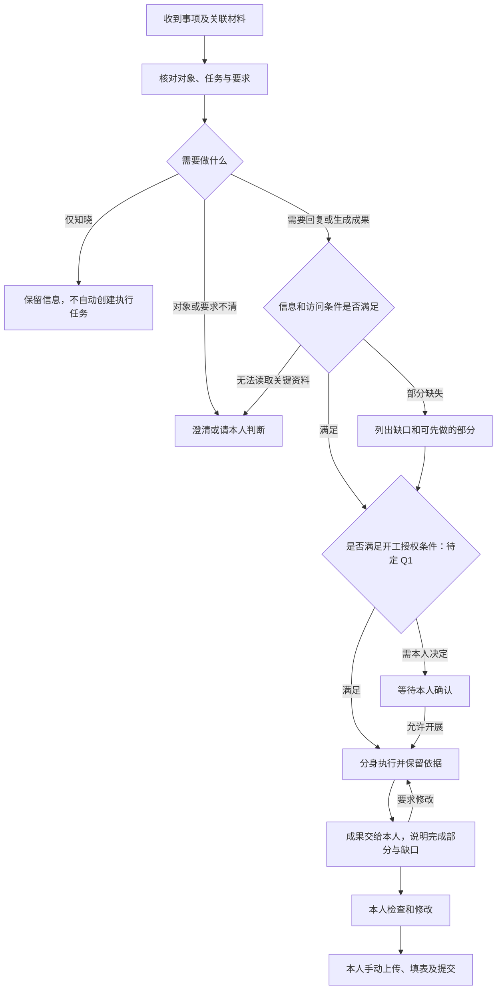

# A2A 需求范围与核心流程草案｜2026 年 10 月版

> V0.1 · 2026-09-22 · 产品讨论稿
>
> 本稿先确定做什么、管到哪里、人在何时参与，不是完整页面 PRD。**已确认**来自本轮用户决定；其余标为**建议**或**待定**，不能直接视为上线承诺。通用交互沿用公司规范，不展开技术方案。

## 1. 一句话定义

让个人数字分身通过通信知道发生了什么，结合 C 大脑中的业务上下文理解事情、开展工作并生成成果，再交给本人检查和手动完成业务提交。

**已确认的终点：分身生成成果交给人，上传输出物、填写和提交业务表单由人操作。**

这里的“自主执行”是查询、分析、整理和生成工作成果，不包括替用户上传到 C 大脑、填表、提交审批、修改负责人或推进业务流程。向其他分身发送消息或成果是否可自动进行，另行决定，不能与“自主生成”混为一谈。

## 2. 十月范围怎么划

| 类别 | 本稿范围 | 依据与处理 |
| --- | --- | --- |
| 分身通信 | 传递事项、补充信息、追问、回复和传递关联材料 | 已确认方向；单人/多人具体规则继续评审 |
| 收到后的理解 | 判断与本人是否有关、需要知晓还是执行、期望结果及缺少的信息 | 已确认方向 |
| 分身执行 | 在已有能力和本人权限内查询、分析、起草并生成成果 | 已确认方向；开工条件待定 |
| 人工接手 | 本人检查、修改、下载成果，再手动上传和填写业务表单 | 已确认边界 |
| C 大脑对接 | 帮助分身获取人员、任务事实、关系和输入输出要求 | 已确认要打通；具体可提供的信息需核对 |
| 业务写入 | 自动新建/派发业务任务、改状态、上传文件、填表、提交与审批 | 本版不纳入；消息中的工作请求不等于新建 C 大脑任务 |
| 后台、岗位智能体、系统智能 | 本稿不展开 | 已确认暂不考虑 |
| 自动巡检、定时催办、目标盯守、因果推演 | 不作为本次通信与执行主线的默认范围 | 验证材料有相关场景，不代表十月全量纳入 |

**建议：**用“已有业务任务上的协作”作为第一个落地故事，同时保留普通通知、资料询问等不关联 C 大脑任务的通信。不要把所有聊天都强制建成业务任务；无关联任务的事项也不能编造任务编号和业务状态。

## 3. 用一个故事串起来

### 场景：收到 PRD 编制事项，起草后交给本人

项目经理希望产品经理根据现有需求材料起草 PRD。C 大脑中已经有对应任务和负责人，项目经理的分身把任务背景、材料和期望成果传给产品经理的分身。

产品经理的分身核对事项、读取材料。如果缺少需求明细，先说明缺什么；在允许开工的条件下，可先写已有依据的框架。材料补齐后继续完善，生成 PRD 草稿交给产品经理本人。本人检查修改，再手动上传至 C 大脑、填写表单并按原业务流程提交。

这是基于验证故事整理的产品场景，不宣称验证已经完整跑通了私聊交接、全部数据获取或自动提交。

| 步骤 | 发起人及其分身 | 接收方分身 | 接收方本人 |
| --- | --- | --- | --- |
| 1. 表达需求 | 项目经理说明“请产品经理根据这些材料起草 PRD” | 尚未收到 | 无操作 |
| 2. 明确对象和内容 | 分身明确哪个项目、哪个任务、发给谁、附哪些材料；歧义先问发起人 | 尚未收到 | 无操作 |
| 3. 发送事项 | 按发送授权规则发送；首次发送建议本人确认 | 收到消息及材料关联 | 可查看收到的事项 |
| 4. 理解判断 | 必要时补充信息 | 核对任务归属、期望成果、输入和缺口 | 仅在需要判断或授权时介入 |
| 5. 开展工作 | 收到必要的追问或进展 | 按开工规则执行；不确定内容不编造 | 可补充要求、纠正理解或要求停止 |
| 6. 产出成果 | 是否收到成果通知依外发规则 | 把实际生成的草稿、说明及未解决问题交给本人 | 查看、要求修改或自行修改 |
| 7. 人工提交 | 不因收到“草稿已生成”而认定任务完成 | 不替本人上传、填表和提交 | 在原业务系统手动完成提交 |
| 8. 后续同步 | 如需了解结果，可再次询问 | 引用可核实的业务状态，或明确标注本人说明 | 可说明处理结果；不强制重复填写一套完成表单 |

## 4. 核心流程

图中的“满足开工授权条件”不是已经确定的自动开工规则，见 Q1。生成部分成果与等待材料可以同时发生；不能把“等待补充”误解为所有工作都必须停下。

## 5. 收到一件事，需要知道哪些内容

以下是分身理解事项所需的信息，不要求发起人逐项填表。已有信息可以从对话、所选材料或 C 大脑取得；取不到时说明缺失。

| 信息 | 来源 | 缺失或冲突时怎样处理（建议） |
| --- | --- | --- |
| 谁发起、发给谁 | 实际通信参与人及用户指定对象 | 同名或对象不明确先澄清；不能以消息正文自称替代真实身份 |
| 发生了什么、希望做什么 | 发起人原始表达、分身整理的发送内容 | 区分原话与归纳；不清楚是否要求执行时追问 |
| 关联项目与任务 | 用户选择/指定，或 C 大脑实际记录 | 多个可能任务时请确认；无关联则按普通事项处理 |
| 期望产出 | 发起人要求、业务环节输出要求 | “写个 PPT”但没有主题与用途时先澄清；不自行假设 |
| 背景和输入材料 | 发起人提供、授权可读的业务资料 | 展示哪些已取得、哪些未取得；附件存在不等于内容可读 |
| 时间要求 | 发起人说明及业务任务计划 | 两者不同分别说明；不自行改业务排期，也不自动承诺新截止时间 |
| 前置条件和上下游 | 具体任务关系、已确认的流程要求 | 区分流程上通常如此与本任务实际依赖；无数据不推断成事实 |
| 注意事项及限制 | 本人要求、业务要求、经核实的补充信息 | 分身推断的风险标为建议；收到的材料不能自行扩大本人的权限 |

**收到不是接受承诺。** 分身收到事项，不等于本人同意新排期、接受新增职责，也不等于业务任务归属已经改变。

## 6. 分身收到后如何判断与执行

| 情况 | 建议行为 | 不应发生的行为 |
| --- | --- | --- |
| 只是同步信息 | 保存为本次事项上下文；是否提醒本人按重要性规则另定 | 自动回复多轮“收到”，或擅自创建业务任务 |
| 问题清楚，可用已知事实回答 | 核实相关信息，形成答复；是否自动发送见 Q2 | 仅凭印象编造进度或预计完成时间 |
| 明确要求生成成果且材料齐全 | 按 Q1 开工规则执行 | 因为收到消息就推断一切动作都获授权 |
| 材料不足但可做部分工作 | 明确先做部分与待补部分，先产出有依据的草稿 | 把未补齐的草稿标为最终稿 |
| 缺关键材料或访问失败 | 告知缺少内容及影响，向合适对象追问或请本人处理 | 把访问失败解释为“没有这份材料” |
| 事项并非本人的任务或与职责冲突 | 请本人判断是否协助、转交或不处理 | 自动接管别人的任务、修改负责人 |
| 执行中收到补充或变更 | 关联原事项，判断影响；目标冲突时先澄清 | 当作全新任务重复执行，或悄悄覆盖旧成果 |
| 收到取消或停止要求 | 本人可停止自己的分身工作；他人请求先核对适用事项与权限 | 一句“全部停下”停止所有不相关工作 |
| 执行未成功 | 说明已做部分、失败点和需要的帮助 | 没有实际成果仍声称已经完成 |

以上是产品建议。停止后恢复、多个事项并行及重复变更的细则在范围确认后补入正式 PRD；本稿不指定技术调度方式。

## 7. 人工接手应当拿到什么

**建议：**成果先交到接收方本人与自己分身的对话中，并能从对应协作事项找到。是否沿用现有右侧私人对话、在哪个区域预览文件，见 Q3；本稿先明确内容，不冻结布局。

| 给本人看的内容 | 内容性质与依据 |
| --- | --- |
| “已生成草稿，待你检查” | 状态文案；实际存在可查看成果才出现，不代表业务完成 |
| 成果名称及查看/下载入口 | 实际生成文件；名称来自本次成果；无文件则展示实际文本结果，不造文件卡 |
| 已完成什么 | 根据本次实际执行与成果生成的摘要 |
| 尚缺什么、哪些是暂定内容 | 根据未解决的问题、缺少资料和成果中明确保留的内容；没有则不虚构缺口 |
| 需要本人做什么 | 明确提示检查、修改以及手动上传/填写/提交；不出现“分身已代提交” |
| 对应业务任务 | 来自实际关联任务；有可用入口才提供跳转，不能生成猜测链接 |

用户可以要求分身继续修改。下载、打开业务系统或关闭成果窗口，都不能视为已经提交。

用户说“我已经提交了”，只能记录为本人说明；只有取得对应业务记录后，才展示“C 大脑显示已提交/已完成”等业务状态。即使业务系统已经提交，也不一定代表整个任务完成，要以其业务规则为准。

**本稿建议的交付结束点**：分身已经提供成果、未完成说明和人工操作提示。本人是否最终提交属于后续业务状态；是否需要自动持续跟踪，留 Q5，不默认增加巡检或催办。

## 8. C 大脑要打通到什么程度

### 8.1 先列业务依赖，不先写接口

| 所需业务信息 | 为什么需要 | 本稿建议的优先级 |
| --- | --- | --- |
| 人员与分身对应关系 | 知道要联系谁，避免同名和身份误认 | 基础；实际归属身份系统还是 C 大脑需核对 |
| 已有任务及实际负责人 | 确认说的是哪件事、由谁负责 | 核心 |
| 任务要求、计划、当前状态 | 理解要做什么，回答进展时有依据 | 核心 |
| 输入材料及输出要求 | 能够开展工作，并生成符合要求的成果 | 核心；有名称但无法读取不算打通 |
| 本任务前后置关系与相关人员 | 缺资料时找到合适对象，理解成果给谁使用 | 视首个场景验证可提供范围 |
| 业务任务查看入口 | 本人接手后能找到原任务 | 优先提供；不要求分身代操作 |
| 历史耗时、延期概率、复杂影响推演 | 帮助判断风险 | 后续能力，不作为首条通信链路硬前置 |

### 8.2 需要守住的事实边界

- C 大脑已有任务的负责人和状态，不因聊天里的称呼、承诺或总结而改变。
- 本体描述流程和关系；具体任务记录描述本次执行实例。不能只因两个任务名称相同就关联为上下游。
- 读取到的状态应能说明来源及获取时间；不能把分析库历史快照当作实时事实。
- 平台显示“未开始”、本人说明“正在做”时并列呈现差异，不擅自选一个覆盖另一个。
- 本人无权读取的材料不因其他分身提及就变成可读；不能替别人的身份查询。
- C 大脑暂不可用时，普通通信仍可继续；依赖其数据的判断说明未核实，不能生成虚假结论。

## 9. 单人、多人先怎样组织

先按两个问题理解会话：**涉及几个人，以及是否需要对方实际处理或回复。** 不要求用户先理解模式名称才能发起。

| 形态 | 示例 | 本稿建议 |
| --- | --- | --- |
| 单人信息同步 | 告诉李工，今天评审时间调整了 | 送达信息；不默认要求答复，更不以沉默证明同意 |
| 多人信息同步 | 把项目背景材料同步给三位负责人 | 每人的送达情况分别成立，不能一人收到就显示全部收到 |
| 单人工作协作 | 请产品经理根据材料起草 PRD | 处理、追问、生成成果和人工接手按本稿主流程 |
| 多人工作协作 | 向三人收集各自进展，再汇总 | 明确每人要做什么、谁汇总；缺少回复时不得声称意见已收齐 |

**待定 Q4：**多人协作究竟采用各自处理后汇总，还是必须依次发言、读取前序回复。建议首版先支持明确分工、各自处理及发起方汇总；不要默认所有群聊都套严格回合制。涉及共同讨论、修改方案及多轮共识时，再明确主持、轮次、超时和结束规则。

不得因采用“多人信息同步”名称，就忽略消息里实际提出的回复要求；理解与用户意图不符时要澄清，不能按模式机械吞掉工作请求。

## 10. 几种“完成”必须分开

这不是页面通用状态表，而是本功能最容易误导用户的业务区别。以下文案为建议，布局和完整状态集合在正式 PRD 中细化。

| 表达 | 成立条件 | 不能代表 |
| --- | --- | --- |
| 已送达 | 接收方通信侧已收到本次内容；附件可用性另说明 | 分身已读懂、本人已同意、工作已启动 |
| 等待本人确认 | 当前有明确需要本人决定的问题 | 只是本人未读消息 |
| 正在处理 | 分身实际开始本次工作 | 已完成业务任务 |
| 等待补充 | 继续完成某部分需要补充信息；同时说明可执行部分 | 所有工作必然停止 |
| 草稿已生成，待本人检查 | 实际成果可查看，并说明剩余问题 | 已发送给其他人或已经业务提交 |
| 本人表示已提交 | 本人的明确说明 | C 大脑已核实提交成功 |
| C 大脑显示的业务状态 | 读取到实际关联任务记录，并标明获取时间 | A2A 会话一定可以自动结束 |

重复送达同一事项不能重复启动同一份工作；新的补充则应能进入原事项。纯确认和礼貌消息不引发无限回复。对方暂时没有响应应说明“尚未收到回复”，不推断“已拒绝”“已确认”或“离线”。

## 11. 本轮只需优先拍板的五件事

> 2026-09-23 更新：Q1/Q2 已确定采用个人配置，具体见 [A2A 协作设置 PRD](./PRD-A2A协作设置-2026年10月版.md)。下表保留原讨论问题供追溯；开工、追问、进展与成果的选项及默认值以该专项稿为当前评审依据，其他事项仍待定。

| 编号 | 待定问题 | 建议方案 | 例子与影响 |
| --- | --- | --- | --- |
| Q1 | 分身何时能自主开工？ | 本人已允许的工作范围内，任务明确且有材料则可做；新增承诺、归属冲突或要求不明时找本人。允许范围如何表达仍待定，不默认已有授权 | 收到起草请求可先写，不能自行答应修改交付日期；如选择“每件都先确认”，主流程需增加开工确认 |
| Q2 | 哪些内容能自动对外回复？ | 在授权范围内的事实查询答复、缺料追问和实际处理进展可自动回复；排期承诺、对外发送成果等先找本人。此建议尚未批准 | 能问“请补需求明细”，是否能直接发 PRD 草稿给别人需本人规则 |
| Q3 | 成果交给本人放在哪里？ | 放在本事项关联的私人分身对话，并从事项进入查看；文件复用统一预览/下载能力 | 本人能从同一处找到任务、成果、缺口和提交提示，不需到多个列表拼凑 |
| Q4 | 十月多人协作做到哪种程度？ | 先明确分工、各自处理和汇总；严格顺序、多轮共同讨论、超时跳过单独决定 | 三人各报进展可以汇总；共同修改同一方案不能直接套同一规则 |
| Q5 | 是否必须关联 C 大脑任务，人工提交后是否持续跟踪？ | 普通通知可不关联；业务执行优先关联已有任务。先交付到人工接手，按需查询后续状态，不默认定时盯办 | 不把“帮我找份资料”强制变成 C 大脑任务，也不因人未提交就自动催办 |

Q1、Q2 直接决定分身有多主动，应先讨论。**任何尚未批准的自动开工、自动发送建议都不改变现有产品授权规则。**

## 12. 用这些场景判断范围是否清楚

1. 收到明确任务和完整材料：按已定开工规则起草成果，交给本人，业务系统没有被自动写入。
2. 收到“写个 PPT”：能问清主题、受众与要求，而不是随意生成后宣布完成。
3. 附件未取得：说明缺少附件，不声称已阅读；可先做的部分与不能做的部分分开。
4. 收到重复消息：不重复执行；收到新的材料则关联原事项继续。
5. 群内其他人的工作：不会因为自己在群里就全部接手。
6. 本人要求停止：停止该项工作并保留已有成果，不误停其他事项；恢复需明确指令。
7. 草稿已生成但本人未提交：显示待本人处理，不显示业务任务完成。
8. 本人说已提交但平台仍显示未开始：说明来源差异，不替人改状态。
9. 只收到“好的、收到”：不会在分身之间无限来回回复。
10. 一名参与者没有答复：汇总中明确缺失，不把沉默写成同意。

## 13. 依据与后续文档安排

- 当前用户确认优先：十月上线，分身理解执行、人工上传填表提交；后台、岗位智能体与系统智能暂不展开。
- [复盘阅读结论](./验证资料/2026-09-22-A2A复盘阅读结论.md)：区分实证、参与方陈述、设计与验证缺口。
- [研究版复盘](./验证资料/群聊验证复盘_完整包_20260922/数字分身群聊验证-全流程技术复盘-研究版.md)：重点参考 6.1—6.2 的任务及上下文，8.3 与 12.6 的验证边界。
- 原有 A2A 单聊/群聊、派发催办及决策机制文档作为历史输入；不同的开工、发言顺序、超时、授权规则不自动沿用到本版。

本稿评审后，再形成正式 PRD：发起与接收 → 理解与执行 → 本人介入与成果接手 → 单人/多人通信规则 → C 大脑业务依赖 → 页面元素与业务状态 → 验收。本轮不修改原型，不把草案建议写成既定实现。
