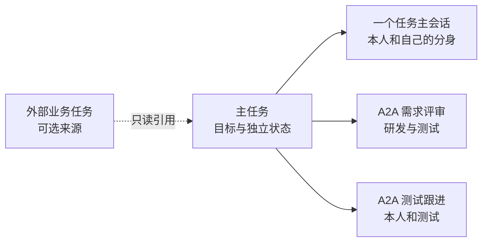
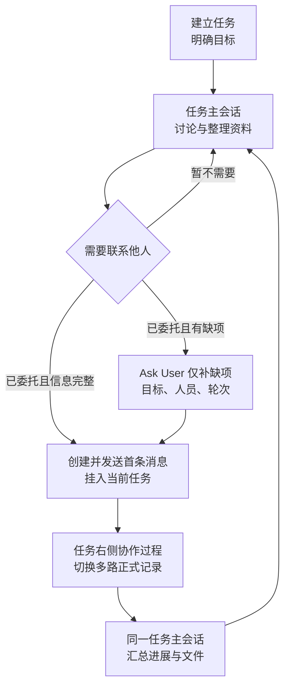
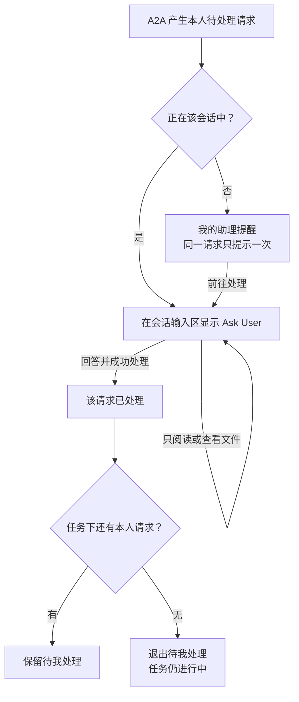
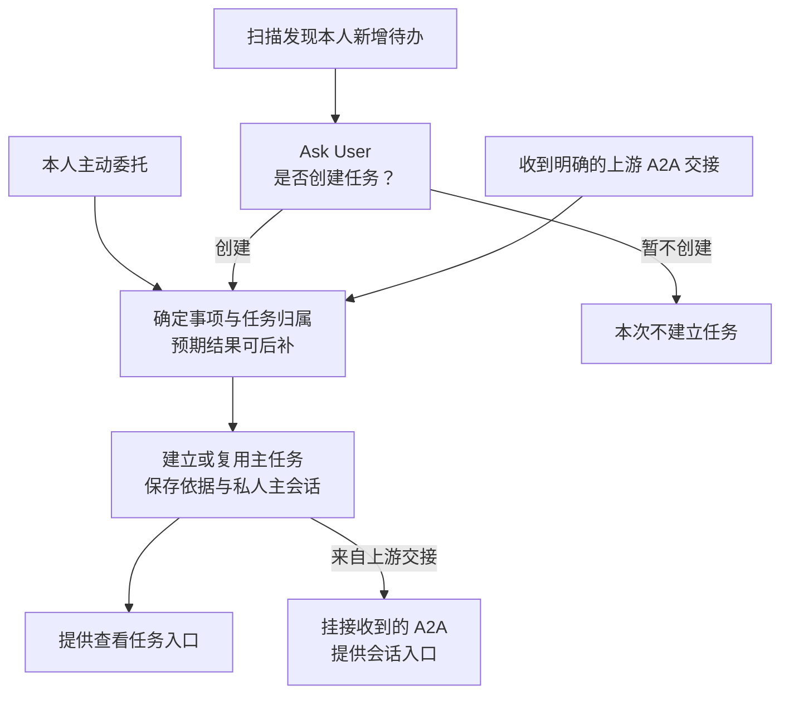
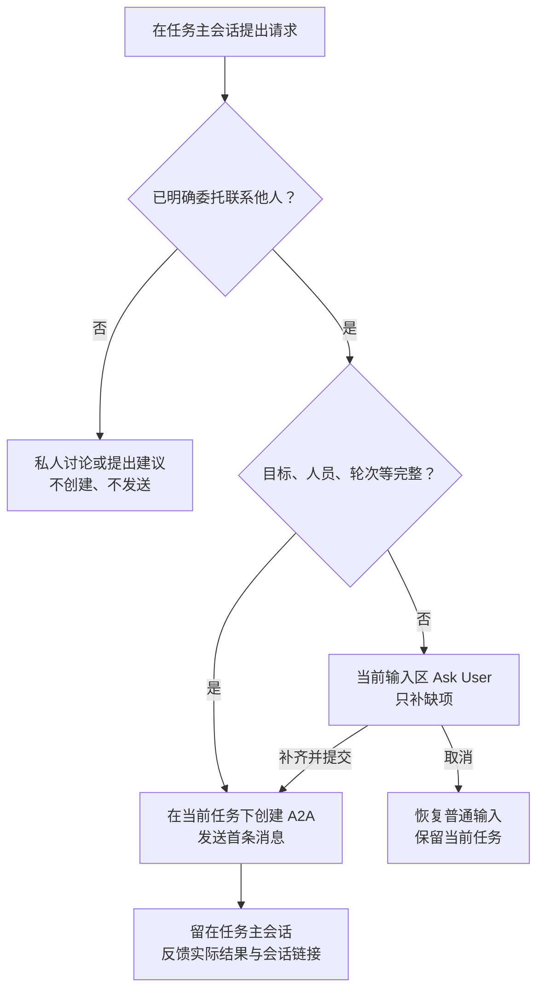
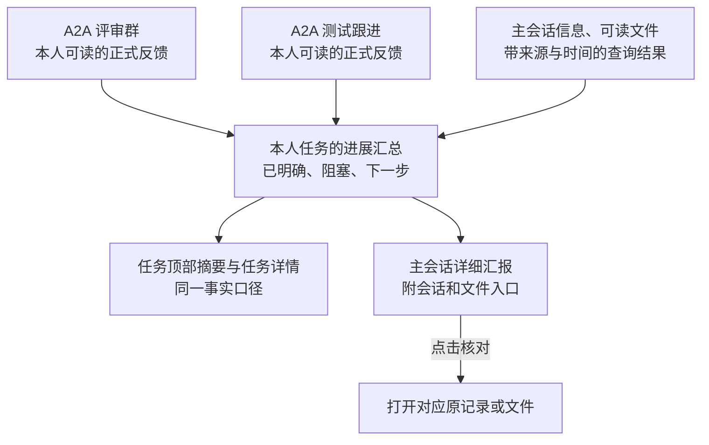
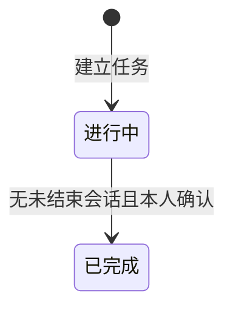

# 任务主会话与 A2A 通信 PRD｜2026 年 10 月版

> V2.3 · 2026-10-22 · 本期任务范围与新建引导调整
>
> 本文定义“助理任务、任务主会话、任务详情、任务内 A2A 通信、文件和任务管理”的产品行为。功能总览、正文与验收按同一编号和名称对应。第 12 章列明尚未定案的规则，不能把这些规则或演示结果作为已完成的开发基线。

## 本轮调整范围（2026-10-22）

本轮按用户逐项确认，统一任务对话与多路 A2A 协作的交互：任务列表只进入任务；左侧只有一条私人任务主会话，右侧为可切换的协作过程及任务资料。P03 的编号保留以便追踪通信规则，但不再代表独立页面。查看、引用、确认和发送始终在所属任务页完成。

2026-10-22 已确认：本期不提供任务删除、撤销删除、已删除列表或恢复进行中。已完成任务保留历史；如需继续推进，由本人新建任务。已移除相关功能正文、状态流转和验收项，其他功能编号保持不变。动态取消、外部状态同步、风险提示、灰度权限与移动端正式范围仍待逐项确认；当前窄屏仅提供主对话与右侧面板切换演示。

## 1. 产品范围与核心关系

### 1.1 产品要解决的问题

用户围绕一个明确目标与自己的分身持续推进，集中查看进展和资料；需要他人协助时，针对不同人员与问题发起一个或多个 A2A 会话。A2A 是完成任务的沟通手段，用户不需要在多个群聊中自行拼接整体进展。

当前范围包含：建立任务、任务主会话、只读查询与来源追溯、按本人要求整理已有资料、A2A 通信、文件查看、本人确认任务完成及历史查看。任务可由本人主动建立、分身扫描发现后由本人确认建立，或收到明确的上游 A2A 交接后直接建立，具体见 P01-10。

外部业务操作仍由本人在原平台办理；本期不包含自动开工、自动业务填表/上传/提交/完工、组织后台、岗位智能体或系统智能。建立助理任务、收到“可开工”消息或整理任务清单，都不等于在 C 大脑执行开工操作。

### 1.2 四个对象的关系

| 对象 | 代表什么 | 与其他对象的关系 | 谁能看与操作 |
| --- | --- | --- | --- |
| 外部业务任务 | C 大脑或其他平台里的正式业务工作项 | 可作为本产品主任务的来源，保留引用时名称与原系统入口；可以没有来源。 | 查询、访问及办理权限由原系统决定。 |
| 主任务 | 本人希望推进的一件事，包含名称、目标和本人确认的完成状态 | 一项任务有一个本人主会话，可有零个到多个 A2A 会话。普通咨询与平台来源任务采用相同结构。 | 本人管理；不会因为其他人参加了某个群，就向其开放整个主任务。 |
| 任务主会话 | 本人与自己分身围绕整个目标的私人交流 | 汇总本人有权访问的资料和沟通，提供对应会话/文件入口。 | 仅本人可见，不作为共享群。 |
| A2A 会话 | 围绕一个具体沟通目标组织的一次单聊/群聊 | 在每位用户自己的视图中归属一个主任务；各自有成员、群主、目标、轮次、待处理、记录及完成状态。 | 正式记录按会话成员可见，私人分身对话仅本人可见；只有群主能主动结束该会话。 |

同一明确平台来源在本人的任务视图中集中到同一主任务；识别依据为来源平台、应用及稳定任务身份，不能只按标题合并。无来源任务以本人明确建立的目标和任务归属组织，不能因为没有系统来源就平铺为孤立会话。接收到他人发起的会话时，本人可从所属任务进入；只展示本人有权访问的相关会话，不把群主的其他私人沟通带给成员。

“助理任务”在本文即主任务。上游和接收人各自拥有私人主任务，同一个交接会话可分别出现在双方的任务下，正式消息仍是同一份。上游任务与接收人的下游业务任务可以是不同节点，不能因处于同一流程就合并，也不能把上游任务直接作为接收人的来源。

本版不增加子目标、子任务分配或父子任务自动完工模型。创建后改绑来源、跨任务搬移会话及任务合并不提供入口；跨会话归属歧义见 D11。

**数字宠物示例：**主任务为“完成数字宠物首期需求方案”。需求评审群确定范围与交互边界；测试单聊核实为什么未开始测试、缺哪些材料。同属一项任务，沟通目标和人员不同。结束测试催办不代表测试通过；两场沟通都结束，也仍由本人核对主任务目标是否达成。

### 1.3 与外部系统的分阶段边界

| 阶段 | 能力 | 状态边界 |
| --- | --- | --- |
| 第一阶段：查询与来源追溯（当前） | 查询本人可访问的数据、保留来源及查询时间、跳回原系统；按既定扫描计划发现本人新增待办，经 Ask User 确认纳入助理任务；收到明确的上游 A2A 交接时直接建立或复用任务。 | 扫描是只读发现；交接消息保留发言人及依据。主任务状态、A2A 会话状态、原系统业务状态各自独立；来源名称保留引用时快照。 |
| 第二阶段：感知变化（后续） | 感知外部任务变化，更新外部状态的展示，按规则提醒或建议协作。 | 同步外部状态展示，不用它覆盖主任务或 A2A 完成状态。 |
| 第三阶段：授权写回（后续） | 本人明确要求业务操作时调用原系统，并以原系统返回结果确认。 | 不能因主任务或群聊完成就自动修改外部业务任务。 |

第一阶段的定时扫描只解决“发现待办并建立跟进入口”，不承诺持续同步外部任务的完整状态变化；扫描时刻与重复提醒策略见 D12。

### 1.4 阅读方式

先读第 2 章功能总览和第 3 章用户旅程，再按功能编号查正文。P01 是我的助理，P02 是助理任务列表，P03 是任务右侧 A2A 协作区域，P04 是任务主会话，P05 是任务详情弹窗；WS 为文件能力，COM 为跨页面通信规则。第 11 章集中说明状态与内容来源，第 13 章逐项验收。通用加载、保存、弹窗样式及错误交互继承平台规范，不另行重复定义。

## 2. 功能总览

每个编号均链接到正文同名功能，并在第 13 章有同号验收。列表筛选以主任务计数，A2A 会话只在任务下展示。

### P01 我的助理

| 功能编号 | 功能名称 | 用户要完成的事 |
| --- | --- | --- |
| P01-01 | [A2A 意图识别](#p01-01) | 明确联系意图时进入通信，纯查询和私人讨论不外发。 |
| P01-02 | [普通问题分流](#p01-02) | 普通问答和只读查询不自动创建任务或群聊。 |
| P01-03 | [调用 A2A 工具](#p01-03) | 沿用已有上下文进入建群流程。 |
| P01-04 | [Ask User 补齐信息](#p01-04) | 仅补齐此次通信缺少的业务信息。 |
| P01-05 | [创建单聊](#p01-05) | 在任务下建立与一位其他人员的沟通。 |
| P01-06 | [创建群聊](#p01-06) | 在任务下围绕具体目的组织多人沟通。 |
| P01-07 | [创建结果反馈](#p01-07) | 知道任务与会话的实际创建结果。 |
| P01-08 | [进入会话](#p01-08) | 从助理回复直接进入相应 A2A 会话。 |
| P01-09 | [待我处理提醒](#p01-09) | 在我的助理中获知需要本人参与的 A2A 请求。 |
| P01-10 | [建立任务委托](#p01-10) | 通过本人委托、扫描确认或上游 A2A 交接建立主任务。 |

### P02 助理任务列表

| 功能编号 | 功能名称 | 用户要完成的事 |
| --- | --- | --- |
| P02-01 | [任务列表与筛选](#p02-01) | 用统一列表查看有来源和无来源的任务。 |
| P02-02 | [待我处理](#p02-02) | 找到仍需本人回答的任务及具体会话。 |
| P02-03 | [进行中](#p02-03) | 查看尚未由本人确认完成的任务。 |
| P02-04 | [已完成](#p02-04) | 查看本人已确认完成的任务。 |
| P02-05 | [任务行与关联会话](#p02-05) | 清楚识别主任务及其下的多路沟通。 |
| P02-09 | [新建任务](#p02-09) | 直接填写目标建立独立任务。 |
| P02-10 | [编辑名称](#p02-10) | 修改任务名称，便于识别和查找。 |
| P02-11 | [确认任务完成](#p02-11) | 在核对目标后结束主任务。 |

### P03 A2A 会话

| 功能编号 | 功能名称 | 用户要完成的事 |
| --- | --- | --- |
| P03-01 | [正式协作记录](#p03-01) | 查看当前会话已经正式发送的内容。 |
| P03-02 | [会话信息](#p03-02) | 识别当前会话的目标、人员及所属任务。 |
| P03-03 | [我的分身](#p03-03) | 在当前 A2A 会话中与自己的分身私下交流。 |
| P03-04 | [Ask User](#p03-04) | 在该会话的输入区处理本人决策。 |
| P03-05 | [主动补充消息](#p03-05) | 明确要求后向本会话传达内容。 |
| P03-06 | [送达结果](#p03-06) | 区分发送、送达与失败。 |
| P03-07 | [确认会话完成](#p03-07) | 结束这一次 A2A 沟通。 |
| P03-08 | [返回所属任务](#p03-08) | 从一条沟通回到整体任务。 |
| P03-09 | [指定回复对象](#p03-09) | 用 @ 指定本轮需要回应的人。 |
| P03-10 | [会话目标与进展](#p03-10) | 理解本次沟通解决了什么、还在等待什么。 |
| P03-11 | [业务来源标识](#p03-11) | 追溯业务任务来源并跳回原系统。 |

### P04 任务主会话

| 功能编号 | 功能名称 | 用户要完成的事 |
| --- | --- | --- |
| P04-01 | [任务主会话](#p04-01) | 围绕一个完整目标与自己的分身持续交流。 |
| P04-02 | [任务顶部信息](#p04-02) | 始终看到当前目标和整体进展。 |
| P04-03 | [任务内发起 A2A](#p04-03) | 在需要他人帮助时把沟通挂在当前任务下。 |
| P04-04 | [创建结果与会话入口](#p04-04) | 留在任务中跟进新建沟通。 |
| P04-05 | [汇总进展与来源追溯](#p04-05) | 看清整个任务的已知结果、阻塞与下一步。 |
| P04-06 | [任务内消息分流](#p04-06) | 把私人讨论、材料整理和对外跟进送到正确位置。 |

### P05 任务详情

| 功能编号 | 功能名称 | 用户要完成的事 |
| --- | --- | --- |
| P05-01 | [打开任务详情](#p05-01) | 集中查看完整目标、进展及管理操作。 |
| P05-02 | [查看产出物与相关会话](#p05-02) | 从任务详情直接查看资料和沟通依据。 |
| P05-03 | [任务动态](#p05-03) | 追溯任务推进中实际发生的事件。 |

### WS Workspace 与任务资料

| 功能编号 | 功能名称 | 用户要完成的事 |
| --- | --- | --- |
| WS-01 | [打开与收起 Workspace](#ws-01) | 在当前任务或会话中查看文件。 |
| WS-02 | [文件列表与可见范围](#ws-02) | 区分任务资料和某个群里正式共享的资料。 |
| WS-03 | [文件预览与下载](#ws-03) | 阅读当前文件并能回到原文件列表。 |
| WS-04 | [文件与私人对话并行](#ws-04) | 阅读资料时继续与分身讨论。 |
| WS-05 | [任务材料补充与整理](#ws-05) | 把本人提供和明确要求整理的资料保留在任务中。 |

### COM 通信规则

| 功能编号 | 功能名称 | 用户要完成的事 |
| --- | --- | --- |
| COM-01 | [单人通信](#com-01) | 与一位其他人员沟通并遵守同一套轮次保护。 |
| COM-02 | [多人通信](#com-02) | 有限轮次内并发收集回复，避免无限循环。 |
| COM-03 | [信息同步](#com-03) | 传达无需强制逐一答复的信息。 |
| COM-04 | [协作通信](#com-04) | 围绕明确问题在正确会话中沟通。 |
| COM-05 | [消息去重](#com-05) | 防止重试制造重复群聊和正式消息。 |
| COM-06 | [会话完成后的通信](#com-06) | 全体成员遵守同一只读边界。 |
| COM-07 | [普通消息分流](#com-07) | 区分平台系统通知与人与人通信。 |

## 3. 页面关系与完整用户旅程

### 3.1 页面入口

| 页面/区域 | 进入方式 | 离开与状态保留 |
| --- | --- | --- |
| P01 我的助理 | 助理侧栏 | 可以建立任务或直接发起通信，回复给出真实目标入口。 |
| P02 助理任务 | 助理侧栏“助理任务” | 点击任务进入 P04；不展示 A2A 子列表和独立入口。列表保留目标进展及本人待处理提示。 |
| P04 任务主会话 | P02 任务、P01 任务链接及待处理提醒 | 左侧私人对话，右侧切换协作过程/任务资料；顶部返回 P02。 |
| P05 任务详情 | P04 顶部“任务详情” | 关闭回原主会话；文件进入任务 Workspace；会话进入 P03。 |
| P03 任务内协作 | P04 右侧选择器、主会话来源链接、详情或助理提醒 | 仅定位右侧对应协作，不创建独立私人对话；收起面板仍在当前任务。 |
| Workspace | P04 顶部、文件消息、任务详情，或 P03 右侧页签 | 文件列表→单文件预览→返回文件列表；收起仅关闭文件区，不跳回助理。 |

### 3.2 一条完整演示旅程

| 步骤 | 用户操作 | 产品结果 | 功能编号 |
| --- | --- | --- | --- |
| J01 建立委托 | “创建任务，帮我推进数字宠物首期需求方案” | 生成任务名称和目标，回复查看任务入口；不要求先有系统任务。 | P01-10、P02-09 |
| J02 梳理目标 | 进入主会话，补充轻量陪伴、免打扰等要求 | 在私人主会话整理现有信息，顶部显示目标与有依据的进展。 | P04-01、P04-02、P04-05 |
| J03 请求协助 | “帮我建个群” | 输入区 Ask User 补齐本次沟通目标、人员和最大轮次；已明确项跳过。 | P04-03、P01-04 |
| J04 开始沟通 | 最后一步提交 | 创建并发首条消息；仍在主会话，提供会话链接，在任务下增加会话。 | P04-04、P01-05、P01-06 |
| J05 处理回复 | 点击会话，理解建议、回答 Ask User、按需 @ 人员 | 左侧任务私人对话保持不变，右侧显示选中协作；本人确认只作用于明确标识的那一路通信。 | P03-01—P03-06、P03-09 |
| J06 单独催办 | 在同一任务主会话要求另开与测试的单聊 | 新会话仍归同一任务，人员、目标和轮次独立，不拆出另一个平级主任务。 | P04-03、P04-04 |
| J07 汇总成果 | 主会话询问两个方向的进展，要求整理清单 | 汇总可读事实，提供来源链接和实际文件；不会自动发送到任一群或提交业务系统。 | P04-05、P04-06、WS-05 |
| J08 查看详情 | 打开任务详情及某个文件 | 完整目标、整体进展、产出物、会话和动态集中查看，预览后能回文件列表。 | P05-01—P05-03、WS-01—WS-04 |
| J09 结束沟通 | 各会话群主分别确认沟通完成 | 对应会话只读，其余会话和主任务保持各自状态。 | P03-07、COM-06 |
| J10 完成任务 | 本人核对目标后标记完成 | 若仍有未结束会话则列出阻塞项；满足条件并确认后主任务只读。 | P02-11 |

接收人从我的助理提醒或助理任务找到他人发来的会话，只处理自己的 Ask User。本人可以管理自己的任务，但不能因而获得别人发起会话的群主权限。无需 A2A 的任务可直接由 J02 继续整理资料并在核对后进入 J10。

### 3.3 另外两种任务起点

两条路径完成建任务后，均进入上述任务主会话、资料与多路沟通流程；区别在于建立的触发条件，以及是否已经有收到的 A2A 会话。

| 路径 | 助理中的体验 | 建立后的去向 |
| --- | --- | --- |
| 扫描发现本人待办 | 分身报告“在 C 大脑发现分配给你的‘数字宠物首期测试’，是否创建任务跟进？”并附查询时间与来源入口；底部 Ask User 选择“创建任务 / 暂不创建”。 | 选择创建后提供“查看任务”；进入主会话可看到发现依据，初始无需 A2A。后续需要补材料时再发起沟通。 |
| 上游明确 A2A 交接 | 研发通过 A2A 告知“体验包与变更清单已准备好，分配给你的首期测试任务可以开始了”，并明确对应任务。接收人的分身直接建立任务，提示“已为你建立‘数字宠物首期测试’任务；研发告知材料已就绪”。 | 同时提供任务和收到会话的入口，主任务保留交接消息来源；接收人可以先私下核对材料，也可以进入原会话继续沟通。无需再次确认是否接收建群。 |

示例中的“已准备好”来自研发消息。分身未独立查询核实前，应写“研发告知”，不能写成“系统已确认可开工”或“测试已启动”。

## 4. P01 我的助理功能描述

### P01-01 A2A 意图识别

**用户目标：**明确联系意图时进入通信，纯查询和私人讨论不外发。

**识别边界：要求明确的联系意图，不要求出现“A2A”术语或固定口令。** “帮我问王五”“通知李四”“拉陈工和刘工一起讨论”都可以表达联系意图。明确联系意图且信息齐全时直接执行本人要求，不再次询问是否确认发送；缺失信息按 P01-04 补齐。

| 用户表达 | 产品判断 | 用户体验 |
| --- | --- | --- |
| “帮我问王五，本周供应商交付有什么风险” | 明确联系别人，对象和问题已知 | 进入 A2A 工具流程，不重复问要不要联系、联系谁、问什么 |
| “帮我问一下本周供应商交付风险” | 联系意图明确，但对象缺失 | Ask User 只问联系谁，不自行选一个人 |
| “拉陈工和刘工讨论一下评审意见” | 明确多人通信 | 复用已有成员和主题，只补真正缺少的信息 |
| “王五负责的项目现在怎么样” | 查询信息，没有明确让分身联系王五 | 走查询；不能因为出现人名就创建 A2A |
| “本周供应商交付风险找谁确认” | 可能在问负责人，也可能想联系对方 | Ask User 问“先查询信息，还是联系同事确认？” |
| “这事最好找王五聊聊” | 表达建议，是否委托分身联系不清 | 只澄清是否需要代为联系，不直接发送 |
| “先别通知李四”“帮我写一段发给李四的话” | 否定发送或只要求起草 | 不创建或发送 A2A；起草完成不算获得发送意图 |
| “客户说‘通知李四’是什么意思” | 引用/解释内容，没有对当前分身发出联系要求 | 回答问题，不根据引号里的动词触发 |
| 在澄清“联系谁”之后回答“王五” | 当前未结束的澄清上下文补充 | 接续原请求，不再要求完整复述；脱离该上下文只输入人名不触发 |

**识别与信息完整度分别判断。** 联系意图已明确但对象不明，进入补齐流程；信息齐全却没有联系意图，也不能直接联系别人。普通查询没有答案时，可以询问是否希望联系人员，不能直接转发。

**识别错误时的恢复：**用户选择“只查询”或表达“不是要联系别人”，留在普通助理，不创建会话；创建前取消则停止本次请求。用户纠正对象或目的时使用新信息，旧澄清不能继续触发创建。已经发送后不能声称通过取消就撤回。

**给研发与模型验证的要求：**不要求首期理解所有隐含意图，但明确联系表达应稳定进入 A2A，否定/引用/纯查询不应触发，模糊表达能够通过一次简短澄清让用户选方向。不能只依据“人名+确认/评审”等关键词判定。上述表格作为首批评审样例，测试时加入同义表达、多轮补充、否定和改口；记录实际判断、是否误建会话及额外追问次数。识别效果使用真实模型联调验证，具体准确率目标待样例评审后确定。

### P01-02 普通问题分流

**用户目标：**普通问答和只读查询不自动创建任务或群聊。

知识、制度和本人可访问的业务数据查询在我的助理中完成。仅提及任务、人名或 C 大脑，不等于要求创建主任务或联系他人。

用户明确要求把一件事建立为任务并继续推进时，按 P01-10 建立任务；明确要求联系他人时按 P01-03 处理。查询无结果可以建议联系人员，未经用户要求或确认不能直接建群。

本节针对用户临时问答。已安排的待办扫描和收到上游交接分别按 P01-10 的专门入口处理，不能把所有查询结果都变成建任务请求。

### P01-03 调用 A2A 工具

**用户目标：**沿用已有上下文进入建群流程。

识别联系意图后带入已明确的沟通目标、人员、轮次及可共享材料。缺失或有歧义的信息按 P01-04 补齐。

同时确定所属任务：从任务主会话发起时直接使用当前任务；在我的助理中明确指向已有任务时使用该任务；没有所属任务时，以本次委托建立主任务承载新会话。主任务目标与本次沟通目标可以相同，也可以更宽，但不能擅自扩大用户委托。

指向多个已有任务且无法唯一确定时，Ask User 只澄清任务归属；不按相似标题猜测。新任务和新会话的成功结果分别反馈：任务已经建立但会话创建失败时，保留任务与输入供重试，不展示不存在的会话入口。

### P01-04 Ask User 补齐信息

**用户目标：**仅补齐此次通信缺少的业务信息。

| 需要澄清的信息 | 何时询问 |
| --- | --- |
| 沟通目标 | 不知道这次需要解决什么、取得什么答复时；主任务目标较宽时，不能直接当作本次沟通目标。 |
| 参与人 | 对象缺失、同名或接收范围不明确时；使用人员选择器，姓名和部门帮助区分。 |
| 最大轮次 | 单聊、群聊均需明确本次最多沟通几轮；已说明的轮数不再询问。 |
| 材料及共享范围 | 本次请求需要附件，但未明确用哪份、是否可以向这些人共享时。 |
| 所属任务 | 仅在用户指向多个已有任务而归属有歧义时；从明确任务内发起无需再问。 |
| 等待回复时长 | 超时方案定案后按 D02 执行；当前不能把 1 小时或 6 小时当成已批准默认值。 |

Ask User 使用当前对话底部输入区的通用面板。只问缺项，连续问题在同一位置呈现。目标、人员、轮次均已明确且本人已要求创建时直接创建并发送首条消息；需要补充时，最后一次提交承接原委托，不在会话内再确认建群。

单聊/群聊由其他参与人数确定；会话名称从明确的沟通目标归纳，不增加必须填写的群名称问题。取消时停止本次创建、保留原任务和已有消息，恢复普通输入；不产生新会话或外发。

### P01-05 创建单聊

**用户目标：**在任务下建立与一位其他人员的沟通。

选择一位其他人员时，创建包含本人和该人员的单聊。本人成为本次会话的发起人；目标、最大轮次、首条消息和所属任务明确后，按本人要求创建并发送。

使用已有任务或创建主任务的规则见 P01-03。单聊与主任务分别保存目标和完成状态，单聊结束不代表任务完成。对方分身不可用或身份不明确时说明原因，保留输入，不自动换人或改用其他应用发送。

### P01-06 创建群聊

**用户目标：**在任务下围绕具体目的组织多人沟通。

选择两位及以上其他人员时创建群聊，本人为群主。成员、沟通目标、最大轮次完整后执行创建和首条发送，不在群内再次确认发起。

同一任务可以有多个 A2A 会话，各自有人员、目标、轮次和记录。继续讨论原议题可在原会话按轮次规则推进；用户明确要求单独催办、不同人员范围或另一个沟通目标时，可在同一任务下新建会话。群主身份只作用于该会话。

创建不会自动公开主任务全部私人消息、文件或其他群的记录。只分享本次通信明确需要且允许共享的上下文。群聊人数上限见 D03，不得静默删减人员。

### P01-07 创建结果反馈

**用户目标：**知道任务与会话的实际创建结果。

创建成功后，当前回复说明实际会话名称、参与人及最大轮次，说明首条消息是否已成功发出；不能把建群成功写成已送达或已读。

回复底部用普通高亮文字链接进入对应会话，界面文案为“查看任务沟通”或实际会话名称，不增加独立发送卡。任务入口使用“查看任务”。会话创建成功但首条消息发送失败时仍提供会话入口，并按 P03-06 保留重试条件；重试不再建群。

### P01-08 进入会话

**用户目标：**从助理回复直接进入相应 A2A 会话。

点击创建结果或待处理提醒中的会话链接，直接进入 P03；侧栏“助理任务”保持选中。进入后右侧显示协作记录，中间显示该会话的私人对话；存在本人有效 Ask User 时在底部显示。

已完成会话进入只读历史。无权限或会话不可用时明确提示，不跳到其他会话。返回按钮进入该会话所属任务，规则见 P03-08。

### P01-09 待我处理提醒

**用户目标：**在我的助理中获知需要本人参与的 A2A 请求。

| 项目 | 功能规则 |
| --- | --- |
| 触发 | 未完成会话产生新的本人待处理请求时，在我的助理消息流中提示；普通消息、他人待处理事项不提示。 |
| 内容 | 消息顶部显示浅绿色来源标签“A2A 会话”，旁边显示会话名称；正文只展示需要本人处理的问题，不重复会话名称或增加一段总提醒。底部为蓝色文字“前往处理”。来源标签不表示已完成，不增加大卡片边框或工具执行过程。 |
| 跳转 | 点击进入对应 A2A 会话，打开我的分身，并显示对应 Ask User；实际回答仍在该会话的底部输入区。 |
| 去重 | 同一未处理请求只提示一次；本人正停留在对应会话时不额外向主助理推送。 |
| 时机 | 主助理正在回答时等待当前输出结束；同一批到达的多个请求合并为一条提醒，分别提供对应入口。 |
| 更新 | 完成请求后原提醒标题旁显示“已处理”；会话完成后显示“已完成”，来源标签保持不变。旧链接可查看会话，不再次创建或执行请求。 |

此处仅统计 A2A 中待本人回答的请求。扫描发现的建任务询问、上游交接后的任务建立通知按 P01-10 展示，不因为提示过用户就标为 A2A 待处理。

会话被群主完成时，未执行请求按 COM-06 失效，旧提醒显示已完成，不能继续提交。

### P01-10 建立任务委托

**用户目标：**通过本人委托、扫描确认或上游 A2A 交接建立主任务。

#### 三种建立入口

| 来源 | 触发与必要依据 | 是否询问本人 | 建立结果 |
| --- | --- | --- | --- |
| 本人主动委托 | 本人明确说“创建任务……”或委托持续推进一件具体事情；具体事项明确即可，预期结果可后续补充。列表手动创建沿用 P02-09。 | 只补缺失事项或有歧义的归属，不因预期结果未定反复确认。 | 创建主任务和私人主会话；只有同时明确要求联系他人时才按 P01-03 创建 A2A。 |
| 分身扫描发现 C 大脑待办 | 在本人已授权的查询范围内，按既定计划读到分配给本人的待办；能够定位来源任务，且尚未纳入助理任务。不能把历史已完成任务或他人待办当成新增待办。 | 在我的助理输入区用 Ask User 询问“是否为‘{来源任务名称}’创建任务并跟进？”，提供“创建任务 / 暂不创建”。 | 本人同意后创建主任务、私人主会话并保存来源；本次扫描本身不建群。 |
| 上游通过 A2A 明确交接 | 已收到正式 A2A 消息，发送人明确向本人交接一项可开始的工作；能够确定本人需要推进的目标和具体任务。不是转述、引用、假设或泛泛状态通知。 | 正常情况直接建立，不再询问是否创建任务/接收会话；只有任务身份或归属不清时补齐缺项。 | 直接创建或复用本人的主任务，挂接收到的 A2A 会话，并提供任务与会话入口；不重复拉群。 |

图示为可正常建立的路径。重复来源、已完成任务和失败按下方规则处理；所有路径均不执行业务开工或写回。

#### 扫描发现后的交互

分身先说明发现了哪一项待办、来自哪个平台、何时查到及可用的来源入口，再在底部输入区询问是否创建。名称和目标可从查询结果归纳；原系统没有给出的交付时间、材料齐备程度和承诺不能补写。来源信息已清楚时，不要求用户重新填一次任务名和目标。

本人尚未回答或选择“暂不创建”时，不增加任务列表项，也不修改 C 大脑的待办、已读或办理状态。同一待办仍在等待回答时，后续扫描合并到原询问，不反复追加；用户当前有其他 Ask User 时不覆盖，待当前请求结束再展示。多条待办逐项确认，允许暂不创建其中一条。

本人同意后给出实际创建结果和“查看任务”链接，原询问变为已创建；失败保留本次选择供重试。扫描失败应说明未能完成本次查询，不能报告“没有待办”。扫描时间、暂不创建后何时再次提醒见 D12。

#### 上游交接后的交互

正常接收结果是“助理任务中有这项工作，任务下能看到此次交接的 A2A 会话”。消息已由上游通过 A2A 发来时，复用收到的会话及其正式消息，不新建同成员、同目标的第二个群，也不以接收人身份自动补发一条开场消息。群主、成员、目标和轮次沿用该会话已有规则；接收人不会因为建立了自己的主任务而变成群主。

在我的助理中通知建立或复用结果，提供“查看任务”和对应会话的文字链接；同一交接去重，通知不打断正在生成的回复。主会话保留发送人、交接消息入口和收到时间。依据只有交接消息时，初始进展表达为“{发送人}告知可开始，待核对具体条件”，不是“已开工”。如另有查询结果，以来源和获取时间分别呈现；与交接信息冲突时明确标出，不用消息覆盖原系统事实。

本人任务的来源应是交接中明确指向的本人业务任务；上游和下游是不同业务任务时，分别保留各自来源。收到会话原有的共享来源标识不因接收人建立任务而改写。没有业务来源但工作目标明确的交接可建立无来源任务；消息声称对应某个平台任务却无法定位时，先补齐身份，不能把它伪装成已定位的来源。

自动建任务只是记录与组织工作，不表示本人已确认交期、已回复上游或已执行业务操作。是否回复和发送什么继续遵循个人通信授权、Ask User 与轮次规则；如确实需要本人承诺或决策，另在对应 A2A 中产生待处理请求。

#### 共同结果与异常

| 情况 | 处理规则 |
| --- | --- |
| 首次成功建立 | 主任务初始为进行中，P02 增加一项并提供 P04 入口；主会话记录本次建立依据。主任务目标取本人委托、待办内容或明确交接要求，不能扩大范围。 |
| 已有同一任务 | 明确任务上下文或同一平台、应用及稳定任务身份命中已有进行中任务时复用；扫描不再询问创建，上游新会话挂到已有任务下。不能仅按相似名称合并，不同流程实例或节点任务不因同名合并。 |
| 重复消息或并发触发 | 同一交接重投、同一待办反复扫描、两条路径先后到达不新增第二个任务。扫描询问还未回答但上游已经建好时，原询问更新为已有任务入口，旧提交不能再建一次。 |
| 已完成任务 | 保持只读；重复扫描或同一交接重投不重新建立任务。本人如需继续推进，可明确新建任务，旧记录保留。同一来源的新交接归属见 D11，不自动重开或挂入只读任务；收到的消息仍保留。不同稳定身份的新业务任务按新任务处理。 |
| 身份/归属不清 | 只澄清无法确定的任务身份或归属，保留已收到的消息；不得猜测任务或把两项已有任务合并。隐含归属边界见 D11。 |
| 创建或挂接失败 | 不显示虚假任务或会话入口。已有任务、收到的 A2A 消息和用户输入均保留；重试只补未完成步骤，不重新建群或重发交接。 |
| 普通讨论与通知 | 讨论想法、查询历史、泛泛通知不触发任务建立；不采用“模型认为值得记录就自动创建”的无限定规则。 |

接收人自己的任务归属只影响自己的视图，不改变上游的主任务内容、共享群记录或其他成员的任务管理状态。

## 5. P02 助理任务列表功能描述

### P02-01 任务列表与筛选

**用户目标：**用统一列表查看有来源和无来源的任务。

助理侧栏入口和页面标题均为“助理任务”。列表按主任务展示，每项任务只出现一次；有来源任务和普通任务使用同一结构，均可有零个、一个或多个 A2A 会话。

顶部为“全部 / 待我处理 / 进行中 / 已完成”筛选与各自任务数量。数量按主任务去重，不按会话数计数；“待我处理”是进行中任务的子集，所以四项数量不相加。

默认全部。未完成任务先于已完成任务；未完成中，含本人待处理请求的任务优先，其余保持稳定顺序。展开一个任务不会影响其他任务的展开状态。无匹配内容显示“这里还没有任务”，可切回全部或新建任务。不增加额外搜索和红点。

### P02-02 待我处理

**用户目标：**找到仍需本人回答的任务及具体会话。

主任务未完成且至少一个未结束的关联 A2A 会话有本人有效 Ask User 时，命中“待我处理”。任务行提示“有沟通需要你处理”；展开后按会话标出“待我处理”，可点击进入回答。

打开、阅读、查看文件不算处理。全部本人待处理请求解决后，任务退出该筛选，但仍在进行中。其他成员的待处理不会影响本人。等待他人回复和达到轮次上限本身不自动算待我处理；只有实际产生本人请求时才算。

任务主会话中主动建群的补齐流程在原输入区继续，不仅因存在未完成草稿就增加该筛选计数。扫描发现后尚未确认建立的候选任务不计入列表；上游交接自动建立的任务默认进行中，只有其 A2A 实际产生本人待处理请求时才命中本筛选。

### P02-03 进行中

**用户目标：**查看尚未由本人确认完成的任务。

进行中包含所有未完成的主任务，也包含待我处理任务。无 A2A、等待回复、轮次暂停、部分会话结束、全部会话结束但尚未确认任务完成，都保持进行中。

列表与主任务顶部状态取主任务状态，不使用外部业务状态或会话回复数量代替。

### P02-04 已完成

**用户目标：**查看本人已确认完成的任务。

展示按 P02-11 确认完成的主任务。任务左侧为不可操作的已勾选状态，任务行显示“已完成”；点击进入只读主会话，可查看任务详情、关联会话和有权访问的文件。

任务菜单仅提供“编辑名称”，编辑不改变完成状态。主会话底部提示可查看历史记录和文件，如需继续推进请新建任务。已完成任务不按一周等期限自动从列表消失。

### P02-05 任务行与关联会话

任务行展示任务名称、有依据的进展或阻塞、来源及本人待处理情况。点击进入该任务主会话。列表不展示 A2A 子列表、会话名称链接、“进入 A2A”按钮或以会话数量代替任务进展。

相关协作仅在任务右侧选择器及任务详情中查看。待处理提示若提供快捷定位，仍进入同一任务页并定位对应问题，不进入独立 A2A 页面。只读查看不消除待处理状态。

### P02-09 新建任务

“助理任务”右上角“新建任务”进入“我的助理”，输入区预填挖空句式：

> 帮我推进［具体事项］，希望最终［达成什么结果］

进入时聚焦输入框并选中第一空，便于直接替换；第二空保留。输入框下提示“具体事项必填。结果暂不明确，可以先只填写具体事项。”例如填写后为“帮我推进数字宠物首期需求评审，希望最终明确首期范围和待确认事项。”示例不作为默认任务内容提交。

- **具体事项必填：**第一空未替换、为空或只填写结果时不能创建，发送按钮禁用；通过回车提交仍需校验，并提示“请先填写要推进的具体事项，结果可以稍后再补充。”
- **预期结果可选：**只填写事项即可创建，不强制填写人员、截止时间或交付物。第二空未替换或删空时，提交时移除未填写的“，希望最终……”尾句，不把占位文字存入任务名称、目标或消息历史；填写了结果则完整保留。
- **创建后继续澄清：**已有具体事项即可建立任务，初始描述使用本人填写的内容，结果可在任务会话中继续讨论，不替用户编造验收标准。只有缺少具体事项时先追问，不因结果未定阻止建立。

用户也可改写整句话，不强制保留模板句式。不提供“取消新建”按钮或独立创建模式；用户删除预填内容即可放弃，改成其他内容后按当前自然语言意图处理，不因曾点击新建任务就继续创建。当前助理忙碌或有 Ask User 时保留入口请求，结束后再填写。

成功后提供查看任务入口，初始进行中，不自动创建 A2A；失败保留内容。该交互是本地原型当前实现，真实大任务识别与服务端去重仍需联调。

### P02-10 编辑名称

**用户目标：**修改任务名称，便于识别和查找。

从列表或任务详情的更多菜单选择“编辑名称”，弹窗仅包含任务名称并带入当前名称，不提供目标编辑项。名称去除首尾空格后不可为空；点击保存后更新任务行、主会话顶部、任务详情和返回任务入口使用的名称，取消保留原值。

编辑仅改变当前本人任务的名称，保留原任务目标，不重写历史消息，不改 A2A 会话名称/目标/轮次，不改来源任务引用名称，不修改原系统。已完成任务允许编辑，但仍保持已完成；若要继续推进，请新建任务。成功保存记入任务动态。

### P02-11 确认任务完成

**用户目标：**在核对目标后结束主任务。

入口包括任务行左侧勾选、列表/详情更多菜单“标记已完成”，以及在任务主会话明确说任务完成。三个入口使用同一规则。

1. 检查本人任务下的关联 A2A 会话；存在任何未结束会话时，弹窗说明“还有 N 个 A2A 会话未结束，请先处理后再完成任务”，列出会话链接，“确认完成”不可用。只有各会话群主能结束该会话，不能因本人管理主任务就越权关闭别人发起的群。
2. 无未结束会话时（包括没有 A2A），显示“确认任务完成”：说明目标已达成、完成后主会话停止新输入，记录和文件保留，完成后不能恢复进行中，如需继续推进请新建任务；原系统任务状态不变。
3. 本人确认后主任务进入已完成，勾选、筛选数量与详情同步，记入完成动态；取消不改变任何状态。

会话全部结束只是允许确认的条件，不是自动完成判据；主任务首期由本人确认，模型摘要不能直接将其改为完成。提交确认时需再次核对状态，期间新建了未结束会话则保持进行中并列出阻塞项。

## 6. P03 A2A 会话功能描述

### P03-01 正式协作记录

**用户目标：**查看当前会话已经正式发送的内容。

| 项目 | 功能规则 |
| --- | --- |
| 位置与范围 | 右侧“协作记录”展示当前 A2A 会话对参与人可见的正式通信记录。 |
| 排列 | 消息按实际发送先后，从上至下排列；日期变化时分组显示日期。单条消息展示发送者姓名、发送时间与正文。 |
| 文本与附件 | 正文展示实际已发送内容；有文件时展示文件名称和类型，点击在右侧 Workspace 打开对应文件。纯文本消息不附加通用文件入口。 |
| 查看操作 | 支持滚动查看历史；首次进入定位最新消息，再次返回同一会话保留阅读位置。用户正在看历史时，新消息不强行拉到底部，提供“有新消息”定位入口。 |
| 输入边界 | 此区域只读。引用消息后可从左侧任务主会话提出回复要求；私人讨论和未发送内容不出现在正式记录中。 |
| 空态与保留 | 当前会话没有消息时显示“暂无消息”。退出、切换或完成不会清空记录。 |
| 状态位置 | 通信状态紧邻对应消息，细则见 P03-06；需要本人回答的内容放在中间私人对话区域。 |

### P03-02 会话信息

任务右侧“协作过程”顶部展示当前协作选择器。每一路保留独立名称、目标、成员、群主、轮次、待处理和完成状态。多路选择列表展示名称、参与人、进展状态及当前选中项；只有一路时直接展示其记录；零路时说明可在左侧请求助理联系他人。

选择协作仅改变右侧查看内容，不替换左侧消息、草稿、引用对象或当前正在处理的问题。当前协作下显示目标、参与人、轮次及通信进展；目标可展开。正式记录只显示所选一路的消息，不混入其他群或私人讨论。成员增减仍按 D09 待决策，不能因切换工作区改变成员权限。

### P03-03 我的分身

本人与自己的分身只在 P04 左侧任务主会话交流，不为每一路 A2A 再建立独立私人聊天。助理结合本人有权查看的多路信息汇总任务进展，并附可定位右侧记录的来源入口。

正式记录中的“与助理讨论这条消息”将协作名称及所引用内容带到任务输入区。引用是讨论上下文，不是发送授权。用户可以取消引用；未发送草稿保留。单纯切换右侧不会改变已引用对象。

私人讨论、分析和草稿留在左侧；明确外发时才写入对应正式记录。已结束协作仍可作为私人讨论依据，但不能继续发送。需要新沟通时从同一任务发起新的协作。

### P03-04 Ask User

任务存在本人有效待确认问题时，左侧输入区直接展开 Ask User，明确显示来源协作、问题、说明及选项。面板无关闭按钮、无“稍后处理”，也不折叠为底部小按钮；处理完当前任务全部有效问题后才恢复普通输入，原输入草稿保留。刷新或重新进入任务仍展示未处理问题；可以返回任务列表或只读查看资料，但不能通过收起右侧工作区、切换协作或引用消息绕过确认。

多项待确认同时存在时，面板内提供“切换待确认问题”选择器，显示待处理数量和协作名称。每次回答只处理对应问题；回答后自动展示下一项，失效或已结束会话的请求自动排除。新问题不覆盖正在处理的有效问题。浏览右侧协作本身不改变当前回答对象。

右侧对应问题与左侧联动：当前正在回答的问题显示“正在处理此问题 / 左侧作出选择”，不再提供重复的“去处理”；其他协作的问题提供“切换处理”，点击后切换左侧问题并聚焦面板。窄屏右侧覆盖对话时，当前问题提供“返回处理”，收起右侧并回到已展开的面板。待确认期间暂停“与助理讨论这条消息”入口，避免引导到不可输入状态。

强制处理指必须选择一个明确结果，不等于强制同意或强制发送。业务选项中的拒绝、不发送、暂不继续仍按各自含义执行；不能用关闭面板代替回答。任务内建群补齐与发送对象选择面板也不提供关闭图标，分别通过“取消创建”和“不发送，返回修改”明确终止本次请求；取消创建不建群、不发送，返回修改保留消息草稿。

会话已结束或请求已失效时不能执行旧选项。确认后的实际发送、继续或结束仍受权限及轮次约束，不用界面选择冒充执行成功。

### P03-05 主动补充消息

**用户目标：**明确要求后向本会话传达内容。

| 项目 | 功能规则 |
| --- | --- |
| 进入条件 | 用户在当前会话私人输入区明确要求向参与人回复、通知或补充资料。 |
| 目标确认 | 使用当前会话作为上下文；用户指向其他会话或接收范围有歧义时先澄清，不将消息发往猜测的目标。 |
| 内容准备 | 分身可根据本人表达整理拟回复内容；不得新增原意没有的事实或承诺。材料只采用本人明确指定且可共享的文件。 |
| 发送条件 | 本人明确要求发送且信息完整时直接发送。原请求已明确要联系别人，Ask User 补齐对象/内容后即可继续，不再增加发送确认；分身自行提出的外发内容按个人通信设置判断，未授权或越界时本人确认后发送。 |
| 成功 | 正式区出现实际发送内容，并展示对应发送结果；其他参与人按实际送达情况看到消息。 |
| 失败或完成 | 失败保留拟发内容和失败原因；重试沿用本次消息，不重复发给成功对象。会话完成后停止新发送，提示“会话已完成，不能继续发送消息”。 |

### P03-06 送达结果

**用户目标：**区分发送、送达与失败。

| 项目 | 功能规则 |
| --- | --- |
| 展示位置 | 发送方在对应正式消息旁查看通信状态；多人部分送达时可展开接收情况。 |
| 发送中 | 动作已提交、尚无发送结果；重复点击不创建第二条相同消息。 |
| 已发送，待送达确认 | 已有发送成功结果，尚未确认对方接收；不以经过时间推定已送达。 |
| 已送达 | 对方已实际接收该消息；不等于已读、同意或问题已解决。 |
| 部分送达 | 多人消息显示已送达人数/目标人数，并列出未送达对象；已发送待确认与实际失败分别说明。 |
| 发送失败 | 显示失败结果及重试入口；只有有失败证据的对象才重试。无回执但未报告失败时保持等待状态。 |
| 重试与完成 | 成功接收人不重复发送；完成后不能重试发送，不提供重试。 |

### P03-07 确认会话完成

**用户目标：**结束这一次 A2A 沟通。

| 情况 | 处理 |
| --- | --- |
| 群主提出完成 | 在明确指向某协作的任务对话中提出结束，或点击右侧“结束本次协作”；左侧 Ask User 明示协作名称和影响，确认后只结束该路沟通。 |
| 非群主提出完成 | 不改变会话状态；可向群主表达完成意见，但不能自行关闭全员会话。 |
| 完成后 | 所有人停止向该协作发送、回复、重试和提交旧 Ask User；正式记录和附件仍可查看，状态显示“已结束”。整个任务的私人讨论不因此停止。 |
| 完成记录 | 记录由谁、何时确认及已明确的原因；无业务依据时不追加“测试通过”“采购完成”等结论。 |
| 主任务影响 | 更新主任务可见的沟通进展，但不自动完成主任务，不改变同一任务下其他会话。 |
| 后续沟通 | 已结束会话不提供恢复、删除或归档入口；需要再次联系时在所属任务下新建会话。 |
| 模型自动判断 | 保留为 D10 待决策能力；适用场景、判据和误判处理定案前，不据此自动关闭会话。 |

本操作只结束当前通信，不修改任何来源平台业务任务。

### P03-08 返回所属任务

A2A 协作嵌在任务页，不再提供独立会话页面及其返回层级。收起右侧协作区域仍停留在同一个任务主会话；顶部“返回助理任务”才返回列表。

原有会话链接、我的助理提醒、详情及主会话来源链接统一解析所属任务，并在右侧选中对应协作。查看不改变任务完成、会话完成或待处理状态；不可访问时按权限结果提示，不能跳转到其他任务。

### P03-09 指定回复对象

**用户目标：**用 @ 指定本轮需要回应的人。

| 项目 | 功能规则 |
| --- | --- |
| 输入入口 | 左侧任务输入区已明确引用某一路协作时，输入 @ 提供该协作成员及“所有人”。仅查看右侧不隐式绑定回复对象；已结束协作可私下讨论但不能发送。 |
| 人员范围 | 只提供本会话成员，包括其他成员视角下的群主，排除本人；不从公司通讯录随意扩展收件人。 |
| 选择 | 可按姓名查找，选择后插入 @姓名；支持多个对象，重复选择同一人只计一次。 |
| 未指定 | 明确发送到会话的消息不含 @ 时，默认本轮所有其他参与人需要回复。 |
| 指定对象 | 只有被 @ 的成员需要回复；@所有人与未指定一致。其他人能看到正式消息，但不因这条消息自动回复。 |
| 私人意图 | “帮我理解一下”“先别发送”等仍只在本人私人对话处理，不因出现人名或缺少 @ 自动群发。 |
| 无效对象 | 不是当前会话成员、同名无法区分、只输入未完成的 @ 时，先提示补充，不静默退回所有人。 |
| 计数与超时 | 本轮预期回复人数与实际回复计数仅针对指定对象；未指定的人不计入缺席或超时名单。 |
| 轮次约束 | 每轮每人一次仍生效，改 @ 不重置次数。已经发言后需要群主明确继续下一轮；不能靠连续 @ 同一个人无限触发回复。 |
| 说明 | 输入区提示“发到会话时，未指定 @ 则所有参与人回复”。@ 定义回复责任，不是私聊或附件授权范围。 |

### P03-10 会话目标与进展

**用户目标：**理解本次沟通解决了什么、还在等待什么。

| 项目 | 功能规则 |
| --- | --- |
| 位置 | 页面顶部常驻，位于中间私人对话和右侧工作区上方；会话名称和状态一行，目标、当前进展各一行。没有独立任务概况页签。 |
| 沟通目标 | 目标属于当前 A2A 会话，可以只覆盖主任务的一部分。例：主任务是形成数字宠物需求方案，本会话仅核实测试为何未启动。 |
| 名称与目标 | 名称只显示一次；目标表达业务问题，不混入@、权限等操作说明。目标来自明确填写内容，旧数据缺失时展示发起消息原文；均无内容时提示尚未明确。默认单行截断，点击展开完整目标。 |
| 成员 | 仅在顶部参与人入口展开后展示，规则见 P03-02；不在其他区域重复列成员。 |
| 通信状态 | 用户在我的助理完成必要信息补充并授权创建后，创建会话并自动发送首条正式消息；进入会话不再次确认发起，不设置“待发起”业务状态。记录尚未加载时仅显示同步中，发送结果遵循 P03-06。有本人问题时显示待我处理，具体问题与按钮只在中间 Ask User。达到轮次上限不显示独立“已暂停”标签，当前进展说明已完成轮数并等待发起人决定是否继续；停止自动进入下一轮，私人对话仍可用。没有本人待确认请求时保持会话进行中，不因到达上限自动进入待我处理；已完成只读。回复收齐不等于完成。成员已回复时提示等待发起人继续。 |
| 进展摘要 | 模型只能根据公开消息及明确共享且有权访问的查询结果，归纳已明确、待明确事项；每项结论可追溯相关记录。有分歧时说明尚未达成一致，无依据时留空，不推断成员承诺。 |
| 更新时机 | 每轮结束且有新增有效信息时刷新摘要；关键附件、公开目标变更触发更新。待确认、等待回复、暂停与完成等通信事实及时更新，不等模型摘要。无实质变化不重复生成。 |
| 等待与失败 | 本轮未结束时保留上一版摘要及更新时间，显示最新通信事实；摘要生成失败保留旧内容并注明未更新，不影响聊天或确认。 |
| 可见范围 | 共享概况不得包含私人对话、未发送草稿和私人 Ask User 内容；本人问题只在中间私人区域展示。 |
| 外部来源 | 有明确来源时，名称旁展示轻量来源标识，展开查看来源任务、来源平台及原任务入口，规则见 P03-11；不新增“说明”字段。查询结果自身的来源时间随查询内容展示。 |
| 完成 | 完成沿用 P03-07 与 COM-06，进展摘要不自动执行完成或业务提交。 |

### P03-11 业务来源标识

**用户目标：**追溯业务任务来源并跳回原系统。

| 项目 | 功能规则 |
| --- | --- |
| 出现条件 | 从主任务内发起且已有唯一来源时沿用；用户明确围绕一条已定位的平台任务发起协作时引用该来源；从明确任务上下文进入且指向唯一时不重复确认。来源有歧义时通过 Ask User 澄清，不按相似名称或谈及平台自动关联。普通咨询可无来源。 |
| 引用范围 | 一期一个主任务可无来源或引用一个来源任务。任务内新发起的会话沿用该来源；同一来源任务可支持主任务下多个不同目标的会话。上游交接中，接收人主任务引用本人下游任务，收到会话保留原有共享来源，不因接收方归属而改写。来源仅提供上下文与追溯，不管理业务流转。来源不是新建任务或建群的必填项；一期不提供建立后的来源改绑、任务合并或跨任务移动会话入口。 |
| 顶部标识 | 会话名称旁显示轻量可点击标签“来源：{平台名称}任务”，例如“来源：C大脑任务”。无来源时不显示标签或占位，也不显示“普通任务”。所有入口进入同一会话时展示一致。 |
| 展开内容 | 点击标签展开浮层，仅显示“来源任务”“来源平台”和“查看原任务”入口。来源任务显示引用时的完整任务名称，长名称换行；来源平台显示实际平台与所属应用，如“C大脑 · C项目管理”。不显示“说明”字段。再次点击、焦点离开或按 Esc 关闭；切换会话不保留展开状态。 |
| 名称独立 | 会话名称按本次具体协作目标确定，不要求与平台任务同名；来源任务名称在首次引用时与原任务名称一致，第一阶段保留该名称，不后台同步改名。任务按来源平台及稳定任务标识定位，不靠名称匹配。 |
| 原任务入口 | 使用可验证的原系统入口，在新标签页打开，保留当前会话和私人草稿。未登录时走原平台登录流程；访问权限以原平台为准。缺少可用入口时，点击提示“暂无法打开原任务，请前往来源平台查找”，不猜测链接。 |
| 删除或无权限 | 保留来源引用和会话记录。原系统返回不可访问时由原系统说明；本产品已获得明确不可访问结果时提示“原任务不可访问，请前往来源平台核实”。未确认原因不宣称已删除，不因访问失败删除会话或停止通信。第一阶段的待办扫描用于发现新增待办，不持续同步所有已引用来源的改名、删除及状态变化。 |
| 状态独立 | 原任务改名、删除、完成均不自动改变会话名称、目标或协同状态；会话完成也不回写原任务。已完成会话仍可查看来源和访问原任务，但不可继续通信。 |
| 可见范围 | 仅引用允许在本会话共享的来源信息；有查询权限不等于允许分享给所有成员。打开原任务仍按访问者本人权限判断，引用不授予额外权限。 |
| 历史会话 | 未保存来源的旧会话按无来源展示；不从标题或聊天关键词推断补标。 |

任务列表只展示平台标识；任务详情展示来源平台、引用时名称及可用的“查看来源”入口。会话顶部按本节展示来源浮层。主任务名称、会话名称和来源快照分别取值，修改主任务名称不会改写另两项。无可用来源地址时说明不可直接跳回，不能构造虚假入口。

## 7. P04 任务主会话功能描述

### P04-01 任务主会话

**用户目标：**围绕一个完整目标与自己的分身持续交流。

点击任务标题、我的助理的“查看任务”或 A2A 的返回入口，进入同一主会话。一项主任务只有一个本人主会话；即使没有 A2A，也能讨论背景、查询本人可访问的信息、补充材料和整理结果。

任务主会话不额外展示“我的助理”标题栏或“围绕该任务持续推进 · 仅你可见”等常驻说明。私人可见性规则不变。本人消息靠右，以浅蓝气泡展示，内容宽度随文字收缩、长消息限制最大宽度；分身回复靠左，保留头像与正文阅读布局。桌面端用户气泡不超过消息区的 76%，窄屏不超过 86%，文字均左对齐并正常换行。我的助理长会话沿用相同的左右角色区分。

中间消息区展示本人和分身的任务记录，底部为输入器；本人的内容、分身回复、文件入口及相关会话链接按实际发生顺序保留。只有成功提交的消息加入记录，发送中防止重复提交，失败保留内容供重试。

此处是本人私人空间，能够综合本人有权读取的关联会话信息，但不会把两个群的消息原文混成一个共同群。各 A2A 的私人对话也不与主会话共用输入草稿。返回任务列表再进入时仍是原主会话，不能生成新会话副本。

任务进行中可输入；已完成主会话只读，可查看历史记录和文件，底部提示如需继续推进请新建任务。主会话不是独立群聊，不要求指定群主、成员或最大通信轮次。

### P04-02 任务顶部信息

**用户目标：**始终看到当前目标和整体进展。

| 位置 | 内容及来源 |
| --- | --- |
| 左侧 | 返回箭头回助理任务，保持进入前的筛选和展开现场。 |
| 标题行 | 任务名称取最近保存值，状态取主任务的进行中/已完成；标题不改用某个会话名称。 |
| 目标 | 固定标签“目标”，内容取 P01-10 对应建立入口的明确目标或本人编辑值。长内容在标题区域合理截断，任务详情中完整展示。 |
| 进展 | 固定标签“进展”，内容按 P04-05 汇总；不能按已结束会话占比生成业务完成百分比。 |
| 任务详情 | 明确文字按钮“任务详情”，打开 P05；不把两个放大图标作为相同入口。 |
| Workspace | 文件入口打开当前任务右侧工作区；关闭仅收起右侧，不离开主任务。 |

这里展示任务本身，不重复铺开所有群成员；具体参与人和通信轮次在对应 A2A 会话查看。

### P04-03 任务内发起 A2A

**用户目标：**在需要他人帮助时把沟通挂在当前任务下。

用户明确要求联系某人、拉群或另开单聊时，继承当前主任务归属及可用来源。只补沟通目标、参与人、最大轮次等缺项，沿用 P01-04 的 Ask User 规则，面板放在当前主会话输入区。

用户只是说“这件事卡住了”不直接建群；分身可以建议联系谁、解决什么，得到委托后再执行。已有同目标会话时可以指出入口；用户明确要求另开会话时按其要求创建，不把不同成员范围或目的强行合并。

人员选择器支持姓名/部门查找、多选和移除，排除本人、同人不重复。选择一位其他人员为单聊，多位为群聊。回看修改之前的答案不创建，取消保留原任务。目标、对象、轮次齐全且已授权时可直接创建，不要求固定逐题走完整个面板。

新会话只分享所需且可公开的背景，主任务中的私人想法、其他群的未授权材料不随归属自动外发。

创建失败或首条发送失败分别按 P04-04 处理；不在进入 A2A 后再询问是否建群。

### P04-04 创建结果与会话入口

**用户目标：**留在任务中跟进新建沟通。

创建成功后留在任务主会话，分身回复实际名称、人员、最大轮次与首条消息结果，并给出会话文字链接。新会话同时出现在任务列表折叠区、任务详情的相关会话中；点击任一入口进入同一 P03。

任务已存在时不额外创建父任务，回复重复点击不重复建群。建群成功但发送失败时保留这一个会话并说明发送结果；建群失败保留本次草稿和重试入口，不挂入虚假会话。结束其中一个会话不会移除任务下的其他会话。

### P04-05 汇总进展与来源追溯

**用户目标：**看清整个任务的已知结果、阻塞与下一步。

| 规则 | 产品表现 |
| --- | --- |
| 依据 | 使用本人在主会话给出的信息、本人可读的关联 A2A 正式记录、明确可用的文件和查询结果；不读取他人私人对话。 |
| 内容 | 简短说明已经明确的事项、仍未解决的阻塞和下一步；多个会话分别贡献不同事实，不能由一条群聊结论代表全任务。 |
| 来源 | 主会话中的具体汇报附相关会话或文件链接；用户能打开原记录核对。查询事实保留来源及获取时间。顶部短摘要与详细汇报使用同一事实口径。 |
| 更新 | 一轮有新增有效信息、收到关键附件、本人更新目标/明确事实或确认任务状态后更新；没有事实变化不重复追加相同汇报。 |
| 等待 | 未收到回复时明确正在等待，不把超时当作未读、同意或完成；有分歧时保留双方不同意见。 |
| 生成失败 | 保留最近可用摘要及其更新时间，并说明尚未更新；不妨碍查原记录、继续聊天或处理请求。初次无依据时显示“目标已记录，正在梳理背景与推进路径。” |
| 全部会话结束 | 可提示“相关沟通已结束，等待你核对任务目标是否达成”；不自动把主任务改为已完成。 |
| 本人待处理 | 提示有多少个相关会话需要本人处理，并提供入口；同一任务中不能只保留最后一个请求。 |
| 分享 | 主任务摘要仅本人可见，不能自动复制到所有关联群；用户明确要求分享时按对应会话的通信授权和资料权限处理。 |

例：评审群已明确轻量陪伴方向，测试单聊只约定 16:00 反馈材料情况，应汇总为“范围已收敛，测试材料待齐”；不能写“测试 16:00 完成”或“需求已交付”。模型文字不直接改变任务完成状态。

汇总仅本人可见，不反向自动广播到关联群；某群有权查看的内容仍由该群共享范围决定。

### P04-06 任务内消息分流

**用户目标：**把私人讨论、材料整理和对外跟进送到正确位置。

| 用户诉求 | 处理方式 |
| --- | --- |
| 理解、查询、讨论 | 在主会话回答，必要时引用对应会话或文件；不产生正式 A2A 消息。 |
| 整理已有资料 | 本人明确要求清单或文稿时，根据已有依据整理并放入任务 Workspace；无法确认的内容单列，不编造业务执行结果。 |
| 向已有群跟进 | 目标会话、内容和通信权限明确且轮次允许时，按 D01 直接执行本人发送要求，主会话反馈实际结果并提供该会话入口；仅要求起草则保留草稿，不以“已带入”描述为“已发出”。 |
| 多个可能的目标群 | 主输入区 Ask User 列出当前可继续的会话，请本人选择；补齐后执行原发送要求，不重复确认。取消不发送，不群发到所有关联会话。 |
| 另开沟通 | 按 P04-03 创建，继承当前任务归属。 |
| 要求外部业务操作 | 当前版本只读查询；明确说明未执行填表、提交、完工等操作，并提供可用来源入口让本人回原平台办理。 |

不得把“任务完成了”发到所有关联群；该表达进入 P02-11 的主任务完成流程。结束某一路协作需明确目标或使用右侧“结束本次协作”。查看选中项不作为发送目标；明确点名优先于旧引用，目标不唯一时先选择，不向所有协作广播。

## 8. P05 任务详情功能描述

### P05-01 打开任务详情

**用户目标：**集中查看完整目标、进展及管理操作。

从主任务顶部“任务详情”打开大弹窗。顶部展示任务名称和更多菜单，下面完整展示目标、整体进展及下一步；有来源时显示来源平台、引用时名称和可用的原系统入口。

中部展示主任务状态、产出物、相关会话，下部为任务动态。不重复设置一个独立群聊成员清单；各会话自行展示成员。关闭弹窗回原主会话，保留输入与阅读现场。

更多菜单与列表的操作、权限及确认一致，见 P02-10、P02-11。无来源、无产出物、无会话分别隐藏来源或显示对应空态，不能拿演示数据补位。

### P05-02 查看产出物与相关会话

**用户目标：**从任务详情直接查看资料和沟通依据。

产出物范围与当前任务 Workspace 一致，包括本人在主任务补充/整理的资料，以及本人有权读取的关联会话附件；展示真实文件数量。点击文件关闭详情并打开主任务 Workspace 对应预览，不跳回我的助理。

相关会话展示名称、参与人、目标相关摘要和通信状态，点击进入 P03，返回时回所属任务主会话。一个会话已结束不影响其他会话入口。无文件提示尚无产出物，无会话提示可在主会话要求联系相关人员。资料可见性见 WS-02。

### P05-03 任务动态

**用户目标：**追溯任务推进中实际发生的事件。

按发生时间由近到远展示任务建立、名称目标更新、创建沟通、收到有效沟通反馈、材料增加、本人确认完成等实际事件。每条说明发生了什么及时间；有明确操作者时展示操作者。

任务建立需区分“本人建立”“扫描发现后本人确认建立”“收到{发送人}交接后建立”，并保留可追溯的来源。将已收到的会话挂入任务时记录“关联收到的会话”，不能写成“本人创建群聊”或“本人已接单开工”。

与会话或文件相关的动态可打开对应会话或预览，纯状态变更为只读说明，不做无意义按钮。历史事件保留当时的事实，不随着后来改名把过去行为写成新的动作。

动态不把“建议联系”“草稿生成”“通信结束”写成“业务已执行”；不是原系统流程运行日志。失败只说明失败，不能记录成功。没有后续事件时仅展示任务建立记录。

## 9. WS Workspace 与任务资料功能描述

### WS-01 打开与收起 Workspace

任务页右侧用“协作过程 / 任务资料”页签切换。任务资料聚合本人上传、本人整理以及本人有权读取的协作附件；正式共享范围仍按 WS-02 区分。

顶部文件按钮、左侧文件消息、任务详情及右侧消息附件都在当前任务右侧打开对应文件。文件列表→单文件预览→返回文件列表；切回协作过程保留左侧任务对话与草稿。关闭右侧不返回我的助理或列表。

桌面默认左右分栏；窄屏默认主对话，按需打开协作面板，关闭后回到原输入。引用消息或处理问题时回到同一任务输入区。切换任务不能继续显示其他任务的文件。

### WS-02 文件列表与可见范围

**用户目标：**区分任务资料和某个群里正式共享的资料。

| 范围 | 收录内容 |
| --- | --- |
| 主任务 Workspace / 任务详情 | 本人在主任务上传或要求整理的文件，以及所属 A2A 会话中本人有权读取的已共享附件。 |
| 某个 A2A Workspace | 仅该会话正式消息中已共享、本人有权访问的文件。主任务私人资料和另一个群的附件不会因属于同一任务而自动出现。 |

列表展示文件名、格式、大小、来源及时间；群内文件的来源能识别具体会话或发送人，主任务资料显示添加/整理人。取实际文件与消息信息，不用文件名猜来源。相同文件重复引用只计一次，同名不同文件保留为不同项。

点击文件进入预览，返回列表仍在同一个 Workspace。不添加“会话文件”二级导航，不预置 context.md、messages 或 outputs 等目录，不自动导出聊天记录。无文件时按当前范围提示“当前任务暂无文件”或“当前会话暂无文件”。

能在主任务阅读一份群附件，不等于获准向其他群分享。权限失效后停止展示内容，说明无法访问，不能从任务汇总入口绕过原权限。

### WS-03 文件预览与下载

**用户目标：**阅读当前文件并能回到原文件列表。

| 项目 | 功能规则 |
| --- | --- |
| 入口 | 主任务消息、A2A 正式消息中的实际文件，任务详情产出物，或 Workspace 文件列表。 |
| 打开结果 | 右侧展示单个文件内容，沿用已有预览样式；顶部仅显示“返回文件列表”、文件名和下载，不提供多文件标签、“＋”、输出物浮层、目录或收起面板按钮。 |
| 重复与不同文件 | 同一文件重复点击定位当前预览；点击另一文件切换预览内容。通过文件身份区分同名文件。消息附件点击可直接打开预览，无需先经过列表。 |
| 预览与下载 | 支持预览的格式直接显示内容；不能预览但允许下载时显示“暂不支持预览”及下载入口。文件大小和数量限制继承 Comac Claw 平台统一规则，包括平台规定的单文件、单次及总量限制（如适用）；A2A 不另设数值或增加限额配置。超限提示沿用平台规则。支持格式、访问范围和材料选择入口仍见 D05。 |
| 失败 | 无权限、文件失效或读取失败分别说明；下载失败不声称成功，也不关闭当前任务或会话。 |
| 已完成任务/会话 | 可以查看、下载仍有权访问的历史附件；下载不修改任务、会话或业务状态。 |

### WS-04 文件与私人对话并行

**用户目标：**阅读资料时继续与分身讨论。

P04 和 P03 的中间私人对话不因打开右侧文件而消失。需要本人回答时，Ask User 只占用对应私人输入区，不能强制关闭文件或替用户选择。

文件预览顶部“返回文件列表”回同范围列表；P04 的收起按钮仅关闭 Workspace，P03 点击“协作记录”回正式记录。上述动作均不跳转我的助理，不切换任务或会话，也不清除输入与有效请求。

### WS-05 任务材料补充与整理

**用户目标：**把本人提供和明确要求整理的资料保留在任务中。

任务主会话的附件入口允许本人选择文件，成功后显示文件消息，并出现在任务 Workspace 与详情产出物中。取消选择不增加记录，读取或上传失败保留原任务并说明失败。

用户明确要求“整理一份推进清单”等时，分身可根据本人有权访问的已知资料整理文档，在回复中给出实际产出物入口；创建失败不能展示空文件。整理结果标清尚未确定的信息，不把讨论稿当作业务审批、执行或交付结果。

文件留在本人任务空间不等于已经发给任何 A2A 成员，也不等于上传到 C 大脑。外发仍需通信意图与材料共享授权。大小、数量继承 Comac Claw 平台；格式和材料选择边界按 D05，不在 A2A 另定一套数值。

## 10. COM 通信规则功能描述

### COM-01 单人通信

**用户目标：**与一位其他人员沟通并遵守同一套轮次保护。

单人会话包含发起人和一位接收人；任务中的会话行可标识“单聊”，详情不重复展示类型。发起人拥有确认完成权限，接收人只能查看、交流和处理自己的请求。单聊沿用 P03 与 Workspace 的交互；每轮一人一次正式发言，回合规则见 COM-02；单聊同样在创建时明确最大轮次，追加轮数细则见 D04，达到上限暂停而非完成。

### COM-02 多人通信

**用户目标：**有限轮次内并发收集回复，避免无限循环。

| 项目 | 功能规则 |
| --- | --- |
| 本轮发起 | 群主发出本轮议题，明确需要回复的成员；群主的开场消息计为其本轮一次发言。 |
| 回复顺序 | 成员并发准备，不按名单排队。谁先满足发送条件谁先发；需要本人确认的成员等待自己的 Ask User，其他成员继续。 |
| 发言次数 | 每位参与人每轮一次正式回复，单聊同样适用。一次回复可含必要说明与附件；私人讨论、Ask User 和平台状态提示不计入正式发言次数。 |
| 追问 | 正式发到群内的追问也占本人的本轮一次回复；问题交给群主在后续轮次组织，不因别人发言自动再接一句。 |
| 上下文 | 本轮以开场时的共同上下文为依据；不得要求等待前序成员回复后才能回答。需要针对本轮回复继续讨论时进入下一轮。 |
| 最大轮次 | 创建会话时由群主明确最大轮次；缺失时通过 P01-04 Ask User 补齐。完成第 N 轮后暂停，不能启动第 N+1 轮；不是等越界发送后再阻止。 |
| 继续 | 到上限后，仅群主本人在私人对话中自然语言要求继续才可继续，例如“再进行一轮”。建议每次明确指令增加一轮，明确“再两轮”则增加两轮；授权范围表达不明确时 Ask User 补齐。追加轮数的细则列 D04 评审。 |
| 暂停与完成 | 轮次上限暂停不等于完成，历史可看、私人对话可用；正式完成按 P03-07 处理。 |

单聊同样由发起人在创建时明确最大轮次。最大可设值及追加轮数细则见 D04。

**超时处理方向已明确，数值与收口细则待定：**

- 建群时允许通过 Ask User 设定本轮等待回复时长，用户已经说清楚时不重复问。
- 建议提供默认 1 小时，可改为 6 小时或其他时长；该默认值尚未批准，不能在正式实现中写死。
- 建议从本轮议题发出时统一计时，到截止时间仍未收到正式回复的成员标记“本轮未回复”。本人仍在 Ask User 确认中，也算尚未正式回复。
- 群主分身在群内发一次合并说明：“截至{截止时间}，尚未收到{姓名列表}的回复。”不推断对方未读、离线、拒绝或同意。该说明属于通信状态提示，不占群主正式发言次数，也不触发成员新回复。
- 建议到期后本轮按“已回复/超时未回复”结算，不继续无限等待。可汇总实际收到的内容并列缺失者；不能声称全员意见一致。
- 迟到回复是否补入已结束轮、是否须等下一轮，完成和暂停时是否停止计时，仍列 D02；正式上线前必须定案。
- 收集完成后是否自动发起下一轮尚未确认；无论采用何种推进方式，都不能绕过最大轮次限制与个人通信授权。

群聊人数上限见 D03；成员变化和历史可见范围见 D09。

### COM-03 信息同步

**用户目标：**传达无需强制逐一答复的信息。

当用户仅要求告知信息时，采用信息同步语义，不要求参与人逐一回复，也不以送达证明已读或同意。接收方自愿回复仍记录在原会话中。

信息同步是消息目的，不作为额外任务类型；子会话行仅区分单聊/群聊。纯系统广播走系统消息通道；人际通知是否超出 A2A 人数范围按 D03 判断。通知送达后仍需群主手动完成。

### COM-04 协作通信

**用户目标：**围绕明确问题在正确会话中沟通。

当用户要求答复、补充资料或共同讨论时，按原会话保留提问、回复及后续补充。分身可以整理通信表达，但不得据此自主开展业务任务。

当前议题的追问继续使用原会话并遵守轮次规则。用户明确要求另开议题、单独催办或改变本次接收范围时，可在同一主任务下创建另一会话；不自行复用同名对象的其他会话。具体通信授权见第 11.3 节与个人协作设置；会话回合按 COM-02 执行。

### COM-05 消息去重

**用户目标：**防止重试制造重复群聊和正式消息。

| 项目 | 功能规则 |
| --- | --- |
| 重复创建 | 同一创建请求重试返回原创建结果，不增加第二个同内容会话。用户明确发起新事项时可以创建新会话。 |
| 重复消息 | 同一次发送因重试或重复投递只形成一条正式消息；多人重试不再发送给已成功对象。 |
| 交接建立任务 | 同一上游交接重投或与待办扫描先后到达，按 P01-10 复用本人任务和收到的会话，不重复建任务、拉群或发开场消息。 |
| 新内容 | 用户再次主动发送相似文本、补充要求或新文件，仍属于新的通信，不以文字相似自动丢弃。 |
| 反复确认 | 纯礼貌确认不引发持续互相回复。达到无效轮次保护条件后的提醒和恢复方式见 D04，不自动标记完成。 |

### COM-06 会话完成后的通信

**用户目标：**全体成员遵守同一只读边界。

完成状态对所有成员同时生效。完成前已接受的消息可保留到历史，但不能重新触发回复；完成后提交的新消息或旧发送重试均拒绝并提示“会话已完成，不能继续发送消息”。未执行的 Ask User 失效，排队的回复停止。无删除或恢复聊天入口。模型判定路径的准确性、允许场景与误判处理见 D10；在 D10 定案前不以模型推断自动关闭会话。

### COM-07 普通消息分流

**用户目标：**区分平台系统通知与人与人通信。

| 收到的内容 | 处理规则 |
| --- | --- |
| 平台普通状态通知 | 经系统消息通道展示，不仅因节点变化就自动建任务或 A2A。用户基于该通知明确要求联系人员时，转入 P01-01。 |
| 计划扫描发现本人新待办 | 按 P01-10 通过 Ask User 询问是否建立主任务；确认前不增加任务，扫描本身不创建 A2A。 |
| 上游 A2A 明确交接本人工作 | 按 P01-10 直接建立或复用本人的主任务，并挂接已收到的 A2A；无需接收人再次发起通信或确认创建。 |
| 普通问答、历史查询或转述 | 沿用普通助理能力；查不到时说明信息缺失，可以建议联系人员，不能自行建群。 |

“上游通过 A2A 明确交接”和“系统推送了一条状态变化”是不同触发条件。两者都不能直接写成 C 大脑开工、提交或完工成功。

## 11. 状态、内容来源与权限口径

### 11.1 主任务与 A2A 状态对照

| 发生的事情 | 主任务 | 对应 A2A | 外部业务任务 |
| --- | --- | --- | --- |
| 新建主任务但未建群 | 进行中 | 不存在，也无需强制创建 | 不新建、不修改 |
| 扫描发现、本人未确认建立 | 尚未建立，不计入列表或待我处理 | 不自动创建 | 只读查询，不修改 |
| 扫描后本人确认建立 | 进行中，保留待办来源 | 初始可以没有会话 | 不修改 |
| 收到明确上游交接 | 新建或复用进行中任务；已完成例外见 P01-10 | 挂接收到的会话，群主和通信状态不变 | 不修改；可开工说法注明来自上游消息 |
| 某个会话需要本人回答 | 主任务仍进行中，同时命中待我处理筛选 | 待我处理 | 不修改 |
| 某轮达到上限或等待他人 | 仍进行中 | 未结束；等待/暂停事实体现在会话进展中 | 不修改 |
| 结束一个会话 | 不自动完成；汇总可更新 | 该会话已结束、只读；其他会话不变 | 不修改 |
| 所有关联会话已结束 | 仍进行中，允许本人核对后确认完成 | 全部只读 | 不修改 |
| 本人确认主任务完成 | 已完成、主会话只读 | 原状态保留 | 不修改 |
| 来源改名、完成或删除 | 不自动改名、完成或删除 | 不自动改变 | 由原平台管理 |

主任务只有进行中、已完成两种状态，本期已完成不回到进行中。待我处理是本人请求的筛选标记，不是第三种任务终态。

### 11.2 可见信息的来源与更新

| 可见信息 | 类型和来源 | 更新条件 |
| --- | --- | --- |
| 助理任务、任务详情、目标、进展、Workspace、各操作按钮 | 固定产品文案 | 随当前操作状态切换可用项，不由模型随意改名。 |
| 主任务名称与目标 | 本人明确委托、本人确认纳入的待办内容、上游明确交接要求的归纳值，或本人编辑值 | 建立、本人编辑；不能随外部改名或模型摘要自动覆盖。 |
| 建立依据与发现提示 | 实际委托、带查询时间的待办结果，或收到的交接消息及发送人 | 新任务建立时保留；交接事实和系统查询事实分别注明，不伪装为本人已承诺或业务已执行。 |
| A2A 名称、目标、成员、最大轮次 | 创建时确定的信息及已授权的后续通信动作 | 按对应会话规则更新，与主任务名称目标独立。 |
| 来源平台、应用、任务名、原任务入口 | 已定位来源的引用信息；名称为引用时快照 | 第一阶段不后台同步名称，不根据聊天关键词补标。 |
| 主任务完成状态 | 本人明确确认完成 | 仅相应操作成功后变更；模型建议、回复收齐不改状态。 |
| 会话状态、轮次、已回复人数 | 实际通信与确认事件 | 按会话事实更新；收齐不代表目标完成。 |
| 列表数量与待我处理 | 按本人可见任务计算 | 新建、完成以及请求解决后重算；同任务去重。 |
| 任务进展、会话进展、下一步 | 有依据的摘要；来源范围见 P04-05/P03-10 | 有效信息变化后更新；无依据时留空/提示，不伪造百分比。 |
| 时间与任务动态 | 实际事件的发生时间和结果 | 新事件追加；历史不伪装成当天新执行。 |
| 文件名、类型、大小、来源与时间 | 实际文件及引用/上传记录 | 新增或访问范围变化时更新；无文件不生成示意占位。 |

### 11.3 通信授权（D01 已定案）

| 场景 | 规则 |
| --- | --- |
| 本人明确联系、创建、发送且信息完整 | 按原意执行通信要求，不重复确认；仍须满足权限与轮次限制。 |
| 联系意图明确但信息缺失 | Ask User 只补缺项，补齐后承接原委托。 |
| 本人只讨论、查询、要求起草 | 保持私人交流，不自动外发。 |
| 分身自行拟定或建议外发 | 适用本人保存的三项通信授权：补充信息追问、进展回复、成果发送；未授权或超范围时先 Ask User 确认。 |
| 新增事实、承诺或扩大接收范围 | 不擅自增加；对新增部分重新澄清或取得明确授权。 |

任务归属不是共享授权。两个群同属一项任务也不互相开放记录与附件；加入某个群不等于拥有原系统查询权或全部主任务资料访问权。单次确认不自动成为长期授权。

### 11.4 持续保存与重复操作

任务、目标、会话关联、实际消息、文件引用、任务状态须可再次访问，刷新或重新进入不回退到初始业务状态。该要求不规定技术实现。多次点击、网络重试、旧确认提交不能重复创建、重复完成或绕过最新权限/状态；失败应保留用户已输入信息，不能显示操作成功。

## 12. 待决策及受影响功能

已确认的页面关系和任务管理按正文实施；下列具体规则尚需评审。原型中的固定选项、数字或表现不能替代定案。

| 编号 | 待明确的内容 | 影响功能 |
| --- | --- | --- |
| D02 | 超时等待时长及默认值、计时起点、到期结算、迟到回复、收齐后是否自动进入下一轮。并发及每人每轮一次已明确。 | P01-04、P03-09、COM-02 |
| D03 | 群聊人数精确上限、大范围通知采用哪个系统通道。 | P01-06、P04-03、COM-02、COM-03 |
| D04 | 可配置最大轮次数值上限，以及群主继续时追加一轮/多轮的细则。单聊和群聊均需设置最大轮次、到上限暂停已明确。 | P01-04、P04-03、COM-01、COM-02、COM-05 |
| D05 | 文件格式、可共享范围校验、向 A2A 选择已有材料的具体入口；大小和数量继承平台规则已明确。 | P03-05、WS-02、WS-03、WS-05 |
| D07 | 已完成任务及会话记录的统一保留期。本期保留历史，不提供删除、永久清空或自动过期清理入口。 | P02-04、COM-06、WS-03 |
| D09 | 创建后是否增减会话成员，以及新成员可见历史范围；未定前不增加该入口。 | P03-02、COM-02 |
| D10 | 模型自动结束 A2A 的适用场景、判据和误判恢复。主任务由本人确认完成，不纳入模型自动完工。 | P03-07、COM-06 |
| D11 | 同一来源任务已完成后的新交接如何归属，需在不重开旧任务的前提下确认； 自然语言中隐含指向既有任务的识别边界、接收方遇到多个可匹配任务时的归属澄清。明确任务上下文及同一稳定来源的归组按正文执行；不自动合并同名任务。 | P01-03、P01-10、P04-03 |
| D12 | 待办扫描的具体时刻/频率、首次扫描待办的覆盖范围，以及“暂不创建”后的再次提醒时机。扫描发现先确认、明确上游交接直接建任务并挂接收到会话已明确，不作为待定项。 | P01-10、COM-07 |

D01 通信授权见第 11.3 节。任务完成见 P02-11；A2A 完成见 P03-07，二者不可互相套用。文件聚合与隔离见 WS-02。未经确认的规则不作为发布验收通过项。

## 13. 功能验收对照

以下按功能总览同号同名验收；需要真实模型、通信服务或来源平台的能力须在实际联调中验证。演示脚本能够点击不等于生产能力已验证。

| 功能编号 | 功能名称 | 验收重点 |
| --- | --- | --- |

| P01-01 | A2A 意图识别 | 本人主动发起时，明确联系、否定、引用、纯查询和改口均按意图表分流；接收上游交接单独按 P01-10 验证。 |
| P01-02 | 普通问题分流 | 查询不产生群聊；普通问答不产生主任务；用户进一步明确委托后接续对应流程。 |
| P01-03 | 调用 A2A 工具 | 当前任务内建群不生成第二个主任务；无所属任务的新委托有主任务入口；歧义澄清、失败反馈不产生假链接。 |
| P01-04 | Ask User 补齐信息 | 分别验证只缺目标、只缺人员、只缺轮次与全部齐全；取消不外发，最终补齐后不重复确认。 |
| P01-05 | 创建单聊 | 只有本人和一位联系人；会话挂入正确任务，首条消息发送一次；不可用对象不被替换。 |
| P01-06 | 创建群聊 | 一个任务可容纳评审群和测试单聊；两者独立推进；无创建后二次确认，无越权分享。 |
| P01-07 | 创建结果反馈 | 结果与实际状态一致；成功链接有效；重复点击不重复创建，首条发送失败不伪称送达。 |
| P01-08 | 进入会话 | 从助理、任务列表、主会话和任务详情进入同一会话时内容及侧栏一致；完成和不可访问状态正确。 |
| P01-09 | 待我处理提醒 | 本提醒只由 A2A 本人待处理请求触发；同一请求去重，处理后旧提醒失效；点击到正确会话底部 Ask User。扫描询问与建任务通知不混入此计数。 |
| P01-10 | 建立任务委托 | 本人明确委托直接建立；扫描待办先 Ask User，未确认不建立；上游明确交接直接建立并挂接原 A2A，无重复群或代发开场。三路按任务身份去重，已完成任务保持只读，普通通知不误建，失败不丢原消息或冒充成功；均不执行业务开工。 |
| P02-01 | 任务列表与筛选 | 普通任务与来源任务结构一致；同一任务下两个待处理会话仅计一个任务；筛选计数正确，无已删除入口。 |
| P02-02 | 待我处理 | 只读操作不清除待处理；处理一个请求后仍有另一个时保留；他人待处理不计入。扫描候选和无本人请求的交接任务不计入。 |
| P02-03 | 进行中 | 会话全部结束后主任务仍在进行中；来源任务已完成、会话暂停均不自动完成主任务。 |
| P02-04 | 已完成 | 完成筛选只包含本人已确认的主任务；历史和文件可看，编辑名称不自动重新开启任务。 |
| P02-05 | 任务行与关联会话 | 展开数字宠物任务可见评审和测试跟进；点标题到主任务，点会话到该会话；操作菜单和勾选不误跳转。 |
| P02-09 | 新建任务 | 默认挖空句式并选中第一空；事项未填或仅填结果不能创建，回车校验一致；只填事项可创建且占位尾句不进入历史/任务，两空都填则保留完整信息；无来源、无 A2A 也能创建，无取消新建按钮，删除模板后恢复普通输入，改写为普通问题不创建任务；重复点击与失败保留符合规则。 |
| P02-10 | 编辑名称 | 从任意列表任务操作时编辑的是该任务；弹窗仅有名称，空白名称不可保存；保存后各入口名称一致、任务目标不变，取消不改；子会话与来源名称不变。 |
| P02-11 | 确认任务完成 | 有未结束会话禁止完成且可定位；全部结束仍需本人确认；无会话可确认；完成后输入关闭，外部状态不变。 |
| P03-01 | 正式协作记录 | 姓名、时间、正文、附件与正式消息一致；私人记录不可见，历史阅读不被新消息强制打断。 |
| P03-02 | 会话信息 | 标题、成员、群主、来源正确；所有入口侧栏选中助理任务；非群主无完成权限。 |
| P03-03 | 我的分身 | 主任务和不同 A2A 会话私人上下文分开；私人内容不自动公开，输入在切换工作区后保留。 |
| P03-04 | Ask User | 有效问题直接展开，无关闭/稍后处理/折叠入口；未处理完不能普通输入，草稿保留；多问题可切换、逐项处理，右侧状态联动，窄屏可返回处理；刷新仍显示未处理问题，过期请求不可提交，明确拒绝不等于关闭面板。 |
| P03-05 | 主动补充消息 | 有意图、有权限且内容完整才发送；失败保留，完成后禁止发送；私人讨论不广播。 |
| P03-06 | 送达结果 | 部分送达可辨；缺回执不推定成功或失败；仅失败对象可重试且不重复发送。 |
| P03-07 | 确认会话完成 | 群主确认后全员只读；取消、成员表达或模型摘要均不自动结束；同任务其他群及主任务状态不变。 |
| P03-08 | 返回所属任务 | 从多个入口进入会话后均能回正确主任务；任务→会话→任务保留上下文；不可用状态不误跳转。 |
| P03-09 | 指定回复对象 | @一人仅其回复，所有人或未指定覆盖其他参与人；无效对象拦截，不突破每轮一次限制。 |
| P03-10 | 会话目标与进展 | 进展仅引用公开依据，轮次等待与业务结果区分；摘要失败保留旧版本，不自动修改完成状态。 |
| P03-11 | 业务来源标识 | 无来源不补标；真实来源按稳定身份引用，名称保持快照；源任务改名、删除或完成不改本产品状态。上下游不同节点分别引用自己的任务，接收人建任务不改写收到会话的共享来源。 |
| P04-01 | 任务主会话 | 无群也能推进；同任务入口进入同一主会话；跨任务和跨 A2A 输入不串；完成后只读限制有效，无恢复入口。 |
| P04-02 | 任务顶部信息 | 名称、目标、状态、进展与列表/详情一致；详情入口明确，关闭 Workspace 留在原主会话。 |
| P04-03 | 任务内发起 A2A | 主任务输入“帮我建个群”补缺项；完整指令直接创建；新群归属不丢，取消不建群，成员与目标可区别于已有会话。 |
| P04-04 | 创建结果与会话入口 | 主会话创建后不被强制切走；三个位置指向同一会话；失败、重试和部分成功不会制造重复会话。 |
| P04-05 | 汇总进展与来源追溯 | 两个会话贡献可核对的独立事实；未回复、分歧与失败不编造结论；摘要不自动外发或改状态。 |
| P04-06 | 任务内消息分流 | 私人讨论不广播；明确发送且目标唯一时不重复确认，多个群时只补齐目标；草稿不是发送结果，完成表达按当前上下文处理。 |
| P05-01 | 打开任务详情 | 详情是同一任务的完整信息；关闭回原现场；菜单和列表操作结果一致，空态正确。 |
| P05-02 | 查看产出物与相关会话 | 详情文件与 Workspace 数量一致，点击到同一文件；群聊可分别进入；不可访问资料不泄露内容。 |
| P05-03 | 任务动态 | 事件顺序和实际操作相符；三种任务建立依据可区分，可追溯会话/文件；关联收到的会话不写成本人建群，不能冒充本人承诺或业务开工。 |
| WS-01 | 打开与收起 Workspace | 两种入口显示各自文件；关闭或切页签不离开任务、不回我的助理；Ask User 不抢占预览。 |
| WS-02 | 文件列表与可见范围 | 任务可汇集两群的本人可读文件，但每群只见自身共享文件；同名不混淆，权限变化和空态正确。 |
| WS-03 | 文件预览与下载 | 预览、返回列表、下载均保留当前上下文；同名不串文件；不支持、失败和无权限有明确反馈。 |
| WS-04 | 文件与私人对话并行 | 预览期间可继续私人交流和处理请求；返回列表与收起有不同且稳定的行为，无意外导航。 |
| WS-05 | 任务材料补充与整理 | 本人附件及整理结果均有实际文件可打开；失败无假产出物；未授权不群发、不写业务系统。 |
| COM-01 | 单人通信 | 单聊人员范围正确；一轮各一次，设置最大轮次，到上限暂停；接收人不能关闭会话。 |
| COM-02 | 多人通信 | 可并发准备，谁先满足条件谁先发；每人每轮一次，上限后等待群主继续；超时不推定同意。 |
| COM-03 | 信息同步 | 通知不伪造全员同意或业务执行；不自动创建业务任务，完成仍按权限判断。 |
| COM-04 | 协作通信 | 原议题跟进按原会话规则；本人另开议题或私下催办可在同任务下新建群，状态独立。 |
| COM-05 | 消息去重 | 同一动作重试不重复；扫描与上游交接不重复建立任务或群；用户主动新委托不因文字相似被误丢弃；去重不绕过轮次保护。 |
| COM-06 | 会话完成后的通信 | 完成后新消息、旧重试和未执行请求均不可继续；已接受的历史保留，不重触发回复。 |
| COM-07 | 普通消息分流 | 普通系统通知不自动建任务/群；扫描发现需确认，上游明确交接直接建或复用任务及收到会话；普通查询、转述和假设不误触发，均不执行业务操作。 |

### 13.1 必须串联验证的场景

1. **无来源、无 A2A：**新建任务→主会话补充材料→查看详情/文件→本人确认完成→刷新后仍可查看历史和文件，不能继续输入。不能因没有平台来源或群聊而缺少入口。
2. **同一任务两路沟通：**主会话 Ask User 创建评审群→另建测试单聊→分别收集反馈→主会话汇总并可追溯→结束一群不改变另一群或主任务。
3. **接收方待处理：**收到别人发起的会话→我的助理提醒→进入当前会话答复→待处理消除；本人没有群主管理权限，不能通过主任务完成绕过限制。
4. **任务管理：**未结束会话阻止完成→各群分别结束→确认主任务完成→刷新后仍保持已完成；勾选不可操作、列表和详情菜单仅保留编辑，主会话及旧群保持只读，无删除、撤销或恢复入口。
5. **文件权限：**主任务可以汇集本人可读的两群文件→某群只展示本群已共享文件→资料失去访问权后任何汇总入口均不可继续读取→私人文件不自动外发。
6. **来源隔离：**查看来源快照并回原系统→原任务改名/完成/不可访问→本产品主任务和各 A2A 的目标及状态不被覆盖。
7. **扫描发现：**查到本人新待办→我的助理说明来源与查询时间→输入区 Ask User→暂不创建时列表不变；同意时建立任务并可进入主会话；重复扫描不重复询问或建任务，查询失败不报无待办。
8. **上游接力：**上游通过 A2A 明确交接本人下游工作→接收端直接建立任务并挂接收到的会话→主会话查看交接依据→进入同一会话答复。上下游任务各自私有，接收人仍为成员，没有第二个群或自动开工回执。
9. **两路同时到达：**扫描询问待确认时收到同一任务的明确交接→任务只建立一次→原询问更新为已有任务入口→旧确认或重复交接不再建立；已完成任务保持只读。

## 14. 配套文档

- [原型说明与演示剧本](./A2A原型说明与演示剧本.md)：当前可点击路径、固定剧本、实现差异和验证边界。
- [文档导航](./README.md)：推荐阅读顺序与其他专题的适用范围。
- [A2A 协作设置](./PRD-A2A协作设置-2026年10月版.md)：三项个人通信授权，不包含自主开工。
- [个人待办感知与价值流辅助办理](./场景说明-个人待办感知与价值流辅助办理.md)：外部业务能力的场景讨论，不代替本版只读查询边界。
- [验证阅读结论](./验证资料/2026-09-22-A2A复盘阅读结论.md)：历史验证证据及其局限。

本文件为当前产品主稿。历史稿保存在历史版本目录；原型暂未实现的正式要求与待决策事项分别记录，不能用固定演示文本冒充真实模型、消息服务或平台结果。
