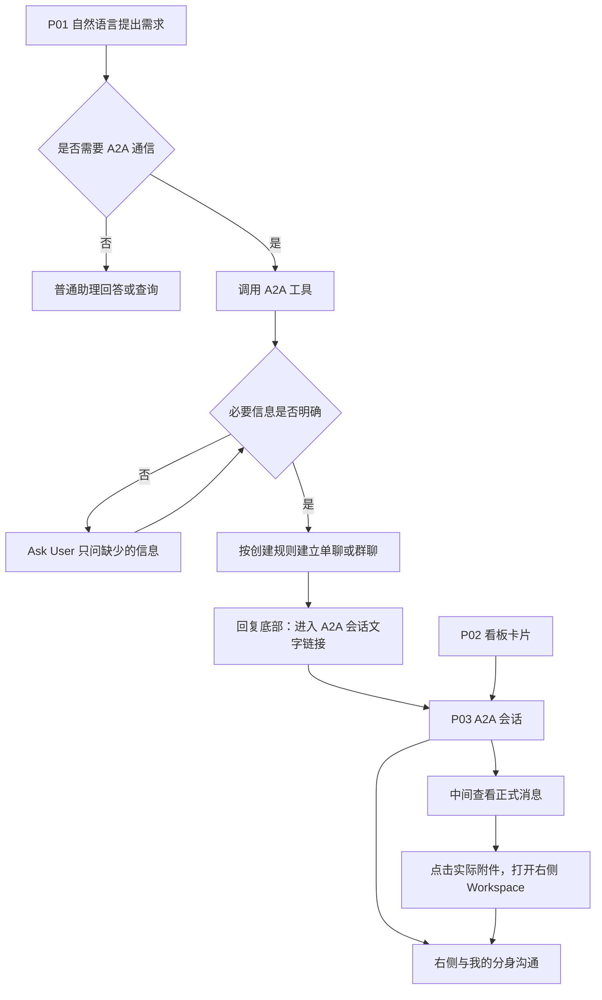

# A2A 通信与任务协作 PRD｜2026 年 10 月版

> V1.0 · 2026-10-08 · 开发评审稿
>
> 本文定义十月 A2A 通信的页面、功能、交互和验收规则。功能总览、正文与验收使用同一编号。未确定的产品规则集中在第 10 章；涉及这些规则的功能尚不能作为最终开发基线。

## 1. 产品范围与阅读方式

十月聚焦 A2A 通信：识别通信需求、Ask User 补齐信息、创建单聊/群聊、交流消息与材料、查看记录和文件。A2A 会话独立存在，系统任务仅用于按需只读查询，不是创建字段、归属依据或会话绑定对象。

不包含自动开工、分身自主执行业务任务、自动生成业务成果、自动业务上传/填表/提交；后台、岗位智能体、系统智能、常驻周期群和持续盯办暂不纳入。个人协作设置保留补充信息追问、进展回复和成果发送三项通信授权；不提供自主开工，成果发送仅指已有且可共享文件的发送。通信授权规则已确定，见第 9.1 节 D01；多人通信的回复收集与轮次规则仍见 D02。

**阅读对应示例：**总览中的 P01-04「Ask User 补齐信息」→正文同名 P01-04 小节→验收表 P01-04。P03 是整个 A2A 会话页面，WS 是其右侧 Workspace 子模块，COM 是跨页面通信规则；它们不是新的页面。

## 2. 功能总览

本期功能如下。P02 提醒由“待我处理”列及数量承担；不提供会话搜索和额外导航红点。

### P01 我的助理

| 功能编号 | 功能名称及正文入口 | 用户目标 |
| --- | --- | --- |
| P01-01 | [A2A 意图识别](#p01-01) | 判断是否需要联系其他人 |
| P01-02 | [普通问题分流](#p01-02) | 继续普通问答或只读查询 |
| P01-03 | [调用 A2A 工具](#p01-03) | 进入创建会话流程 |
| P01-04 | [Ask User 补齐信息](#p01-04) | 只回答必要的澄清问题 |
| P01-05 | [创建单聊](#p01-05) | 与一个对象建立独立会话 |
| P01-06 | [创建群聊](#p01-06) | 与多个对象建立单次事项会话 |
| P01-07 | [创建结果反馈](#p01-07) | 知道会话是否创建成功 |
| P01-08 | [进入会话](#p01-08) | 从回复直接进入 P03 |
| P01-09 | [待我处理提醒](#p01-09) | 在我的助理中获知需要本人处理的 A2A 请求 |

### P02 A2A 任务

| 功能编号 | 功能名称及正文入口 | 用户目标 |
| --- | --- | --- |
| P02-01 | [会话看板](#p02-01) | 查看本人参加的在办通信 |
| P02-02 | [待我处理](#p02-02) | 找到需要本人回答的会话 |
| P02-03 | [进行中](#p02-03) | 查看仍在沟通的会话 |
| P02-04 | [已完成](#p02-04) | 查阅手动完成的历史 |
| P02-05 | [会话卡](#p02-05) | 一点击进入对应会话 |

### P03 A2A 会话

| 功能编号 | 功能名称及正文入口 | 用户目标 |
| --- | --- | --- |
| P03-01 | [正式协作记录](#p03-01) | 消息按实际发送顺序展示姓名、时间、正文及实际附件；历史阅读不被新消息强行打断；私人草稿不可见。 |
| P03-02 | [会话信息](#p03-02) | 不同入口标题、成员和侧栏选中一致；仅群主可见管理菜单；完成标识正确。 |
| P03-03 | [我的分身](#p03-03) | 私人消息仅本人可见；切换会话不串上下文；在同一会话往返 Workspace 不丢未发送输入。 |
| P03-04 | [Ask User](#p03-04) | 问题在对应私人输入区展示；完成或取消恢复输入；Workspace 切换不代答；完成后不可回答。 |
| P03-05 | [主动补充消息](#p03-05) | 只向明确目标发出内容；成功才有正式消息；失败保留草稿；完成后无法发送。 |
| P03-06 | [送达结果](#p03-06) | 部分送达逐人可辨；无回执不推定成功或失败；失败重试不重复发给成功对象。 |
| P03-07 | [确认完成](#p03-07) | 群主提出完成后先确认，确认后全员只读；取消保持会话开放；参与人无法关闭会话。 |
| P03-08 | [返回看板](#p03-08) | 左箭头返回正确列表范围及位置；从 P01 进入也能返回 P02；离开不标记完成或清空草稿。 |

### P03 右侧 Workspace

| 功能编号 | 功能名称及正文入口 | 用户目标 |
| --- | --- | --- |
| WS-01 | [视图切换](#ws-01) | 两个视图共用右侧空间；右侧可拖宽，附件点击打开对应文件；新 Ask User 不强制抢占预览。 |
| WS-02 | [会话文件列表](#ws-02) | 只展示本人可读的当前会话资料；无文件为空态；列表仅来自已共享文件，无附件显示空态。 |
| WS-03 | [查看通信附件](#ws-03) | 单文件预览，返回列表仍在 Workspace；同名不同文件不混淆；不支持预览时可按权限下载；无权限内容不可见。 |
| WS-04 | [返回我的分身](#ws-04) | 返回恢复私人阅读位置和输入；有效问题显示底部面板；切回后恢复原列表或预览位置。 |

### 通信规则

| 功能编号 | 功能名称及正文入口 | 用户目标 |
| --- | --- | --- |
| COM-01 | [单人通信](#com-01) | 两位用户的分身沟通 |
| COM-02 | [多人通信](#com-02) | 多人围绕一次事项沟通 |
| COM-03 | [信息同步](#com-03) | 传递无需强制答复的信息 |
| COM-04 | [协作通信](#com-04) | 围绕明确问题交流 |
| COM-05 | [消息去重](#com-05) | 避免重复创建和重复消息 |
| COM-06 | [会话完成](#com-06) | 保持在办与历史分开 |
| COM-07 | [普通消息分流](#com-07) | 区分系统告知与人际通信 |

## 3. 页面关系与通信旅程

| 页面 | 入口 | 职责 |
| --- | --- | --- |
| P01 我的助理 | 助理默认入口 | 识别需求、Ask User 补齐、创建后提供文字链接 |
| P02 A2A 任务 | 助理侧栏 | 会话看板、待我处理分列、历史查看 |
| P03 A2A 会话 | P01 链接或 P02 卡片直达 | 中间正式记录，右侧我的分身/Workspace 切换 |

| 步骤 | 发起人 | 接收人 | 对应功能 |
| --- | --- | --- | --- |
| 表达与澄清 | 我的助理中说明与谁沟通、沟通什么，回答缺失信息 | 创建前无会话 | P01-01—P01-04 |
| 创建 | 获得结果与文字链接，点击进入 | 能从 A2A 任务找到会话 | P01-05—P01-08、P02-01 |
| 沟通 | 在正式区查看回复，在私人区说明下一条要发什么 | 在自己的私人区表达答复，按适用规则发送 | P03-01—P03-06 |
| 查资料 | 点击实际消息附件，在 Workspace 查看或下载 | 同样只访问有权看到的材料 | WS-01—WS-04 |
| 确认完成 | 群主自然语言提出完成，或顶部菜单发起完成确认 | 确认后移到已完成列，全员只读 | P03-07、P02-04、COM-06 |

上述旅程不包含自主起草、成果生成或业务任务完成。本人明确要求联系或创建会话，必要信息补齐后直接创建并按原意发送，不增加重复确认；分身自行拟定的外发内容先通过 Ask User 请本人确认。

## 4. P01 我的助理功能描述

### P01-01 A2A 意图识别

**用户目标：**用自然语言表达沟通诉求，明确需要联系别人时进入 A2A；只是查信息时不被自动拉进会话。

**一期建议边界：要求明确的联系意图，不要求出现“A2A”术语或固定口令。** “帮我问王五”“通知李四”“拉陈工和刘工一起讨论”都可以表达联系意图。明确联系意图且信息齐全时直接执行本人要求，不再次询问是否确认发送；缺失信息按 P01-04 补齐。

| 用户表达 | 产品判断 | 用户体验 |
| --- | --- | --- |
| “帮我问王五，本周供应商交付有什么风险” | 明确联系别人，对象和问题已知 | 进入 A2A 工具流程，不重复问要不要联系、联系谁、问什么 |
| “帮我问一下本周供应商交付风险” | 联系意图明确，但对象缺失 | Ask User 只问联系谁，不自行选一个人 |
| “拉陈工和刘工讨论一下评审意见” | 明确多人通信 | 复用已有成员和主题，只补真正缺少的信息 |
| “王五负责的项目现在怎么样” | 查询信息，没有明确让分身联系王五 | 走查询；不能因为出现人名就创建 A2A |
| “本周供应商交付风险找谁确认” | 可能在问负责人，也可能想联系对方 | Ask User 问“先查询信息，还是联系同事确认？” |
| “这事最好找王五聊聊” | 表达建议，是否委托分身联系不清 | 只澄清是否需要代为联系，不直接发送 |
| “先别通知李四”“帮我写一段发给李四的话” | 否定发送或只要求起草 | 不创建或发送 A2A；起草完成不算获得发送意图 |
| “客户说‘通知李四’是什么意思” | 引用/解释内容，没有对当前分身发出联系要求 | 回答问题，不根据引号里的动词触发 |
| 在澄清“联系谁”之后回答“王五” | 当前未结束的澄清上下文补充 | 接续原请求，不再要求完整复述；脱离该上下文只输入人名不触发 |

**识别与信息完整度分别判断。** 联系意图已明确但对象不明，进入补齐流程；信息齐全却没有联系意图，也不能直接联系别人。普通查询没有答案时，可以询问是否希望联系人员，不能直接转发。

**识别错误时的恢复：**用户选择“只查询”或表达“不是要联系别人”，留在普通助理，不创建会话；创建前取消则停止本次请求。用户纠正对象或目的时使用新信息，旧澄清不能继续触发创建。已经发送后不能声称通过取消就撤回。

**给研发与模型验证的要求：**不要求首期理解所有隐含意图，但明确联系表达应稳定进入 A2A，否定/引用/纯查询不应触发，模糊表达能够通过一次简短澄清让用户选方向。不能只依据“人名+确认/评审”等关键词判定。上述表格作为首批评审样例，测试时加入同义表达、多轮补充、否定和改口；记录实际判断、是否误建会话及额外追问次数。识别效果使用真实模型联调验证，具体准确率目标待样例评审后确定。

### P01-02 普通问题分流

**用户目标：**继续普通问答或只读查询。

知识、制度、自身业务信息查询由普通助理处理。查询系统任务只是取得参考信息，不生成绑定关系；若用户进一步要求联系别人，再进入 A2A。

### P01-03 调用 A2A 工具

**用户目标：**进入创建会话流程。

识别通信需求后调用 A2A 工具，将对话中已有的人员、事项和要求带入。只有信息缺失或有歧义时调用 Ask User；信息完整不重复盘问。创建尚未成功时，P02 和接收方不展示已建立的正式会话。

### P01-04 Ask User 补齐信息

**用户目标：**只回答必要的澄清问题。

| 需要澄清的信息 | 何时询问 |
| --- | --- |
| 与谁沟通 | 对象缺失、同名或群成员不明确时 |
| 沟通什么、希望得到什么答复 | 事项或目的不明确时 |
| 需要发送的材料 | 请求确实需要材料，但材料或共享范围不明确时 |
| 最大轮次 | 群主未说明本会话最多进行几轮时；不重复询问已明确的轮数 |
| 等待回复时长 | 用户未说明且默认规则尚不适用时；默认时长仍待 D02 定案 |

已明确的信息不重复询问。单人/群聊由参与人数确定；会话名称根据明确内容归纳，不要求用户额外填名。

Ask User 使用当前对话底部输入区的通用问题面板；连续问题在同一面板内切换，完成或取消后恢复输入。取消创建请求不创建会话、不发出消息。具体问题只围绕上述业务信息。

### P01-05 创建单聊

**用户目标：**与一个对象建立独立会话。

通信对象和事项明确后，建立仅发起人和该对象参加的 A2A 会话。本人联系意图明确、对象和沟通内容齐全后直接创建并发送，不要求二次确认。对象没有可用分身时说明无法创建并保留输入，不自动改走钉钉。

### P01-06 创建群聊

**用户目标：**与多个对象建立单次事项会话。

成员和沟通目标明确后创建群聊。采用一次事项一个会话，不建立周期常驻群，不自动关联 C 大脑任务。本人明确要求创建且必要信息完整后直接创建；分身自行建议建群须先获本人确认。人数上限见 D03。人数超过已定上限时说明限制，保留输入供用户调整；不得自行删减成员后创建。

### P01-07 创建结果反馈

**用户目标：**知道会话是否创建成功。

创建成功后，在当前助理回复说明会话名称和参与人，底部给出“进入 A2A 会话”蓝色文字入口，无背景、边框、圆角和箭头。创建失败保留原信息并说明失败，不出现无效会话链接。结果描述可提示“可进入 A2A 会话继续沟通”。

### P01-08 进入会话

**用户目标：**从回复直接进入 P03。

点击回复底部文字链接，直接进入对应 P03；侧栏“A2A 任务”保持选中。已完成的链接进入只读历史；会话不可访问时说明原因并留在当前页面。链接再次点击不会重新创建会话。

### P01-09 待我处理提醒

**用户目标：**无需持续打开 A2A 看板，也能知道有通信事项需要本人参与。

| 项目 | 功能规则 |
| --- | --- |
| 触发 | 未已完成会话产生新的本人待处理请求时，在我的助理消息流中提示；普通消息、他人待处理事项不提示。 |
| 内容 | 消息顶部显示浅绿色来源标签“A2A 任务”，旁边显示会话名称；正文只展示需要本人处理的问题，不重复会话名称或增加一段总提醒。底部为蓝色文字“前往处理”。来源标签不表示已完成，不增加大卡片边框或工具执行过程。 |
| 跳转 | 点击进入对应 A2A 会话，打开我的分身，并显示对应 Ask User；实际回答仍在该会话的底部输入区。 |
| 去重 | 同一未处理请求只提示一次；本人正停留在对应会话时不额外向主助理推送。 |
| 时机 | 主助理正在回答时等待当前输出结束；同一批到达的多个请求合并为一条提醒，分别提供对应入口。 |
| 更新 | 完成请求后原提醒标题旁显示“已处理”；完成后显示“已完成”，来源标签保持不变。旧链接可查看会话，不再次创建或执行请求。 |

## 5. P02 A2A 任务功能描述

### P02-01 会话看板

**用户目标：**查看本人参加的在办通信。

看板固定展示“待我处理、进行中、已完成”三列，不提供完成页或历史切换入口。先判断会话是否已完成，再按本人是否有未处理请求分列；同一会话仅出现一次。已完成会话对所有成员只读，不自动删除。每列显示对应数量，卡片直接进入会话。

### P02-02 待我处理

**用户目标：**找到需要本人回答的会话。

未完成会话中，本人存在未处理的 Ask User 或明确待补信息时进入本列。打开不等于处理；请求解决后回进行中。会话一旦正式完成则移到已完成，原请求不可再执行。其他成员的私人待办不影响本人的分列。

### P02-03 进行中

**用户目标：**查看仍在沟通的会话。

未完成、且本人无待处理请求的会话放在进行中。轮次上限暂停或等待他人回复仍属进行中；不能因为已收齐消息、时间过去或暂无新消息就默认完成。

### P02-04 已完成

**用户目标：**查阅手动完成的历史。

已完成列展示模型判定完成或群主确认完成的会话，按完成时间倒序排列。点击仍进入原会话，只能查看历史消息和有权访问的附件。首期不提供删除、恢复聊天或自动清理操作；无记录显示“暂无已完成会话”。

### P02-05 会话卡

**用户目标：**一点击进入对应会话。

| 项目 | 功能规则 |
| --- | --- |
| 名称与类型 | 名称来自创建时确定的会话；类型标签仅为“单人”“群聊”。 |
| 摘要 | 待我处理卡显示待处理问题，进行中卡显示最近正式消息，完成卡显示最后可见正式消息；无消息显示“暂无消息”。 |
| 参与人 | 头像及姓名来自实际成员；姓名直接显示，不追加“的数字分身”。 |
| 底部 | 左侧固定“发起人：{姓名}”，取真实发起人；右侧显示列表对应更新时间或完成时间。 |
| 交互 | 点击整张卡直接进入对应会话；侧栏“A2A 任务”保持选中。 |
| 可见范围 | 摘要和成员仅展示当前用户有权查看的内容，不包含其他成员私人对话或未发送草稿。 |

## 6. P03 A2A 会话功能描述

### P03-01 正式协作记录

**用户目标：**查看已正式发送的内容。

| 项目 | 功能规则 |
| --- | --- |
| 位置与范围 | 会话中间区域展示当前会话对参与人可见的正式通信记录。 |
| 排列 | 消息按实际发送先后，从上至下排列；日期变化时分组显示日期。单条消息展示发送者姓名、发送时间与正文。 |
| 文本与附件 | 正文展示实际已发送内容；有文件时展示文件名称和类型，点击在右侧 Workspace 打开对应文件。纯文本消息不附加通用文件入口。 |
| 查看操作 | 支持滚动查看历史；首次进入定位最新消息，再次返回同一会话保留阅读位置。用户正在看历史时，新消息不强行拉到底部，提供“有新消息”定位入口。 |
| 输入边界 | 此区域只读。回复要求从右侧“我的分身”输入；私人讨论和未发送内容不出现在正式记录中。 |
| 空态与保留 | 当前会话没有消息时显示“暂无消息”。退出、切换或完成不会清空记录。 |
| 状态位置 | 通信状态紧邻对应消息，细则见 P03-06；需要本人回答的内容放在右侧私人区域。 |

### P03-02 会话信息

**用户目标：**识别当前在哪个会话。

| 项目 | 功能规则 |
| --- | --- |
| 左侧 | 左箭头返回按钮，行为见 P03-08。 |
| 标题区域 | 显示会话名称、类型“单人/群聊”和“{姓名}发起”；来源为实际会话信息。 |
| 右侧成员 | 显示参与人头像及总人数，人数包含发起人且不重复计算同一人；头像提示对应姓名。 |
| 管理菜单 | 仅发起人可见“···”；未完成会话提供“标记完成”，行为见 P03-07；已完成会话不提供管理操作。 |
| 完成标识 | 完成后标题区显示“已完成 · 只读”及完成来源；不提供重新开放操作。 |
| 导航状态 | 从任意入口进入 P03，侧栏“A2A 任务”均保持选中。 |

### P03-03 我的分身

**用户目标：**在当前会话中私下沟通。

| 项目 | 功能规则 |
| --- | --- |
| 位置 | 右侧“我的分身”视图；首次进入会话默认打开。 |
| 交流内容 | 展示本人与自己分身针对当前会话的私人消息。输入可以用于理解内容、补充想法或提出发送要求。 |
| 发送边界 | 私人输入不自动广播；明确要求回复、通知等才进入 P03-05。本人明确给出的回复要求按原意发送；分身自行拟定的外发内容按个人通信设置判断，未授权或越界时先请求本人确认。 |
| 上下文 | 同一用户在同一会话中的私人上下文连续保留；切换到其他会话时展示其独立上下文，不携带前一会话的未发送输入。 |
| 输入保留 | 切换 Workspace 或返回看板再进入时，保留本会话未发送输入；跨刷新草稿恢复不在本节承诺范围。 |
| 完成 | 已有私人记录可查看，普通输入和确认操作暂停；不提供恢复聊天操作。 |

### P03-04 Ask User

**用户目标：**补充或决定当前通信事项。

需要澄清的业务信息仅包括：拟回复的内容、接收对象、要发送的材料范围，以及当前通信中需要本人作出的判断。已明确的信息不重复询问。本人明确要求发送、信息齐全时直接发送；信息缺失时补问；分身自行拟定外发内容则按三项个人通信授权判断，未授权或越界时请求本人确认。

Ask User 使用当前私人对话底部输入区的通用问题面板。多个问题在该面板内切换；完成或取消后恢复普通输入框及未发送内容。取消不发送原拟回复，也不标记会话完成。

待回答期间，“我的分身”页签显示提示点；切到 Workspace 不清除、不强制跳回。完成后不能回答，完成后原请求不再可操作。

### P03-05 主动补充消息

**用户目标：**告诉分身要传达什么。

| 项目 | 功能规则 |
| --- | --- |
| 进入条件 | 用户在当前会话私人输入区明确要求向参与人回复、通知或补充资料。 |
| 目标确认 | 使用当前会话作为上下文；用户指向其他会话或接收范围有歧义时先澄清，不将消息发往猜测的目标。 |
| 内容准备 | 分身可根据本人表达整理拟回复内容；不得新增原意没有的事实或承诺。材料只采用本人明确指定且可共享的文件。 |
| 发送条件 | 本人明确要求发送且信息完整时直接发送。原请求已明确要联系别人，Ask User 补齐对象/内容后即可继续，不再增加发送确认；分身自行提出的外发内容按个人通信设置判断，未授权或越界时本人确认后发送。 |
| 成功 | 正式区出现实际发送内容，并展示对应发送结果；其他参与人按实际送达情况看到消息。 |
| 失败或完成 | 失败保留拟发内容和失败原因；重试沿用本次消息，不重复发给成功对象。会话完成后停止新发送，提示“会话已完成，不能继续发送消息”。 |

### P03-06 送达结果

**用户目标：**知道通信是否成功。

| 项目 | 功能规则 |
| --- | --- |
| 展示位置 | 发送方在对应正式消息旁查看通信状态；多人部分送达时可展开接收情况。 |
| 发送中 | 动作已提交、尚无发送结果；重复点击不创建第二条相同消息。 |
| 已发送，待送达确认 | 已有发送成功结果，尚未确认对方接收；不以经过时间推定已送达。 |
| 已送达 | 对方已实际接收该消息；不等于已读、同意或问题已解决。 |
| 部分送达 | 多人消息显示已送达人数/目标人数，并列出未送达对象；已发送待确认与实际失败分别说明。 |
| 发送失败 | 显示失败结果及重试入口；只有有失败证据的对象才重试。无回执但未报告失败时保持等待状态。 |
| 重试与完成 | 成功接收人不重复发送；完成后不能重试发送，不提供重试。 |

### P03-07 确认完成

**用户目标：**管理会话的确认完成。

本次完成仅指 A2A 通信目标达成，不修改 C 大脑中的任何任务状态。

| 路径 | 触发与结果 |
| --- | --- |
| 模型自动判定 | 模型依据本次沟通目标和实际正式记录判断完成，成立后进入已完成并记录原因。具体可自动判定的场景和判据仍待 D10，不能仅以回复收齐代替达成目标。 |
| 群主主动完成 | 群主在私人对话中说“这次沟通完成了”或从顶部“···”选择“标记完成”，底部 Ask User 展示完成影响，群主确认后迁入已完成。取消则继续沟通。 |
| 非群主表达完成 | 不改变全员状态；可以向群主表达意见，但不能自行关闭会话。 |
| 完成后 | 所有成员停止发送、回复、重试以及未提交的 Ask User；保留正式记录、私人历史及附件查看/下载。标题显示“已完成 · 只读”。 |
| 完成记录 | 展示判定来源（模型/群主）及有依据的原因；不宣称业务系统任务也完成。 |
| 后续操作 | 首期没有归档、恢复或删除入口；需要新的沟通时发起新会话。 |

### P03-08 返回看板

**用户目标：**回到 A2A 列表。

标题左侧左箭头返回 P02 三列看板，保留原列表位置；返回不表示完成、不取消待处理，也不清空未发送草稿。从助理链接进入会话同样返回看板。

## 7. P03 右侧 Workspace 功能描述

### WS-01 视图切换

**用户目标：**在私人对话与文件查看间切换。

| 项目 | 功能规则 |
| --- | --- |
| 入口 | P03 右侧顶部“我的分身 / Workspace”两个视图。 |
| 宽度调整 | 用户可拖动中间记录与右侧区域之间的分隔线调整宽度；窄屏沿用响应式布局。 |
| 切换 | 点击 Workspace 展示当前会话的文件现场；点击实际附件时同时切换 Workspace 并打开该文件。 |
| 状态保留 | 同一会话切换视图，保留私人输入、阅读位置、当前列表或预览位置及所选文件；不产生发送或确认动作。 |
| 其他会话 | 切到另一会话时只使用其本人可见文件和独立状态，默认先展示我的分身。 |
| 待回答 | 收到本人待回答问题时在我的分身页签提示，不强制从文件预览跳走。 |

### WS-02 会话文件列表

**用户目标：**查看当前会话已经共享的文件。

| 项目 | 功能规则 |
| --- | --- |
| 内容范围 | 仅收录当前会话正式消息中已发送、本人有权查看的文件。私人未发送文件不进入列表。 |
| 列表内容 | 显示文件图标、名称、类型、大小、发送人姓名和发送时间，全部来自实际文件与正式消息。 |
| 首次进入 | 首次进入展示文件列表；同一会话再次切回 Workspace 时恢复上次的列表或预览位置。 |
| 无文件 | 显示“当前会话暂无文件”，说明“在会话中发送的文件会显示在这里。” |
| 打开文件 | 点击列表项进入该文件预览；预览顶部提供“返回文件列表”、文件名和下载。返回列表保留原滚动位置，仍处于 Workspace；列表页直接展示文件，无额外导航栏。 |
| 文件来源 | 不预置 context.md、messages/、outputs/，不自动导出聊天记录或生成成果。 |
| 会话隔离 | 切换会话只展示该会话文件，原会话已打开文件状态分别保留。 |

### WS-03 查看通信附件

**用户目标：**预览和下载已共享文件。

| 项目 | 功能规则 |
| --- | --- |
| 入口 | 正式消息中的文件附件，或 Workspace 文件列表中的文件。 |
| 打开结果 | 右侧展示单个文件内容，沿用已有预览样式；顶部仅显示“返回文件列表”、文件名和下载，不提供多文件标签、“＋”、输出物浮层、目录或收起面板按钮。 |
| 重复与不同文件 | 同一文件重复点击定位当前预览；点击另一文件切换预览内容。通过文件身份区分同名文件。消息附件点击可直接打开预览，无需先经过列表。 |
| 预览与下载 | 支持预览的格式直接显示内容；不能预览但允许下载时显示“暂不支持预览”及下载入口。文件大小和数量限制继承 Comac Claw 平台统一规则，包括平台规定的单文件、单次及总量限制（如适用）；A2A 不另设数值或增加限额配置。超限提示沿用平台规则。支持格式、访问范围和材料选择入口仍见 D05。 |
| 失败 | 无权限、文件失效或读取失败分别说明；下载失败不声称成功，也不关闭当前会话。 |
| 已完成会话 | 可以查看、下载仍有权访问的历史附件；下载不修改会话或业务状态。 |

### WS-04 返回我的分身

**用户目标：**看完文件后继续私人沟通。

| 项目 | 功能规则 |
| --- | --- |
| 入口 | 仅通过右侧顶部“我的分身”页签切回私人对话。“返回文件列表”只在 Workspace 内返回，不切换对话视图。 |
| 结果 | 恢复私人消息、未发送输入及原阅读位置；有有效 Ask User 时展示底部问题面板。 |
| 文件现场 | 切回我的分身保留 Workspace 当前文件与预览/列表位置；再次切回可继续查看。 |
| 操作含义 | 返回私人对话不会自动回答 Ask User、发送附件或清除待处理请求。 |

## 8. 通信规则功能描述

### COM-01 单人通信

**用户目标：**两位用户的分身沟通。

单人会话包含发起人和一位接收人，类型标签显示“单人”。发起人拥有确认完成权限，接收人只能查看、交流和处理自己的请求。单聊沿用 P03 与 Workspace 的交互；每轮一人一次正式发言，回合规则见 COM-02；单聊最大轮次设置方式见 D04，达到上限暂停而非完成。

### COM-02 多人通信

**用户目标：**在有限轮次内收集参与人的回复，避免无休止对话或长时间等待。

| 项目 | 功能规则 |
| --- | --- |
| 本轮发起 | 群主发出本轮议题，明确需要回复的成员；群主的开场消息计为其本轮一次发言。 |
| 回复顺序 | 成员并发准备，不按名单排队。谁先满足发送条件谁先发；需要本人确认的成员等待自己的 Ask User，其他成员继续。 |
| 发言次数 | 每位参与人每轮一次正式回复，单聊同样适用。一次回复可含必要说明与附件；私人讨论、Ask User 和平台状态提示不计入正式发言次数。 |
| 追问 | 正式发到群内的追问也占本人的本轮一次回复；问题交给群主在后续轮次组织，不因别人发言自动再接一句。 |
| 上下文 | 本轮以开场时的共同上下文为依据；不得要求等待前序成员回复后才能回答。需要针对本轮回复继续讨论时进入下一轮。 |
| 最大轮次 | 创建会话时由群主明确最大轮次；缺失时通过 P01-04 Ask User 补齐。完成第 N 轮后暂停，不能启动第 N+1 轮；不是等越界发送后再阻止。 |
| 继续 | 到上限后，仅群主本人在私人对话中自然语言要求继续才可继续，例如“再进行一轮”。建议每次明确指令增加一轮，明确“再两轮”则增加两轮；授权范围表达不明确时 Ask User 补齐。追加轮数的细则列 D04 评审。 |
| 暂停与完成 | 轮次上限暂停不等于完成，历史可看、私人对话可用；只有群主主动完成才移入历史。 |

单聊也遵守每轮各发言一次与轮次保护；首期建议创建单聊时同样明确最大轮次，避免再引入另一套默认上限，见 D04。

**超时处理方向已明确，数值与收口细则待定：**

- 建群时允许通过 Ask User 设定本轮等待回复时长，用户已经说清楚时不重复问。
- 建议提供默认 1 小时，可改为 6 小时或其他时长；该默认值尚未批准，不能在正式实现中写死。
- 建议从本轮议题发出时统一计时，到截止时间仍未收到正式回复的成员标记“本轮未回复”。本人仍在 Ask User 确认中，也算尚未正式回复。
- 群主分身在群内发一次合并说明：“截至{截止时间}，尚未收到{姓名列表}的回复。”不推断对方未读、离线、拒绝或同意。该说明属于通信状态提示，不占群主正式发言次数，也不触发成员新回复。
- 建议到期后本轮按“已回复/超时未回复”结算，不继续无限等待。可汇总实际收到的内容并列缺失者；不能声称全员意见一致。
- 迟到回复是否补入已结束轮、是否须等下一轮，完成和暂停时是否停止计时，仍列 D02；正式上线前必须定案。
- 收集完成后是否自动发起下一轮尚未确认；无论采用何种推进方式，都不能绕过最大轮次限制与个人通信授权。

群聊人数上限见 D03；成员变化和历史可见范围见 D09。

### COM-03 信息同步

**用户目标：**传递无需强制答复的信息。

当用户仅要求告知信息时，采用信息同步语义，不要求参与人逐一回复，也不以送达证明已读或同意。接收方自愿回复仍记录在原会话中。

信息同步是消息目的，不新增“通知”类型标签；卡片仍只显示单人或群聊。纯系统广播走系统消息通道；人际通知是否超出 A2A 人数范围按 D03 判断。通知送达后仍需群主手动完成。

### COM-04 协作通信

**用户目标：**围绕明确问题交流。

当用户要求答复、补充资料或共同讨论时，按原会话保留提问、回复及后续补充。分身可以整理通信表达，但不得据此自主开展业务任务。

当前议题的追问继续使用原会话。需要另开议题时，由用户明确要求创建新会话，不自行复用同名对象的其他会话。具体通信授权见第 9.1 节与个人协作设置；会话回合按 COM-02 执行。

### COM-05 消息去重

**用户目标：**避免重复创建和重复消息。

| 项目 | 功能规则 |
| --- | --- |
| 重复创建 | 同一创建请求重试返回原创建结果，不增加第二个同内容会话。用户明确发起新事项时可以创建新会话。 |
| 重复消息 | 同一次发送因重试或重复投递只形成一条正式消息；多人重试不再发送给已成功对象。 |
| 新内容 | 用户再次主动发送相似文本、补充要求或新文件，仍属于新的通信，不以文字相似自动丢弃。 |
| 反复确认 | 纯礼貌确认不引发持续互相回复。达到无效轮次保护条件后的提醒和恢复方式见 D04，不自动标记完成。 |

### COM-06 会话完成

**用户目标：**保持在办与历史分开。

完成状态对所有成员同时生效。完成前已接受的消息可保留到历史，但不能重新触发回复；完成后提交的新消息或旧发送重试均拒绝并提示“会话已完成，不能继续发送消息”。未执行的 Ask User 失效，排队的回复停止。无删除或恢复聊天入口。模型判定路径的准确性、允许场景与误判处理见 D10；原型自动路径仅为固定演示样例。

### COM-07 普通消息分流

**用户目标：**区分系统告知与人际通信。

业务系统节点变化产生的系统通知经系统消息通道展示，不自动建立 A2A 会话。用户可以基于该通知明确要求联系人员，此时转入 P01-01。

知识或只读任务查询沿用普通助理能力；查不到时说明信息缺失，可以询问是否需要联系相关人员，未经表达不得替用户直接联系。

## 9. 数据与状态口径

- 人员、会话名称、参与人来自实际会话；正式消息来自实际发送内容；文件名与大小来自实际附件。没有数据时不填演示事实。
- 私人对话仅本人可见，不将未发送的输入或 Ask User 原文自动公开给参与人。
- 已发送不等于已送达，已送达不等于已读或同意。只有实际事件才能更新状态。
- “待我处理”来自本人尚未处理的请求；“进行中”仅表示通信未完成；“已完成”来自明确完成操作，不由模型判断业务完成。
- 系统任务查询结果可以作为消息参考，标明来源和获取时间；不增加会话关联任务、任务认领、自动完成等功能。
- 加载、保存失败、通用错误样式等沿用公司产品规范，不在本文重复设计。

### 9.1 通信授权规则（D01 已定案）

| 场景 | 产品规则 | 示例 |
| --- | --- | --- |
| 本人明确要求联系、创建或发送，信息完整 | 直接执行本人的通信要求，不重复确认 | “帮我问王五交付进展”直接进入创建/发送流程 |
| 本人联系意图明确，但缺少必要信息 | Ask User 只补缺失信息；补齐后执行原请求 | “帮我问一下交付进展”只问联系谁 |
| 本人明确要求在当前会话回复 | 按原意发送；可以整理表达，不新增事实、接收人或承诺 | “回复他，材料明天提供”中的时间承诺由本人给出，不再重复询问 |
| 分身自行拟定或建议对外发送 | 本人已通过对应通信设置预先授权的类型可在范围内自动发送；未授权或超范围时，在私人输入区 Ask User 确认 | 允许自动进展回复可发送已核实事实；自行承诺明天交付仍须本人确认 |
| 本人只讨论、查询或要求起草 | 只在私人对话中处理，不自动对外发送 | “这段话怎么说合适”不等于要求发送 |

单次 Ask User 确认仅适用于该次内容；持续的类型授权来自本人保存的三项通信设置。修改实质内容或扩大接收范围时，新增部分重新澄清或确认。有效访问权限仍是前提；会话完成时仍不可发送。

A2A 仅承担通信，业务系统最多提供按需只读查询。转达本人说的“明天交付”只是发送消息，不修改 C 大脑计划；本人在聊天中要求开工、改状态、上传、填表或提交，也不会因此获得本期未提供的业务操作能力。

## 10. 待决策及受影响功能

下列规则尚未定案，需业务评审明确后再完成相关功能验收。

| 编号 | 待确定规则 | 影响功能 |
| --- | --- | --- |
| D02（部分定案） | 并发、一人每轮一次、超时公告方向已明确；等待默认值（建议1小时）、计时起点、到期结算、迟到回复及自动下一轮待定 | P01-04、COM-02、COM-04 |
| D03 | 群聊人数精确上限，大范围通知的系统通道 | P01-06、COM-02、COM-03 |
| D04（部分定案） | 群主定义最大轮次、到上限暂停、群主自然语言继续已明确；追加轮数与单聊上限配置细则待定 | COM-01、COM-02、COM-05 |
| D05（部分定案） | 文件大小、数量限制继承 Comac Claw 平台；支持格式、访问范围以及材料选择入口仍待明确 | P03-05、WS-03 |
| D07 | 已完成记录的保存期限按平台规则确定；首期不提供用户删除 | P02-04、COM-06、WS-03 |
| D10 | 模型自动完成的适用场景、达成判据和误判处理；不能将收齐回复、超时或轮次暂停等同于完成 | P03-07、COM-06 |
| D09 | 创建后是否允许增减成员；新增成员能否查看历史 | P03-02、COM-02 |

D08 已定案：仅展示已共享的会话文件，不生成上下文/聊天记录文件。D01 的通信授权规则已定案，见第 9.1 节；D06 已由本版完成机制替代，规则见 P02-01、P02-04、P03-07 与 COM-06；不再作为待讨论项。新增的产品细节属于本版评审方案，尚未实现的行为不能以现有 Demo 表现替代验收。

## 11. 功能验收对照

每一行对应总览和正文中的同一功能。涉及第 10 章待定规则的项目，须在定案后补齐相应验证条件。

| 功能编号 | 功能名称 | 验收结果 |
| --- | --- | --- |
| P01-01 | A2A 意图识别 | 明确的联系请求进入创建流程，普通提问不误建群。 |
| P01-02 | 普通问题分流 | 查询一个系统任务不会创建 A2A 会话或关联任务字段。 |
| P01-03 | 调用 A2A 工具 | 已提供的信息保留，缺失信息进入 P01-04。 |
| P01-04 | Ask User 补齐信息 | 联系意图明确时只补缺失信息；补齐后执行原请求，不追加重复发送确认。 |
| P01-05 | 创建单聊 | 成功后双方可进入同一会话；失败不显示创建成功。 |
| P01-06 | 创建群聊 | 实际成员与已明确对象一致，失败不会创建重复群。 |
| P01-07 | 创建结果反馈 | 仅成功创建或定位到已有会话时提供对应链接。 |
| P01-08 | 进入会话 | 打开正确会话，左侧 A2A 任务保持高亮。 |
| P01-09 | 待我处理提醒 | 仅本人新待处理请求提示；不打断当前输出；点击定位对应私人对话；处理或完成后提醒同步更新。 |
| P02-01 | 会话看板 | 同一会话在主看板只出现一次，完成历史不混进在办列表。 |
| P02-02 | 待我处理 | 打开会话不自动清除真实待处理状态。 |
| P02-03 | 进行中 | 等待对方回复不会显示为待本人确认或业务已完成。 |
| P02-04 | 已完成 | 完成历史可找到；未完成的较早会话不因日期被丢弃。 |
| P02-05 | 会话卡 | 点击卡片一次即进入会话，侧栏 A2A 任务仍选中。 |
| P03-01 | 正式协作记录 | 消息按实际发送顺序展示姓名、时间、正文及实际附件；历史阅读不被新消息强行打断；私人草稿不可见。 |
| P03-02 | 会话信息 | 不同入口标题、成员和侧栏选中一致；仅群主可见管理菜单；完成标识正确。 |
| P03-03 | 我的分身 | 私人消息仅本人可见；切换会话不串上下文；在同一会话往返 Workspace 不丢未发送输入。 |
| P03-04 | Ask User | 问题在对应私人输入区展示；完成或取消恢复输入；Workspace 切换不代答；完成后不可回答。 |
| P03-05 | 主动补充消息 | 本人明确要求且信息齐全时直接发送；本人给出的时间承诺不重复确认；分身自行拟定且未获对应个人授权的内容，未经本人确认不发送；不操作业务系统。 |
| P03-06 | 送达结果 | 部分送达逐人可辨；无回执不推定成功或失败；失败重试不重复发给成功对象。 |
| P03-07 | 确认完成 | 群主提出完成后先确认，确认后全员只读；取消保持会话开放；参与人无法关闭会话。 |
| P03-08 | 返回看板 | 左箭头返回正确列表范围及位置；从 P01 进入也能返回 P02；离开不标记完成或清空草稿。 |
| WS-01 | 视图切换 | 两个视图共用右侧空间；右侧可拖宽，附件点击打开对应文件；新 Ask User 不强制抢占预览。 |
| WS-02 | 会话文件列表 | 只展示本人可读的当前会话资料；无文件为空态；列表仅来自已共享文件，无附件显示空态。 |
| WS-03 | 查看通信附件 | 单文件预览，返回列表仍在 Workspace；同名不同文件不混淆；不支持预览时可按权限下载；无权限内容不可见。 |
| WS-04 | 返回我的分身 | 返回恢复私人阅读位置和输入；有效问题显示底部面板；切回后恢复原列表或预览位置。 |
| COM-01 | 单人通信 | 单聊具备与群聊一致的基本通信入口。 |
| COM-02 | 多人通信 | 并发回复，每轮一人一次；达到群主设定上限后不再自动发起新轮；超时仅报告未收到回复，数值按 D02 定案。 |
| COM-03 | 信息同步 | 通知不会生成虚假的全员同意或自动业务任务。 |
| COM-04 | 协作通信 | 补充进入原会话，不因一次追问另建群或自动开工。 |
| COM-05 | 消息去重 | 重试不制造重复群或重复正式消息。 |
| COM-06 | 会话完成 | 各成员看到同一完成事实，不各自猜测任务是否完成。 |
| COM-07 | 普通消息分流 | 普通系统通知和知识查询不挤入 A2A 看板。 |

## 12. 配套材料

- [原型说明与演示剧本](./A2A原型说明与演示剧本.md)：固定剧本、实现现状和版本记录，不属于功能定义。
- [验证阅读结论](./验证资料/2026-09-22-A2A复盘阅读结论.md)：验证依据及证据边界。
- [A2A 协作设置预研稿](./PRD-A2A协作设置-2026年10月版.md)：三项个人通信授权设置；不包含自主开工。

### 本版原型边界

三列看板、群主“完成了”自然语言请求→底部 Ask User→确认后只读已实现。已完成列有“评审时间确认（模型判定演示）”固定样例，用来评审自动完成后的界面与限制，不是已接入真实模型判断。真实模型判据须先确认 D10 再接入。当前会话演示状态仍为内存数据。
