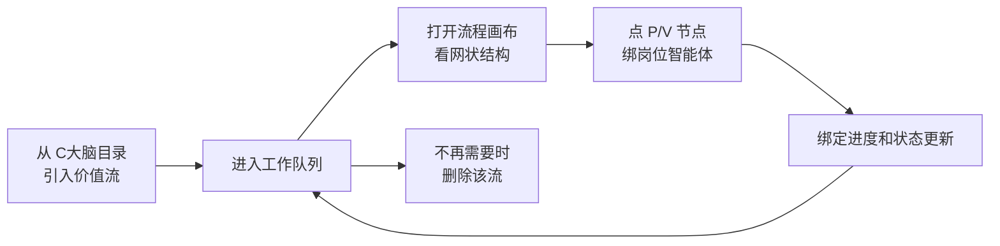
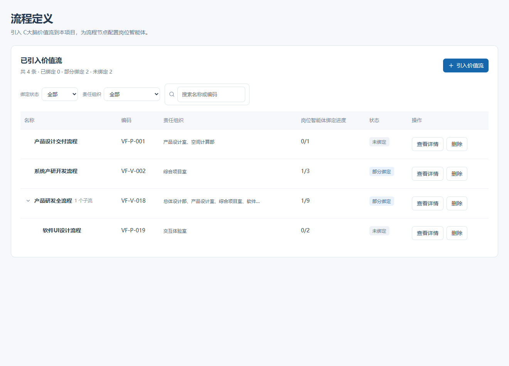
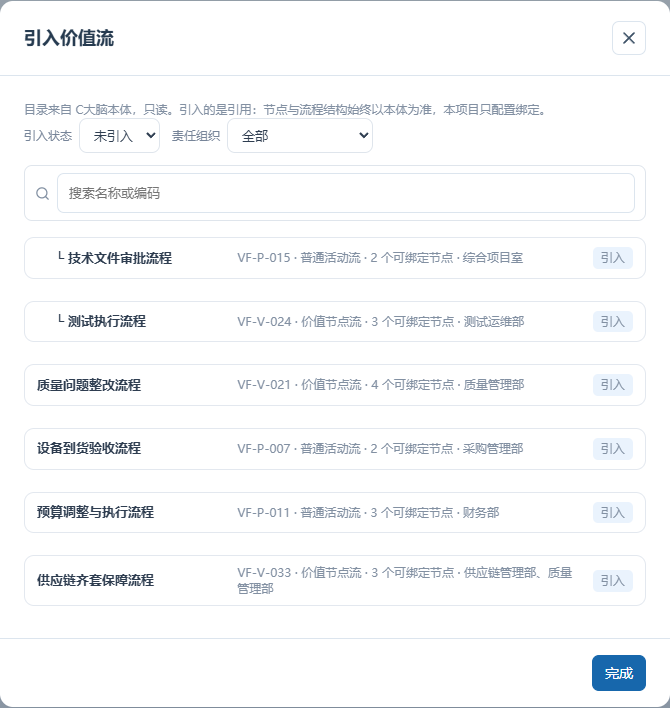
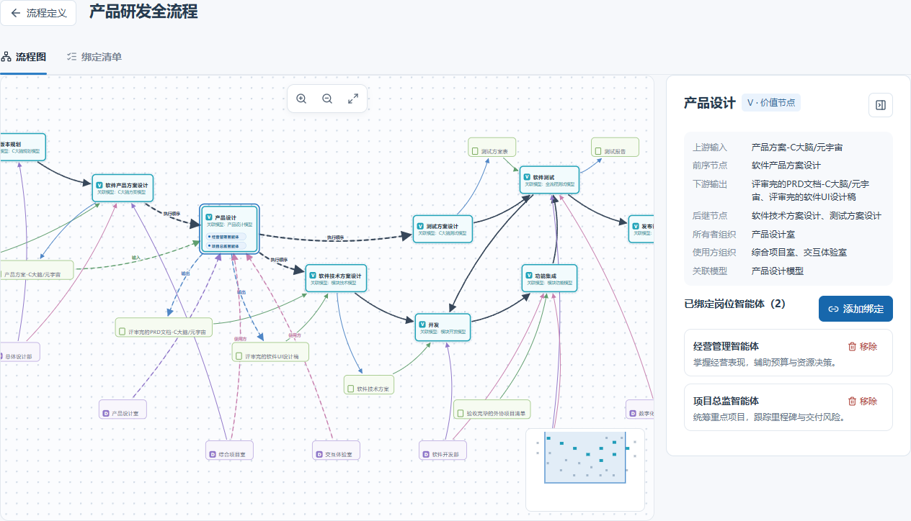
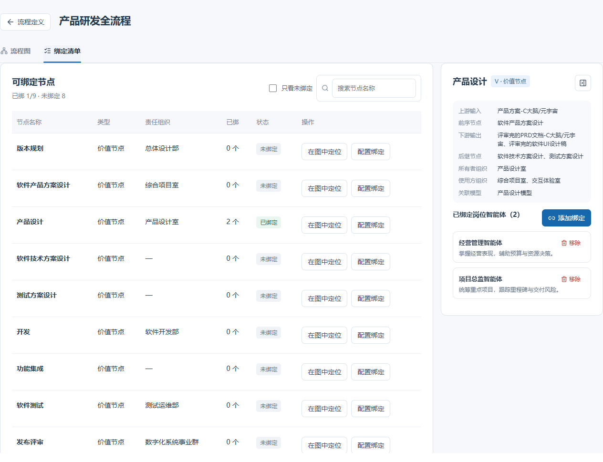

# COMAC CLAW 流程定义 PRD

| 版本  | 日期         | 状态       | 产品  |
| --- | ---------- | -------- | --- |
| 1.0 | 2026-10-15 | 初稿，原型已落地 | 汪涛  |

UI / 开发 / 测试：待定。原型入口：后台管理 → 组织智能 → 流程定义。价值流来源截图：上级目录「商飞智能」下 C大脑价值流 1-4.png。

## 1. 这个页面干什么

COMAC CLAW 是 C大脑的 AI 能力组成部分。企业的业务流程（内部叫「价值流」）都在 C大脑的低代码「价值流」能力里建好，形态是网状图：节点有价值节点（V）、普通活动（P）、组织、资源组织、文档、开始/结束几种，边有输入、输出、所有者、使用方、资源、执行顺序几种。

流程定义页面干一件事：**把 C大脑的价值流读进本项目，给流程里的 P/V 节点绑上本项目的岗位智能体**，让每个节点该承接和交付的工作有 AI 能力去干。

### 边界（全文按这三条来）

| 不做                                   | 做                           |
| ------------------------------------ | --------------------------- |
| 不建流程、不改流程；结构永远以 C大脑为准，画布没有改节点改边的入口   | 读流：从 C大脑目录引入本项目工作队列         |
| 不判断执行侧：绑定的智能体有没有人的数字分身实际启用，本模块不管也不提示 | 写绑定：节点 → 岗位智能体，多对多，只有已发布的能绑 |
| 不留归档：删除全量级联，不可恢复                     | 写引入记录：哪条流、谁、什么时候引入的         |

岗位智能体是本项目「岗位智能体管理」模块的资产。绑定只声明「这个节点的活由它承接」。

## 2. 整体流程

主线一条：引入 → 看图 → 绑节点 → 状态回写队列；删除是队列的出口。分支和异常在第 3 章各页面里说。

## 3. 页面与功能

### 3.1 工作队列（列表页）

干什么用：一眼看见引入了哪些流、绑定配到什么程度，没配的排最前面等着配。

| 区域   | 有什么 / 能干什么                                                                             | 边界与异常                        |
| ---- | -------------------------------------------------------------------------------------- | ---------------------------- |
| 列表主体 | 名称（父子树：父行带展开箭头和「n 个子流」，子行缩进一级）、编码、责任组织（不换行，太长省略号、悬浮看全量）、绑定进度（已绑/总数）、状态徽章、操作（查看详情 / 删除） | 只显示已引入的流；父流没引入时子流不在队列里       |
| 排序   | 默认工作队列顺序：未绑定 → 部分绑定 → 已绑定，同状态按编码                                                       |                              |
| 筛选   | 绑定状态、责任组织、名称/编码搜索                                                                      | 用了任意筛选就平铺显示命中结果，层级不藏东西；清空恢复树 |
| 计数行  | 共 n 条 · 已绑定 x · 部分绑定 y · 未绑定 z                                                         |                              |
| 空态   | 一条都没引入                                                                                 | 直接指路右上角「引入价值流」按钮             |

### 3.2 引入与删除

干什么用：管队列的成员——哪些流进本项目、哪些离开。

| 操作   | 规则                                                                 | 边界与异常                  |
| ---- | ------------------------------------------------------------------ | ---------------------- |
| 引入   | 弹窗是 C大脑目录（只读），按父子顺序排、子流缩进带 └；每行显示名称、编码、粒度（价值节点流/普通活动流）、可绑定节点数、责任组织 | 引入的是引用不是副本：结构始终以 C大脑为准 |
| 弹窗筛选 | 引入状态（**默认「未引入」**，打开直接看到能引的）、责任组织、搜索                                | 已引入的置灰标「已引入」，幂等不能重复引   |
| 子流门禁 | 父流没引入 → 子流置灰标「待父流」，悬浮说明「需先引入父流『XX』」                                | 子流是父流的分解，脱离父流没有工作上下文   |
| 删除   | 全量级联：这条流 + 已引入的子流 + 它们身上全部绑定                                       | 不归档，不可恢复               |

删除确认弹窗把后果说全：点名会级联删掉哪些子流、一共几个节点的绑定会没；本来没绑定就说明不会丢别的数据。取消则什么都不发生。

### 3.3 流程画布（详情页）

干什么用：一张图看全这条流的网状结构，哪些节点绑了、哪些没绑一目了然，决定下一步配哪个。

| 区域     | 有什么 / 能干什么                                                                                                | 边界与异常                                      |
| ------ | --------------------------------------------------------------------------------------------------------- | ------------------------------------------ |
| 图主体    | 完整渲染，网状结构原样：不线性化、不树化、不合并节点。节点类型：V（青虚线框）、P（橙）、组织（紫灰）、资源组织（灰）、文档（绿）、开始/结束（圆）                                | **只有 V 和 P 能绑**；画布没有改节点改边的入口，改结构只能去 C大脑    |
| 只读节点   | 点击不发生任何事；**悬浮**高亮它的全部连线和相邻节点、其余降透明                                                                        | 看关系只靠悬浮，不弹窗                                |
| P/V 节点 | 点击开右侧绑定面板；未绑的带虚线光圈 = 待配置；已绑的卡片底部显示智能体**名称芯片**（淡蓝底蓝字带小圆点），卡片高度随芯片行数自动加高、最多两行、超出 +n；芯片名按卡片宽度尽量显示全名，放不下才截断省略 |                                            |
| 选中节点   | 它的全部连线（出边、入边、归属线）变同色流动虚线动效 = 「这个节点的关系被激活」                                                                 | 用户系统开减少动态效果时自动静止                           |
| 视野     | 滚轮/按钮缩放、拖拽平移、适应全图按钮、右下缩略图点击/拖动移视野                                                                         | **视野保护**：开关面板、点空白、换选中都不重置调好的缩放和位置          |
| 选中状态   | 点另一个节点 = 切换选中                                                                                             | **点空白、拖拽平移都不取消选中**；关闭选中只有面板右上「收起面板」按钮这一个途径 |
| 底纹     | 淡点阵，跟着平移缩放走，屏幕上点大小不随缩放变                                                                                   |                                            |

### 3.4 绑定面板（画布右侧）

干什么用：看清一个节点的上下游和责任组织，给它绑上岗位智能体。

| 区域    | 有什么 / 能干什么                                                                      | 边界与异常                                        |
| ----- | ------------------------------------------------------------------------------- | -------------------------------------------- |
| 头部    | 节点名 + 类型徽章（V·价值节点 / P·普通活动）+ 收起面板按钮                                             |                                              |
| 只读上下文 | 上游输入（文档）、前序节点、下游输出（文档）、后继节点、所有者组织；V 多一行使用方组织，P 多一行资源组织；V 有关联模型的多一行（纯文字不可点）      | 全部来自 C大脑，改不了                                 |
| 已绑区   | 标题**恒显计数**：「已绑定岗位智能体（n）」，一个没绑也显示（0）；每条 = 名称 + 一句简介（岗位说明里「岗位目标」那段，两行截断、悬浮看全）+ 移除 | **不显示**版本、岗位、组织、「有没有人持有数字分身」——本模块不判断执行侧      |
| 移除绑定  | 二次确认：「解除后该节点不再由此智能体承接，确认解除？」                                                    |                                              |
| 添加绑定  | 选择器**纯手动**：搜索 + 按组织分组的全量已发布智能体，每项带名称和简介；点一下立即绑上、徽章变「已添加」给即时反馈                   | 不推荐不自动绑；已绑到本节点的置灰标「已绑定」                      |
| 不可用   | 智能体被停用或未发布                                                                      | 该条标「该智能体当前不可用（已停用或未发布），绑定保留但节点无法承接工作」，绑定不自动删 |
| 版本更新  | 智能体发了新版本                                                                        | 绑定自动跟新版本，不用重绑                                |
| 空态    | 一句话：「这个节点还没绑智能体，流程跑到这一步暂时无人承接。」                                                 |                                              |

### 3.5 绑定清单页签

干什么用：节点多的流上，用表格逐节点配绑定，比在图里找节点快。

| 区域  | 有什么 / 能干什么                            | 边界与异常              |
| --- | ------------------------------------- | ------------------ |
| 表格  | 节点名称、类型、责任组织、已绑个数、状态（已绑定/未绑定/含不可用）、操作 | 与流程图同级页签           |
| 操作  | 「在图中定位」「配置绑定」都切到流程图页签、把节点平移到画面中心并开面板  | 面板挂在图上，清单页签里不悬空开面板 |
| 辅助  | 「只看未绑定」开关 + 节点名搜索；头部显示总进度 已绑 x/y      | 全绑完且开着「只看未绑定」时表内空态 |

## 4. 状态与口径

| 对象  | 状态                     | 规则                             |
| --- | ---------------------- | ------------------------------ |
| 流   | 未绑定 / 部分绑定 / 已绑定       | 0 个节点绑了 / 绑了一部分 / 全部 P/V 节点都绑了 |
| 节点  | 未绑定 / 已绑定 / 含不可用       | 含不可用 = 有绑定但智能体停用或未发布           |
| 进度  | 已绑节点数 ÷ 可绑定节点数（P/V 总数） | 父子流各算各的，不互相继承                  |

队列的默认排序、计数行、筛选都吃这套状态。

## 5. 数据与权限

| 数据             | 来源 / 去向     | 说明                                  |
| -------------- | ----------- | ----------------------------------- |
| 流结构、节点、边、组织、文档 | 读自 C大脑本体接口  | 本项目不存结构快照（原型阶段用内置快照演示，正式接入等跨部门接口会议） |
| 引入记录           | 本项目写        | 哪条流、谁、什么时候引入                        |
| 绑定关系           | 本项目写        | 节点 → 岗位智能体，多对多                      |
| 权限             | 沿用后台既有角色    | 资源管理员可引入、删除、绑定；原型阶段不做权限校验           |
| 绑定候选           | 只列已发布的岗位智能体 |                                     |

容量：单条流节点数没有定数，原型最大样例 27 节点；画布要求能完整渲染并交互 50 节点级的流。列表规模 = 引入的流数，预期几十条级。性能与系统技术要求沿用平台统一标准，本功能无特殊要求。

# 
