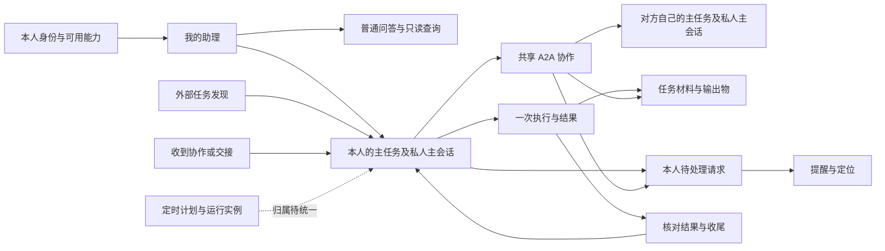

# 助理产品逻辑全链路审查

> 日期：2026-10-22（北京时间） · V0.1 · 审查与决策讨论稿
>
> 本文记录现有方案的规则缺口、冲突和建议，不是新的开发基线。未修改产品代码或正式 PRD 规则。建议、优先级和待决策方案均为本次审查判断，须在讨论后转入正式需求。

> 2026-10-22 后续范围决定：用户已确认本期移除任务删除及恢复，已同步原型和主 PRD V2.3。下文为调整前审查快照；F01 中删除/恢复部分不再是待决策项，F08 中依赖恢复的旧路径已移除，同一来源完成后的新交接归属仍待 D11 确认。其他审查建议未因此自动采纳。

## 1. 审查结论与阅读方式

当前方案已经定义了任务主会话、多路协作、私人讨论与公开通信隔离等基本结构，但仍不足以支持开发按统一规则处理完整用户旅程。主要问题不只是页面缺少交互，而是：**对象之间的关系已经描述，跨对象的责任、状态和动作联动尚未闭环；新结构与旧规则并存；正常路径比中断、变更、接收端和跨模块路径完整。**

本次形成 **48 项审查发现、12 组集中决策、36 个跨环节验收场景**。48 项不等于 48 个代码缺陷：其中包含已列待定事项、当前规则冲突、范围变化尚未落稿、原型差异和需要补全的规则。不能把它们全部变成新增功能。

优先看第 4 章的四个实际断点，再看第 7 章集中决策。第 5 章是完整追踪台账，第 8 章是拟补入 PRD 的位置，第 9 章用于防止修完一条又漏另一条。

### 1.1 范围与证据边界

| 范围层次 | 本次检查内容 | 边界 |
| --- | --- | --- |
| 核心全链路 | 我的助理、普通问答与建任务、任务列表/主会话/详情、接收端、A2A、Ask User、材料、进展、完成与后续 | 通读当前任务主 PRD、通信设置和演示说明；结合关键源码核对 |
| 跨模块接口 | 数字分身身份/画像/能力/知识、自动化定时任务、消息通知、SubAgent、通用 Workspace、外部 Agent、移动端 | 查阅对应规则与关键章节，重点检查与新任务体系的接缝；不声称逐个 UI 控件或全量接口已经测试 |
| 范围管理 | 历史普通任务模式、岗位智能体、组织后台、外部业务写入 | 识别边界和冲突，不因仓库存在 Demo 就纳入本期建设；岗位/后台内部业务不是本次任务产品的上线承诺 |
| 验证方式 | 文档交叉核对、源码静态检查、场景推演 | 未执行真实多账号通信、服务端状态同步、模型效果或跨端联调；未将前端 Mock 结果当成线上事实 |

本轮保留了开始审查前已有的未提交修改。源码证据仅说明此 checkout 的原型行为，不证明真实后端有相同问题。

### 1.2 证据索引

后文的“主稿 Pxx”指下列 E01 的对应功能章节；这些编号便于讨论后直接回填。

| 编号 | 依据 | 本次用途 |
| --- | --- | --- |
| E01 | [任务主会话与 A2A 通信 PRD V2.2](./PRD-A2A通信与任务协作-2026年10月版.md) | 当前任务产品主稿；全文核对 |
| E02 | [10 月 21 日评审智能纪要](/Users/shinbouei/Downloads/智能纪要：Cloud平台助理任务功能评审%202026年10月21日.md) | 变化线索；包含摘要、时序讨论和关键决策，不能整篇当作无冲突定案 |
| E03 | [项目概要](../PROJECT_CONTEXT.md)、[文档导航](./README.md)、[演示说明](./A2A原型说明与演示剧本.md) | 版本范围、历史覆盖关系和 Mock 限制 |
| E04 | [A2A 协作设置](./PRD-A2A协作设置-2026年10月版.md) | 三项通信授权、保存生效与既有请求规则 |
| E05 | [个人数字分身配置](./PRD-个人数字分身配置-2026年10月版.md) | 身份、画像、能力、知识及反馈的产品接口；其待决策项仍未定案 |
| E06 | [自动化定时任务](./PRD-自动化定时任务.md) | 计划、运行实例、重试、停止、通知与保留规则 |
| E07 | [长 Session 通知中心](./PRD-助理长Session消息通知中心.md) | 旧单 Session 缓冲队列模型；需要明确哪些规则继续适用 |
| E08 | [SubAgent 执行过程](./PRD-助理SubAgent协同执行过程.md) | 旧输入阻塞、失败、整轮重执行规则；检查是否适用于新主任务 |
| E09 | [Workspace 规范](./PRD-Workspace工作台交互规范.md)、[全屏预览](./PRD-输出物全屏预览.md) | 文件工作区的适用范围、状态保留与全屏差异 |
| E10 | [外部 Agent 入口](./PRD-外部Agent展示与跳转入口.md) | 已明确仅跳转、不传任务上下文、不接收执行结果 |
| E11 | [历史双模式](./PRD-双模式会话与统一Workspace.md)、[历史确认机制](./PRD-A2A用户决策与确认机制.md)、[历史派发催办](./PRD-助理A2A任务派发与催办.md) | 旧方案已有的上下文、版本和幂等规则可作输入；旧业务写入及按钮唯一授权不直接继承 |
| E12 | [移动端自动化补充说明](../../Comac-shuzifenshen-mobile/docs/PRD-移动端自动化定时任务.md) | 现有移动稿只覆盖自动化，不能代替新任务协作的移动需求 |

主要源码证据：

| 编号 | 文件/函数 | 可确认的原型事实 |
| --- | --- | --- |
| C01 | [TaskWorkspace.tsx](../src/assistant/TaskWorkspace.tsx)：`unfinished`、`applyAction`、`matching`、`pending` | 任何未结束协作阻止任务完成；待处理只来自协作；保留删除恢复和动态 |
| C02 | 同文件：`requestConversationCompletion`、`resolveTaskConfirmation` | 结束确认写入同一个待处理字段；先清除请求再提交命令，不能据此证明动作成功 |
| C03 | [a2aIssues.ts](../src/assistant/a2aIssues.ts)：`issueOf`；[会话类型](../src/assistant/a2aConversationTypes.ts) | 有来源时优先按会话共享来源生成任务 ID；只有单份 `issue` 和单个当前用户待确认对象，未表达真实每用户归属映射 |
| C04 | [A2AConversationView.tsx](../src/assistant/A2AConversationView.tsx)：命令处理、`runSpeaker` | 有模拟轮次与完成保护；执行链路未读取三项个人通信设置；不是生产通信引擎 |
| C05 | [taskProductModel.ts](../src/assistant/taskProductModel.ts)、[a2aMentions.ts](../src/assistant/a2aMentions.ts) | 发送目的地/意图采用受限文本规则；不代表完整自然语言理解 |
| C06 | [localProductStore.ts](../src/assistant/localProductStore.ts)、[App.tsx](../src/App.tsx) | 任务状态保存键不包含用户；存储失败返回值未向界面反馈；无真实多账号/跨端持久化证明 |
| C07 | [TaskCollaborationPanel.tsx](../src/assistant/TaskCollaborationPanel.tsx)、[A2AFileWorkspace.tsx](../src/assistant/A2AFileWorkspace.tsx) | 当前右侧是任务聚合资料；使用简化文件预览；空态已区分任务/会话 |
| C08 | [WorkspaceWorkbench.tsx](../src/workspace/WorkspaceWorkbench.tsx)、[workspace.css](../src/workspace/workspace.css) | 通用全屏仍保留输出标签，与 E09 全屏稿的隐藏标签描述不同 |

## 2. 已有规则应保留，不能当成“完全没写”

- 主稿已明确：本人主任务私有、同一 A2A 正式记录由成员共享，上下游可对应不同的业务任务（§1.2、P01-10）。缺的是完整的双方联动矩阵，不是完全没有对象关系。
- 主稿已明确：结束 A2A 不自动完成任何主任务，群主才能结束全员通信；结束后停止新发送、旧确认和排队回复（P03-07、COM-06）。缺的是成员独立收尾、委托撤销和在途动作的整体关系。
- 意图明确且信息完整直接执行、只补缺项、私人讨论不外发、@ 只定义回复责任，这些原则已有依据（P01-01、§11.3、P03-09）。不需要把所有发送改成重复确认。
- 三路建任务的稳定身份去重、创建部分失败保留、发送与送达区分，已有较详细要求（P01-03/07/10、P03-06、COM-05）。缺口是扩展到普通接收、已完成后新交接和长期失败。
- 文件聚合不扩大共享权、摘要有来源、超时不等于同意，已有规则（WS-02、P04-05、COM-02）。需要把原则落实到混合来源输出物、当前权限和可执行验收。
- D02/03/04/05/07/09/10/11/12 已经登记部分未定事项。本文把它们纳入依赖关系，并非把已知待定重新包装成新发现。

## 3. 产品全景与旅程覆盖

这是审查用关系图，不是批准新增独立“执行中心”或“审批中心”。对象可以存在而不增加页面。

| 旅程环节 | 已有基础 | 本次发现 |
| --- | --- | --- |
| 首次进入/权限变化 | 本人分身、配置目录 | 灰度资格、未配置是否可用、撤权后的在途动作缺统一规则（F42、F45） |
| 普通聊天变成任务 | 明确委托与普通问答分流 | “持续任务”判断及从助理带入哪些上下文不完整（F05、F06） |
| 扫描与交接建任务 | 三路来源、稳定身份去重 | 普通协作接收入口、完成后同源新需求存在断点（F07、F08） |
| 目标修订 | 可编辑名称目标 | 原协作/执行/待确认究竟沿用哪个目标未闭环（F12） |
| 无需他人的任务执行 | 私聊、查询、整理资料 | 一次执行与长期任务混用，普通任务等待处理无统一承载（F17—F21） |
| 派活、接受、拒绝、纠正 | 明确交接可自动建任务 | 建任务与承担责任的界线、错误归属后处理不足（F09—F11） |
| 多路沟通与确认 | 右侧切换、引用、待处理 | 同一路多个问题、确认过期、失败后恢复不足（F22—F24） |
| 自动追问与对外发送 | 三项授权、目标选择与 @ | 设置优先级、组合意图、混合资料外发不足（F25—F28） |
| 轮次推进 | 并发、每人每轮一次、上限 | 通知与 @ 冲突；超时、迟到、纠错、人员不可用未定（F29—F32） |
| 材料与成果 | 任务聚合、共享隔离、预览 | 上传就绪、成果验收、版本、派生资料和保留链路不足（F33—F36） |
| 异步反馈与多任务 | 提醒、摘要、旧消息缓冲 | 新任务执行范围与旧单 Session 排队不一致（F20、F37—F40） |
| 完成、取消、继续 | 本人完成、群主结束 | 成员完成门禁、非成功终止、外部状态冲突（F13—F16） |
| 后台与外部系统 | 只读查询、独立自动化规范 | 扫描和主动推进边界、自动化与任务归属未统一（F18、F41、F43、F44） |
| 移动、刷新、多端 | 窄屏演示与一般持久化要求 | 功能矩阵、旧确认竞态、历史迁移不足（F04、F46、F47） |
| 验收与交付 | 按功能编号验收 | 缺双方、跨模块和变化时序的组合验收（F48） |

## 4. 四个需要优先讨论的实际断点

### 4.1 接收人的任务可能永远不能自行完成

**现有规则推导：**甲发起协作 C，乙在自己的任务 T乙下关联 C；乙完成了自己的工作，甲暂未结束 C。P02-11 要求所有关联 A2A 结束才能完成 T乙；P03-07 又禁止乙结束甲的 C。乙没有合法的独立收尾路径。这是当前规则组合的确定问题，不只是没写一个提示。

建议把“本人工作已完成”与“共享沟通已结束”分开设计。本人完成时可以提示仍有协作及未交付事项，但不宜一概依赖他人的关闭动作；是否允许完成后继续回复原协作，必须与只读和接收规则一起决定。不能只移除门禁而留下新的矛盾。

### 4.2 “关闭”不能统一解释成目标达成

甲不再需要乙做某项工作，可能是需求取消，并非工作已交付。当前主任务以进行中/已完成组织，结束沟通也不等于通知乙撤销委托。把这种操作记成“目标已达成”，会制造虚假结果；只关闭聊天，又可能让乙继续工作。

建议至少区分“目标达成”和“不再推进”的结束原因，以及“仅结束我的跟进”“请求撤销委托”“结束共享沟通”的影响。是否增加可见状态可以精简，行为语义不能省掉。

### 4.3 外部完成、本人确认和协作门禁不能同时无条件成立

主稿：外部状态不覆盖主任务；本人确认且所有协作结束才能完成。纪要摘要：外部任务已完成，助理任务自动完成；同时又写仅用户确认后完成。若外部任务结束时仍有协作与待确认请求，三条规则无法同时执行。

建议先选状态权威方案，再讨论实现：①只同步外部事实，提醒本人核对；②外部来源任务按外部状态收尾，自建任务由本人；③保留外部状态和助理处理状态两条独立状态。不能让前端展示和后端同步各自选一种。

### 4.4 普通任务也会等待用户，不能只有 A2A 有待处理

一个没有任何 A2A 的任务可能等待用户补资料、选择方案、授权工具或核对结果。主稿 P02-02 和原型 `matching` 只根据关联 A2A 的 Ask User 生成“待我处理”，这些任务不会进入该筛选。

建议“待处理请求”归属主任务，同时标注来源为任务执行、协作、文件或其他已纳入能力。是否需要一个全局独立列表可以后定；任务列表计数与任务内逐项处理必须覆盖相同范围。

## 5. 48 项发现台账

### 标记说明

- **P0**：当前核心规则若不决定，开发无法得到唯一合法行为，或可能发生错误外发/错误收尾。是本审查的产品优先级，不是线上事故评级。
- **P1**：对应能力上线前需补齐，可随首期范围裁剪。
- **P2**：文档一致性、体验或后续能力可延后；若已决定纳入本期，则应回到本期验收。
- **冲突**＝现有描述不能同时成立；**缺口**＝所查当前依据不能决定行为；**已待定**＝已有 D 项但缺决策；**范围冲突**＝会议/历史/当前版本待统一；**原型差异**＝仅代码事实，不等于正式规则缺失。

各表“建议补充”均未定案。

### A. 范围、术语与版本（F01—F04）

| 编号/级别 | 场景与证据 | 问题和影响 | 建议补充及落点 |
| --- | --- | --- | --- |
| F01 · P0 · 范围冲突 | E01 开头保留旧生命周期；E02 取消删除/恢复/动态、调整排序、提出外部同步；人数上限和移动范围仍有不同口径 | 开发无法知道“照主稿”还是“照纪要”；纪要内部也不是单一最终答案 | 建版本范围决策表：保留/调整/移除/未定，覆盖全部受影响功能、验收与 Demo；写入主稿§1和§12 |
| F02 · P1 · 缺口 | E01“助理任务”承载助理任务；E06 有定时计划和运行会话；E11 有旧普通任务模式；代码仍有多种入口 | 相同“任务/完成/进行中”实际指不同对象；用户可能在两个列表找同一工作 | 明确普通聊天、主任务、一次运行、定时计划、外部业务任务的定义及是否进统一列表；主稿§1与各模块术语 |
| F03 · P0 · 冲突 | E01 P03-03/P03-08 已合并私人对话；P01-08/09、P03-05/10、P04-01/04及验收仍写独立私人对话、当前会话隐式发送、列表展开 | 同稿会导出两套导航和发送目标规则；P02-05 正文取消子入口但验收仍要求展开 | 整体同步正文、总览、流程图、验收和演示脚本，按统一任务会话规则清理；具体条目见§6 |
| F04 · P1 · 缺口/原型差异 | E03 说明旧 A2A 私人历史仍在旧存储、未自动合并；旧链接依靠所属任务解析 | 升级后历史、待确认、草稿、文件和链接如何保留不完整；无归属的旧协作可能无入口 | 定迁移/兼容表：可合并哪些私人记录、原来源如何标记、无唯一归属如何找回、迁移失败如何展示；不把旧公开记录复制成新的外发 |

### B. 创建、归属与上下文（F05—F08）

| 编号/级别 | 场景与证据 | 问题和影响 | 建议补充及落点 |
| --- | --- | --- | --- |
| F05 · P0 · 缺口/范围冲突 | E01 P01-10 明确持续委托可建立；E02 34:10 大任务判定待确认、40:27 提到创建需确认；C05 为固定触发词 | “帮我分析一下”与“持续帮我推进”何时落任务没有统一判定；也不清楚新建是否再确认 | 由产品给正例、反例、歧义、多意图和改口规则；区分明确委托与模型建议，不按耗时阈值猜；P01-01/02/10 |
| F06 · P1 · 缺口 | E01 P01-03 沿用上下文；E11 有按需检索原则 | 用户先聊十轮再建任务，哪些目标、附件、约束、私人偏好进入新任务？多个任务如何防串？ | 定创建时带入的最小背景、来源链接、后续引用和上下文压缩后不可丢的约束；在助理继续说“刚才那个任务”需定位规则；P01-10、P04-01 |
| F07 · P0 · 缺口 | E01 §1.2 每位成员视图均有所属任务；P01-10 接收端建任务只覆盖明确工作交接 | 乙仅收到“帮我确认会议时间”或普通通知，既不构成交接，又没有独立 A2A 页，第一次从哪里看和回复？ | 明确普通询问、纯通知、工作交接各自是否建立轻量主任务、复用任务或先澄清；都必须有可达入口；P01-10、COM-07 |
| F08 · P0 · 范围冲突/已待定 | P01-10 同源已完成不另建、提供恢复；E02 不恢复、重新发起；D11/D12 尚未定案 | 若采纳“不恢复”，同源新增需求既不能复用又不能新建；“暂不创建”后的提醒也会反复出现 | 区分来源身份与一次跟进周期；定再次交接、外部重新打开、暂不创建、误建重复任务的规则；不只按源 ID 永久阻止新工作 |

### C. 多方责任与目标变化（F09—F12）

| 编号/级别 | 场景与证据 | 问题和影响 | 建议补充及落点 |
| --- | --- | --- | --- |
| F09 · P0 · 缺口/原型差异 | E01 §1.2/P01-10 明确双方私有任务、下游来源不同；C03 用共享来源优先生成任务归属 | 产品关系尚未形成可验收的“用户—本人任务—共享会话”映射；原型不能证明上下游隔离成立 | 补双方对象表和可见/可改矩阵，稳定关联按用户视角保存；上游来源与本人来源分别展示；§1.2、§11 |
| F10 · P0 · 缺口 | P01-10 自动建任务不代表承诺；COM-04 又仅通信；历史派发方案曾含业务写入及被动接收 | “派活”究竟只是发出请求，还是形成正式工作责任？拒绝、提出调整、发错人、撤销委托谁处理没有闭环 | 明确首期承诺到哪一步；若仅通信，双方必须能识别“收到/待本人判断”，不能声称已接单；若管理委托则另定接受/拒绝/撤销权 |
| F11 · P1 · 已待定/缺口 | D11 归属歧义待定，§1.2 不支持跨任务移动；群可能涉及乙的两件事 | 不能唯一归属或错挂后，没有恢复正确工作的路径；不提供移动入口不等于可以忽略错误归属 | 定歧义暂存入口、人工核对及纠错方式；一群多事项首期明确限制或拆分建议，不暗中合并私人任务；P01-10、P03-08 |
| F12 · P1 · 缺口 | P02-10 编辑目标不修改既有协作目标；P04-05 可更新摘要 | 已经派出的目标变了，旧回复和待确认是否仍有效？改标题与改实质范围目前同一处理 | 区分描述修订与目标/交期/验收条件变化；提示受影响协作和确认，通知对方仍遵守授权；已完成结果保留当时目标依据 |

### D. 完成、终止与跨对象联动（F13—F16）

| 编号/级别 | 场景与证据 | 问题和影响 | 建议补充及落点 |
| --- | --- | --- | --- |
| F13 · P0 · 冲突 | P02-11 所有协作结束才可完成；P03-07/COM-01 只有群主可结束；C01 同样拦截 | 成员完成自己的工作仍被他人群控制；反向催促关群可能提前截断其他人的工作 | 决定本人完成是否与共享会话解耦，以及完成后收信/回复如何承载；§4.1与§7 K03 |
| F14 · P0 · 缺口 | 只有完成、删除恢复和结束沟通，P02-11 明示“目标达成” | 不做了、做不了、取消委托与目标完成混淆；删除收缩后更没有退出路径 | 定非成功收尾和中止动作，是否增加状态可选，但原因、通知、在途工作与历史不能含混；P02、P03-07、§11 |
| F15 · P0 · 范围冲突 | 主稿§1.3/11.1 状态独立；E02 外部完成自动同步，同时说用户确认 | 外部完成遇到未结束协作、用户否认或外部重新打开，无法唯一决定状态 | 选择外部事实与助理状态的权威/映射；不得用摘要改状态；§4.3、§7 K04 |
| F16 · P0 · 缺口 | COM-06 已定义会话结束后的新消息拒绝；P02-11 只复核未结束协作 | 完成时仍在生成文件、上传、排队调用或批准发送；完成后迟到结果应去哪？现有检查只覆盖 A2A | 补动作结算边界：已受理/未受理、完成与停止的先后、结果留存、失效请求和双方通知；主任务同样需要在途规则 |

### E. 执行、持续推进与失败恢复（F17—F20）

| 编号/级别 | 场景与证据 | 问题和影响 | 建议补充及落点 |
| --- | --- | --- | --- |
| F17 · P0 · 缺口 | P04 可讨论/查询/整理，会议希望任务持续推进；但没有普通主任务的一次执行状态定义 | 用户不知道“进行中”表示模型在跑、等待自己、等待别人还是已停住；输出完成也容易被当作任务完成 | 分开主任务生命周期与一次执行状态；排队/执行/等待/失败/停止可作为进展事实，不强制加很多列表状态；P04、§11 |
| F18 · P0 · 范围冲突 | E02 不做后台主动轮询推进，但保留待办轮询；E07 离线仍消费；P01-10 有计划扫描 | “持续跟进”是否离线执行、收到消息是否唤醒、无人回复是否主动催办没有统一承诺 | 定四类触发：用户、事件、扫描、定时；区分完成已开始动作与主动发新动作；明确首期不做的主动能力及对应文案 |
| F19 · P1 · 缺口/跨稿冲突 | 主稿有发送重试原则；E08 失败整轮重执行；E06 有自动重试 | 查询、生成、发送组合执行失败时，整轮重跑可能重发消息；停止不等于撤销已成功动作 | 按动作给重试/中止规则和部分成功结果：重复不外发、成功步骤不重做、未知结果先查证；工具实际结果才能显示成功 |
| F20 · P1 · 缺口 | E07 一个全局 Session FIFO；E08 本轮执行时禁输入；新 P03-04 允许暂缓问题继续聊 | 一项任务等待人是否堵住所有任务？工具在跑能否处理别路确认？全局、任务和单次运行忙碌范围不明 | 定资源忙碌与业务等待的区别、同任务排队/改口规则、跨任务独立性、限额时提示；不要求本期实现复杂优先级 |

### F. 待处理与确认对象（F21—F24）

| 编号/级别 | 场景与证据 | 问题和影响 | 建议补充及落点 |
| --- | --- | --- | --- |
| F21 · P0 · 缺口 | P02-02、P01-09 只覆盖 A2A 请求，C01 同样只算协作字段 | 无 A2A 的任务等待资料/选择/授权/核对时不进入待处理，用户离开后难以发现 | 统一任务级请求来源与聚合口径；候选任务尚未建立时放助理层，建成后可定位任务；P02-02、P03-04、P04 |
| F22 · P0 · 缺口/原型差异 | P03-04 支持多条但未定义同路并存；C02、C03 每协作只有单一待确认字段，点结束会覆盖原值 | 原有发送确认可能被结束确认替代；取消结束后旧请求无恢复规则 | 请求需独立身份、动作和目标，支持排队或显式替代；结束确认取消应保留之前有效请求；数量按请求与任务分别算 |
| F23 · P0 · 缺口/原型差异 | §11.4 有旧确认幂等原则；C02 先清请求再派命令；E11 旧稿已有草稿版本但未纳入新入口 | 用户点同意后发送被轮次拦截，待处理却消失；另一端/旧内容确认可能执行错误版本 | 明确待答复→提交中→执行结果/可重试/已失效；确认绑定内容、文件版本、对象、有效条件；复用历史版本思想，不恢复旧行动卡和重复授权 |
| F24 · P1 · 缺口 | P03-04 稍后不等于拒绝已明确；P01-04 创建取消；各动作取消语义仍分散 | 关闭面板、取消草稿、拒绝请求、停止执行、暂不发送看起来类似，后续是否提醒/是否仍阻塞不同 | 为每类动作列出“对方是否得知、是否保留待处理、是否可继续”；暂缓不当作拒绝，也不默认替用户对外解释 |

### G. 授权、发送对象与隐私（F25—F28）

| 编号/级别 | 场景与证据 | 问题和影响 | 建议补充及落点 |
| --- | --- | --- | --- |
| F25 · P0 · 缺口/原型差异 | E04 已规定保存后新动作生效、旧确认不批量放行；E05 画像有确认偏好；C04 未读取设置 | 画像“都先问我”、本次“直接发”、自动进展开启同时存在时规则不完整；收紧设置时排队动作是否复核不明 | 定产品强制边界、有效权限、本次委托、个人设置、画像偏好的优先级；明确动作执行时复核及混合类型按更严格项处理；§11.3、E04 |
| F26 · P1 · 缺口 | E04 允许自动回复“已核实进展”；P04-05 要来源和时间 | 什么算核实、多久过期、本人自述/别人转述/系统结果冲突时发什么未操作化 | 给可发送事实分级与过期/冲突处理样例；承诺和事实区分；无法核实时自动回复不能改成确定事实 |
| F27 · P0 · 缺口/冲突 | P04-06 明确点名优于引用，但 P03-05 仍用当前会话；C05 固定规则 | “先分析，再把结论发给评审群”、多个同名群、引用旧群但正文指定新人，可能误分流或整段指令被当正文 | 明确动作拆分、目的地/正文/回复对象绑定；引用并非授权；有歧义只问缺项；给完成主任务和结束协作的语言对照 |
| F28 · P0 · 缺口 | WS-02/§11.3 已说可读不等于可共享 | 把多个私聊/群文件汇总成新文档后，是否可发给任一群？不再是“原附件权限”能单独解决 | 对派生输出保留来源范围；整份文件共享范围按全部必要来源校验；不适合共享的内容可整理成独立可分享版本并重新核对 |

### H. 通信轮次、超时与人员（F29—F32）

| 编号/级别 | 场景与证据 | 问题和影响 | 建议补充及落点 |
| --- | --- | --- | --- |
| F29 · P0 · 冲突 | P03-09 未 @ 时所有其他成员需要回复；COM-03 纯通知不要求逐一回复 | 发送“通知大家明天改时间，不用回复”却不 @，应不应等全员？自主回复、通知转协作也未闭环 | 先判断本消息是否请求答复，再在请求答复时应用 @ 范围；通知的轮次和自愿回复规则单独明确，不能仅看有没有 @ |
| F30 · P0 · 已待定 | D02/D04 明确超时、收齐后是否自动继续、追加轮数未定 | 一个成员不回，协作何时退出本轮？达到上限不产生请求时谁发现要继续？ | 定轮次起止、预期集合、超时结算、上限后继续发起人和提醒条件；默认数值需决策，不能由 Demo 的 3/50 轮推导 |
| F31 · P1 · 已待定/缺口 | COM-02 每人每轮一次，迟到回复 D02 待定 | 成员先问缺材料就用完次数，随后拿到材料不能再答；已发错内容怎样纠正？ | 明确下一轮承接追问、迟到内容归属、纠错消息与原记录关系；首期不做编辑撤回也需告知可用的纠错方式，不能无限循环 |
| F32 · P1 · 已待定/缺口 | D03/D09 人数和变动待定；纪要提 2—20 人且中途不增减；P01-05 有不可用对象提示 | “20 人”含不含发起人、部分成员不可用能否建群、群主离职/撤权后谁收尾不明 | 明确选人资格与上限计数、建群失败/部分创建原则；固定成员方案也需不可用提示和人工收尾路径，不必自动增加转让功能 |

### I. 文件、输出物与知识（F33—F36）

| 编号/级别 | 场景与证据 | 问题和影响 | 建议补充及落点 |
| --- | --- | --- | --- |
| F33 · P1 · 缺口 | P05-02/WS-02 把上传材料与生成结果一起计为产出物 | 用户上传原始资料就多一份“产出物”，容易误以为已完成交付；哪份结果是待核对/最终稿不明 | 定材料、助理整理稿、对外共享稿、用户认可结果的关系与展示；不强制增加复杂审批，但“生成≠验收≠交付”要能辨识 |
| F34 · P1 · 已待定/缺口 | WS-05 有上传失败；D05 格式和共享入口待定；E05 知识处理就绪单独待定 | 本地读到文件不等于服务已存储/解析/可供模型用；同名新版本、解析失败、部分文件成功无闭环 | 补上传→处理→可用及失败/重试，定版本与重复引用；给平台限制的真实规范入口，不能只写“继承平台”却无可验证依据 |
| F35 · P1 · 冲突/原型差异 | WS-01 任务资料聚合、WS-02 仍有某会话 Workspace；C07 只有任务资料页签；E09 全屏稿隐藏标签，C08 保留标签 | 从某群附件返回列表究竟看本群还是全任务？通用与任务预览是否都应有全屏？现稿可导出不同设计 | 明确任务资料/按协作筛选的产品方案、返回路径和适用组件；通用全屏按最新已确认行为回写，不能把两种工作区强行同一化 |
| F36 · P1 · 缺口/已待定 | WS-02 撤权不再展示，D07 保留期未定；E05 删除知识保留历史；E06 有独立 90/180 天 | 原文件失权后，摘要、派生文件、历史引用是否继续可看？不同保留期会造成断链 | 定内容类型与访问校验边界、过期引用的占位说明、退出/撤权的可见规则；历史已下载内容不能承诺远程收回 |

### J. 通知、摘要与风险（F37—F40）

| 编号/级别 | 场景与证据 | 问题和影响 | 建议补充及落点 |
| --- | --- | --- | --- |
| F37 · P0 · 跨稿适用性缺口 | E07 所有 A2A 入全局长 Session、堵塞有红点；新主稿只推本人待处理，任务各自有主会话 | 消息缓冲、业务待处理、任务提醒三个对象混用会造成全局堵塞和重复注入；旧规范是否覆盖新任务未声明 | 指定正式记录/任务处理/助理提醒的落点；传输队列不等于待办；定义独立排队范围，明确继承 E07 哪些规则 |
| F38 · P1 · 缺口/残留 | P01-09 去重、正在该会话不提醒；P03-08 新入口定位任务；旧提醒仅会话 ID | 用户在任务里看其他协作/文件时是否算“正在会话”？同路多请求如何精确定位？只发一次可能一直被忽略 | 定可见条件、请求级定位、已处理/已失效状态、重新进入后的发现方式；提醒不抢焦点；完成与撤销是否必须告知也纳入 |
| F39 · P1 · 缺口 | P04-05 来源、分歧、失败保留已有原则；C05/原型部分摘要固定 | 旧摘要可能晚于新摘要返回；多个群事实冲突、本人纠正后摘要又恢复旧结论；无逐句依据的 Demo 不能验证可信度 | 定摘要版本/依据时间、陈旧标记、矛盾展示及纠正优先；控制摘要进入可分享输出的范围；任务进展与通信状态分开 |
| F40 · P1 · 范围未落稿 | E02 提一句话风险、每轮更新、超宽不输出；E01 尚未纳入 | 风险为空可能是没有风险、未评估、生成失败或被长度限制隐藏；“每轮”是任务还是某群也不清楚 | 明确风险类型、依据、更新时间、无风险与未知的区别；长文截断可展开比隐藏更可辨；频率可按有效事实变化合并更新 |

### K. 系统接入、资格与自动化（F41—F44）

| 编号/级别 | 场景与证据 | 问题和影响 | 建议补充及落点 |
| --- | --- | --- | --- |
| F41 · P1 · 已待定/缺口 | P01-10/D12 计划扫描与去重；主稿第一阶段不持续同步，E02 扩展状态同步 | 首次扫描历史范围、全量失败/部分失败、改派、撤销、来源消失和多源事件顺序缺规则 | 按每个来源明确接入范围、权威字段、变化类型、过期/失败展示和重新授权；外部 Agent E10 只跳转，不当作这类系统接入 |
| F42 · P0 · 范围未落稿 | E02 小范围 20—30 人验证；E05 身份来源 D01；C06 使用演示身份和共享本地任务键 | 谁有资格发起、接收、被选中？移出灰度/停用后已有任务及自动动作怎么办？原型换账号不等于多用户隔离 | 需本人/组织/灰度资格与运行时权限矩阵，深链也校验；被选中无资格时明确提示；不要求为此新建组织后台 |
| F43 · P1 · 缺口 | E06 定时计划→运行实例→独立运行会话；E01 任务三种来源未包含自动化运行 | 同一个周期工作是否每次新建任务、结果发到哪个任务、需要 Ask User 时计划是否等人、主任务完成是否停定时均未定义 | 首期明确联动或隔离；若联动，定义计划/运行/主任务映射与等待确认、中止、删除、结果保留规则，不把每次运行成功当目标完成 |
| F44 · P1 · 专题内冲突 | E06 §12.1/13.1 单次计划实例终态后才 COMPLETED；§20.3 S07 却在实例产生时 COMPLETED。§13.4 固定 30 分钟与超时重试的总时长口径也需明确 | 单次计划在执行中是否还能立即执行、终止和展示何种状态会有不同实现；运行总预算不清 | 修正文与验收的完成时点，明确 30 分钟按 attempt 还是整次运行，以及取消确认前重试是否允许；适用于既有自动化，不强迫纳入本轮任务改版 |

### L. 配置、移动、多端和验收（F45—F48）

| 编号/级别 | 场景与证据 | 问题和影响 | 建议补充及落点 |
| --- | --- | --- | --- |
| F45 · P1 · 已待定/接口缺口 | E05 已有目录、权限、知识就绪等待定清单；画像仅偏好；E04 通信授权独立 | 无画像是否能用任务？任务未选技能时从哪取能力？处理中停用技能、更新知识、撤销连接怎么影响执行？ | 先定最小可运行前提与能力来源，再区分新动作/在途动作/历史结果；个人目标说明不自动创建任务，画像不授予系统权限 |
| F46 · P1 · 范围冲突 | E02 摘要说可待办处理，关键决策说仅查看/接收推送；E12 只写自动化；当前窄屏为原型适配 | 手机能否确认外发、结束任务、看协作附件并未统一；PC 手机同时确认也无任务专用验收 | 定按动作的 PC/移动能力表及不可用入口引导；共享同一请求状态；窄屏隐藏面板不能等于正式移动完成 |
| F47 · P1 · 缺口/原型差异 | §11.4 持久化、幂等有原则；C06 本地保存失败静默、用户维度缺失 | 刷新、断线、保存失败、账号切换和两端同时操作，不能用当前原型证明恢复正确 | 明确已发送/保存中/失败/结果未知、草稿范围、重连顺序和账号清理；服务持久化事实与 UI 乐观状态分开验证 |
| F48 · P1 · 验收缺口 | E01§13 按功能验收，部分仍验旧结构；现脚本测试解析/路由，演示依赖种子数据 | 单点通过无法证明多人闭环；“没有实现”与“没有定义”容易被混记 | 增加规则—功能—界面—双方结果—异常—用例映射，定下第9章组合场景；每项记录证据级别和负责人，不要求现在把所有建议开发出来 |

## 6. 已定位的文档残留与纪要冲突

### 6.1 无需重做产品决策的主稿一致性清理

以下应在统一回填时处理，而不是交给开发自行解释。仍需以当前已经确认的“一个任务私人主会话、右侧多路协作”为准。

| 位置 | 当前残留 | 应对齐的规则 |
| --- | --- | --- |
| P01-08 | “中间显示该会话的私人对话”、独立返回任务 | 进入所属任务并定位右侧协作，左侧仍唯一任务对话 |
| P01-09 表格/流程图 | 打开对应会话的“我的分身”，在该会话输入区回答 | 进入所属任务，定位具体有效请求；队列对象与来源清楚 |
| P02-01/02 | 展开任务、展开会话 | 列表取消 A2A 子入口后，提示定位仍经任务页 |
| P03-05 | 当前会话私人输入区、使用当前会话作为发送上下文 | 查看项不等于发送对象；按明确指向、引用和澄清决定 |
| P03-10 | 会话概况常驻整个页面顶部、私人区域另列 | 任务顶部显示任务；协作概况在右侧，不替换任务目标 |
| P04-01 | “各 A2A 的私人对话也不与主会话共用输入草稿” | 新结构不再有各 A2A 独立私人输入；历史兼容另外说明 |
| P04-04 | 新协作出现在“任务列表折叠区” | 只在任务内协作选择器、来源链接及详情体现 |
| §13：P02-05/P03-03 等 | 验证展开会话、主任务和 A2A 私人上下文分开 | 与最新正文同步；不能沿旧用例验收新产品 |
| 演示 S03/S07、§4/§6 | 仍含外层展开、独立私人会话、“任务完成了”只结束当前 A2A；空态差异已过时 | 以 T01 新流程为准；“任务完成了”与结束某协作的解释统一；删去已修复的差异说明 |

### 6.2 纪要必须核实、不能直接批量覆盖的事项

| 主题 | 证据差异 | 讨论要求 |
| --- | --- | --- |
| 完成确认方式 | 摘要强调自然语言/用户确认；53:02 明确保留手动完成按钮 | 明确自然语言、按钮、模型建议是否同一确认语义，而非机械删除按钮 |
| 外部状态 | 摘要要求外部完成自动同步；17:11 外部与主任务是否划等号未定；主稿保持独立 | 必须选择状态权威方案，不能以一个摘要句子替代整体决策 |
| 删除 | 43:40 曾讨论限删，01:03 仍提删除按钮；01:05 和关键决策改为暂不做 | 证据较强的最终方向是本期不做，但需同步全部正文、入口、异常与验收；不是只隐藏按钮 |
| 已完成恢复 | 56:24 不恢复、重发；主稿 P01-10/P02-12 依赖恢复 | 回填时必须一并解决“同源新请求不得另建”的冲突 |
| 新建任务 | 51:59 倾向自然语言，01:22 又提表单待定；当前用户已要求的新原型走自然语言 | 已做出的当前交互不能被较早候选讨论自动覆盖；需确认最终上线方式 |
| 扫描与主动推进 | 前文提轮询发现，56:24 又推迟后台主动处理 | 区分发现新待办与后台自主推进已有任务，不能把二者一起删或一起纳入 |
| 群人数/成员 | 34:10 暂定 2—20 人、中途不变；主稿 D03/D09 仍待定 | 明确总人数是否含发起人，并处理人员失效；不用暂定值冒充已验收 |
| 移动端 | 摘要含待办处理；关键决策仅查看和接收推送 | 用动作矩阵定案，而非一句“轻量适配” |
| 文件共享 | 31:05 讨论全员/发起人/指定用户，另说模型判断是否发群 | 现有可读与可共享边界不能被“模型判断”取代；指定用户与整群可见如何兼容需决定 |

## 7. 集中决策包：12 组，不逐条零散确认

建议先讨论 K01—K06，它们决定对象和主流程；再讨论 K07—K12。每组可以一次解决多项台账，避免每个异常都重新发明规则。

| 决策包 | 要拍板的核心问题 | 本次建议方向（未定案） | 覆盖 |
| --- | --- | --- | --- |
| K01 范围与对象词典 | 哪些工作进助理任务？普通任务模式、定时计划/运行是否保留独立？ | 主任务统一承载持续目标；一次运行和计划分别管理。先画现有入口归属，不扩大本期后台范围 | F01—F06、F43、F48 |
| K02 接收与责任 | 收到普通询问/通知/正式交接分别产生什么？“派活”是否管理责任？ | 普通通信也有明确落点；自动建任务只记录待办，不冒充接受承诺；若要正式委托闭环需明确接受/调整/撤销规则 | F07、F09—F12、F32 |
| K03 本人收尾与共同协作 | 本人完成是否必须等群主？不做了怎么结束？完成后还能回复吗？ | 倾向解耦本人目标状态与共享会话状态；完成时提示影响，不一律强制关群。只读与后续回复必须同时定义 | F13、F14、F16、F24 |
| K04 外部状态与再开启 | 外部完成是否覆盖本地？已完成后又收到同源新需求怎么办？ | 倾向保留外部事实和助理处理状态，先提示核对；若采用自动完成，要列全部例外并支持新的跟进周期 | F08、F15、F41 |
| K05 执行与后台触发 | 谁让任务继续？等待人、运行中、停止分别阻塞什么？ | 将长期目标与单次执行分开；事件处理与主动后台推进分别承诺；失败只重试未完成且允许重试的动作 | F17—F20、F43—F45 |
| K06 统一待处理 | 普通任务和协作请求是否统一？同一路多个问题怎么办？ | 请求统一归任务、保留来源，身份独立；稍后不丢，提交不等于执行成功；扫描候选另在助理层处理 | F21—F24、F38 |
| K07 通信授权与内容 | 显式指令、设置、画像的优先级？混合资料能否自动发？ | 权限和强制边界始终生效；明确委托不重复确认；自主外发按设置、事实依据和共享范围核对 | F25—F28、F45 |
| K08 轮次与人员规则 | 通知是否需回复？何时结束一轮？无回复/迟到/群主失效怎么办？ | 先区分通知与答复请求；固定轮次和预期人员；超时/上限需明确下一位行动者；数值由评审定 | F29—F32 |
| K09 资料与结果 | 什么算成果、如何验收、分享哪一版、撤权后保留什么？ | 材料/整理稿/共享稿/已认可结果可区分，版本与来源可追溯；不强行新增复杂审批 | F28、F33—F36 |
| K10 提醒、进展与风险 | 哪些消息发到哪里？哪些需提醒？风险何时更新？ | 正式通信在协作记录，处理在任务，助理提醒可定位；待处理与缓冲队列分开；摘要/风险不修改事实状态 | F37—F40 |
| K11 身份、灰度与多端 | 谁可发起/接收？资格失效时怎么收尾？手机能做什么？ | 小范围但真实鉴权；先定 PC/移动动作矩阵；旧请求跨端必须同一状态；本地 Demo 不作隔离证明 | F04、F42、F46、F47 |
| K12 文档与验收基线 | 哪份文件权威？历史专题复用哪些规则？ | 决策→规则→正文/图/验收→原型差异一条链维护；复用历史幂等与版本思想，不恢复旧业务范围 | F01、F03、F35、F44、F48 |

### 7.1 围绕“我关任务，对方怎么办”的完整影响矩阵

以下是建议方案的讨论矩阵，不是对当前行为的承诺。A/B 为两位用户，C 为共同协作；双方私人任务分别为 TA/TB。

| 事件 | TA | TB | C | B 的私人对话与待处理 | 必须决定的用户反馈 |
| --- | --- | --- | --- | --- | --- |
| A 确认自己的目标达成 | A 的任务完成 | 建议不自动完成 | 建议不自动结束 | 建议继续保留，按原条件处理 | A 是否需要主动同步成果/完结消息；完成后 A 怎样接收 C 的新请求 |
| A 不再需要委托 B 做事 | 不能直接记录目标达成 | 不应静默删除或完成 | 可继续协商，不必立即关群 | B 需要看见撤销意图及已有工作如何处置 | 是请求撤销还是有权直接撤销；B 已执行/已产出的补偿或留存规则 |
| A 作为群主结束 C | 按本人目标独立 | 按 B 自己目标独立 | 全员停止新通信 | C 的未执行请求失效，但 B 的其他任务请求保留 | B 得知谁结束、何时、原因；保存未发草稿，说明本次未发送 |
| B 完成自己任务但 A 仍讨论 | 不变化 | 需要合法独立收尾路径 | 建议保留共同通信 | 已完成后的新消息不能变成无法进入的待处理 | B 继续回复、另开跟进或仅查看，三者必须选定一致方案 |
| A 的来源系统任务完成 | 按 K04 | 不因上游外部状态直接完工 | 不得在未定义规则时自动结束 | 已有问题按 K04/K06 处理 | 外部事实与本人状态的来源清楚；不可伪称本人验收 |
| A/B 失去使用资格 | 不应由模型猜完成 | 不静默转交或完成 | 按人员失效规则处理 | 阻止未授权的新动作；历史访问按政策 | 剩余参与人如何得知不可继续、怎样结束或另找人 |
| C 结束前已受理消息迟到 | 不自动重开 | 不自动重开 | 可留历史但不重触发回复（已有原则） | 旧确认不可再执行 | 显示实际发送/受理时点与结束时点，避免像结束后新发送 |

这里最关键的是：**“结束我的工作”“撤销给你的请求”“关闭大家的通信”是三个动作，不能用同一个关闭按钮暗中同时完成。** 具体 UI 可以合并入口，但用户必须能理解实际影响。

## 8. 后续 PRD 补充结构

不建议只往第 12 章再追加几十个 D 项。应补一组跨模块规则，再回填已有功能章节。

| 产物 | 应写内容 | 回填位置 |
| --- | --- | --- |
| 版本范围与术语表 | 本期/不含/未定；任务、运行、协作、请求、来源、文件 | 主稿§1、文档导航；历史稿顶部注明适用与覆盖关系 |
| 对象与权限矩阵 | 每个对象谁拥有、谁可看、谁可改；双方各自归属 | §1.2、§11；不能只画一个发起人视角树 |
| 状态与联动矩阵 | 事件、前置条件、操作者、各对象结果、通知、失败、补救 | §11；P02-11、P03-07、COM-06 链接同一套规则 |
| 创建与上下文规则 | 三路来源加普通接收、归属、重复、完成后新交接、目标变更 | P01、P02-09/10、P04-01/03 |
| 执行与待处理规范 | 单次执行、队列、停止、重试、请求生命周期与动作版本 | P04 新增执行说明；P02-02、P03-04、§11.4 |
| 通信授权与回合表 | 显式委托/设置/画像优先级、通知/答复、超时/迟到/轮次 | §11.3、COM、协作设置专题；D 项转成定案或明确排除 |
| 文件与结果规则 | 输入/输出/共享/验收、版本、就绪、权限与保留 | WS、P05、相关知识与 Workspace 规范 |
| 提醒、摘要与风险规则 | 来源、触发、落点、跳转、去重、失效、失败、可见范围 | P01-09、P04-02/05、通知中心适用范围 |
| 接入及端能力矩阵 | 外部状态、灰度、能力来源、PC/移动、跨端竞争 | §1.3、§11、独立接入说明和移动补充 |
| 跨环节验收与差异表 | 下方场景、两端结果、实际服务证据、Mock 未实现项 | §13、演示说明；每项关联发现与决策编号 |

每条规则建议统一采用：**触发 → 对象 → 前置条件 → 谁能做 → 实际动作 → 各方状态/可见信息 → 通知 → 失败/未知结果 → 继续或退出 → 验收场景**。不需要每条写十个标题，但这些信息不能靠开发猜。

## 9. 36 个跨环节验收场景草案

以下用例尚未执行。带决策依赖的用例，必须先选定预期再验证，不能以原型现状当作预期答案。共有的底线包括不误外发、不冒充业务完成、不越权、不重复执行、不吞掉未处理工作。

| 用例 | 场景 | 核对结果/决策依赖 |
| --- | --- | --- |
| X01 | 纯查询、人名引用、否定联系、明确持续委托分别输入 | 仅符合创建/发送条件的动作发生；K01/K07 |
| X02 | 全局助理讨论并上传资料后建立任务 | 目标和必要上下文带入有来源；不携带无关任务资料；K01 |
| X03 | 扫描询问未答时收到同任务交接，随后点击旧同意 | 只建一次，复用同一任务和收到会话；旧请求不可再执行 |
| X04 | 甲发普通询问、纯通知、明确派活给从未有任务的乙 | 三种都有明确定义的接收入口；不误称乙承诺接单；K02 |
| X05 | 同名不同来源、无来源相似目标、同源新跟进周期 | 不误合并，不制造永久无法新建的状态；K04 |
| X06 | 用户改任务目标时，协作正在回复、旧确认尚未提交 | 历史保留，执行依据与失效请求清楚，不静默改变对方任务；K02/K06 |
| X07 | 上游来源 A、接收人来源 B，共享同一会话 | 双方私人任务/来源隔离，共享消息一致；K02 |
| X08 | 乙完成工作，甲尚未结束群 | 乙有合法收尾路径，不越权关群；K03 |
| X09 | 甲取消委托，乙未开始/已开始/已交付分别处理 | 不同情形有明确通知和结果，不伪称目标达成；K02/K03 |
| X10 | 甲结束一条协作，双方各有另外一条未结束协作 | 只结束目标协作，其他任务/会话/请求不受影响 |
| X11 | 外部系统已完成，但本人未验收且还有待确认 | 状态唯一、无互相打架或不可处理请求；K04 |
| X12 | 同源已完成任务收到新交接或外部重新打开 | 不静默恢复、不丢消息、有可继续的路径；K04 |
| X13 | 任务完成同时有上传、生成、发送和新增协作 | 已受理和未受理动作结算明确，无错误成功/无主产物；K03/K05 |
| X14 | 无 A2A 的任务需要补资料、选方案、核对结果 | 能在待处理找到，处理后正确清除，仍有请求则保留；K06 |
| X15 | 同一协作同时有发送确认和结束确认，取消结束 | 原请求不被吞，来源明确，不因取消而发送；K06 |
| X16 | 两路请求同时到达，处理一条后暂缓另一条 | 草稿不丢、计数正确、讨论可继续、不错误对外拒绝 |
| X17 | 确认前正文/文件版本/接收人变化，或另端已处理 | 旧授权不能执行新内容，展示失效/最新结果；K06/K07 |
| X18 | 确认提交后消息因轮次、权限或网络失败 | 不显示已发送/已处理成功；可定位失败与安全重试；K06 |
| X19 | 本人临时指令、自动设置、画像偏好冲突；排队时收紧设置 | 执行按定案优先级，未授权内容不外发；K07 |
| X20 | 自动回复依据是转述、旧查询、互相冲突的消息 | 标明依据和不确定性，不编造承诺或核实结果；K07 |
| X21 | 引用群 A，查看群 B，文字要求发到群 C；同名群存在 | 明确目标优先，歧义只澄清，不按所看页面发送 |
| X22 | “先分析，再把结论发给某群”，以及“只起草别发” | 组合动作按授权拆分，正文不等于原始操作指令；K07 |
| X23 | 把两群材料和私人信息汇总成文档，再发给其中一群 | 按派生来源校验可共享范围，不能以文件新建绕过权限；K07/K09 |
| X24 | 纯通知不 @、协作不 @、只 @ 一人、@ 无效成员 | 通知不强制等全员；答复责任仅落应答集合；K08 |
| X25 | 一人超时、一人等待本人确认，其他人已经回复 | 不无限堵塞，不说未读或同意；到期/继续规则明确；K08 |
| X26 | 本轮已发一次后收到补充材料；迟到回复/错误内容纠正 | 归属与下一步可解释，不重置次数绕过限制；K08 |
| X27 | 首轮未达上限、达到上限、群主追加一轮/多轮 | 自动/人工继续按规则，不能越界；K08 |
| X28 | 人员不可用、同名选择、达到人数上限、群主失去权限 | 不换人、不静默删成员；剩余人员能理解并结束/继续；K08/K11 |
| X29 | 文件部分上传成功、解析失败、同名不同版本、共享失败 | 不把原始资料当交付，不丢成功部分、不串版本；K09 |
| X30 | 文件撤权/过期时正在预览，摘要和派生文件仍引用它 | 当前内容与历史引用按政策处理，提示可理解；K09 |
| X31 | 在任务 A 忙碌/等人时收到任务 B 请求，并在手机打开 | 不串上下文、不因一项业务等待永久卡住全部任务；K05/K10/K11 |
| X32 | 用户看右侧其他群或文件时新待处理到达；通知重复/过期 | 不抢焦点、不漏发现；入口定位请求而不执行旧动作；K10 |
| X33 | 摘要旧请求晚返回、两群事实相反、风险生成失败 | 不覆盖新事实，未知与无风险可区分；K10 |
| X34 | 定时任务产生结果或需要人工确认，随后关闭其关联主任务 | 运行/主任务/计划状态不混淆，后续计划和结果去向明确；K05 |
| X35 | 新用户未配画像、技能撤销、灰度被移除、账号切换 | 能力前提明确，不冒充连接成功、不读写另一人内容；K11 |
| X36 | 保存失败、断线重试、刷新、PC/手机同时确认和历史升级 | 不重复外发/建任务，状态可追溯；生产服务验证不能用 Mock 代替；K11/K12 |

上述场景验证时，需同时记录：操作人的所见、另一方所见、任务/协作/请求状态、消息/文件实际结果。单看发起方截图不能判通过。

## 10. 建议推进顺序与本轮交付边界

1. **先集中确定 K01—K06**：明确产品对象、接收责任、收尾和执行/待处理机制。这些结论会决定其余问题的大部分答案。
2. **再确定 K07—K11**：补通信、文件、通知、来源与多端例外。现有 D 项按依赖一起讨论，不单独追问默认值。
3. **按 K12 一次性回填**：更新主稿正文、图、功能总览和验收；同步专题适用范围与演示差异，形成唯一评审基线。
4. **最后调整原型与联调验证**：先补会导致错误目标、错误状态或无法收尾的闭环，再完善提示；完成组合场景验证后才判断可上线范围。

本轮只新增审查稿并在文档导航登记。未把本稿建议改写成已确认需求，未改变现有代码、权限或任务状态，未发布。本文是基于目前可用资料的完整旅程静态审查，不宣称穷尽所有线上边界；真实业务接口与模型接入后的新证据继续按同一编号体系补充。
