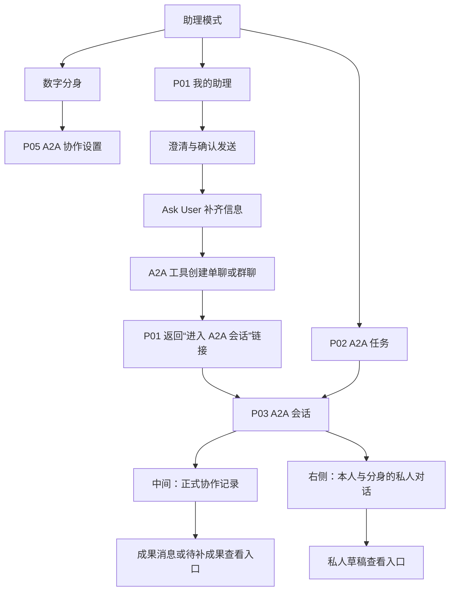
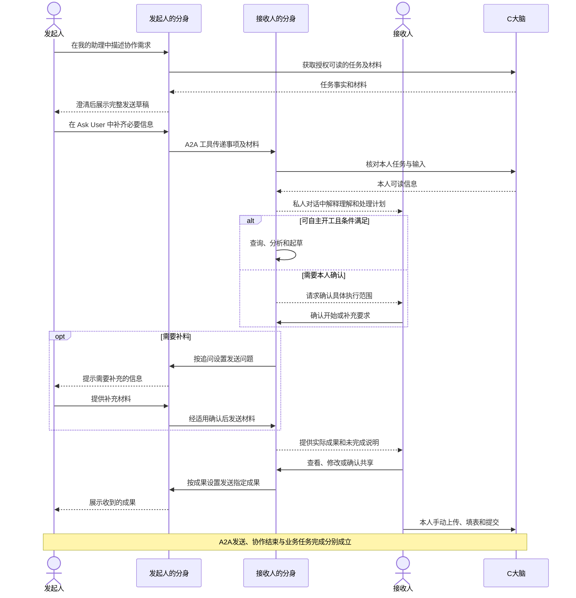
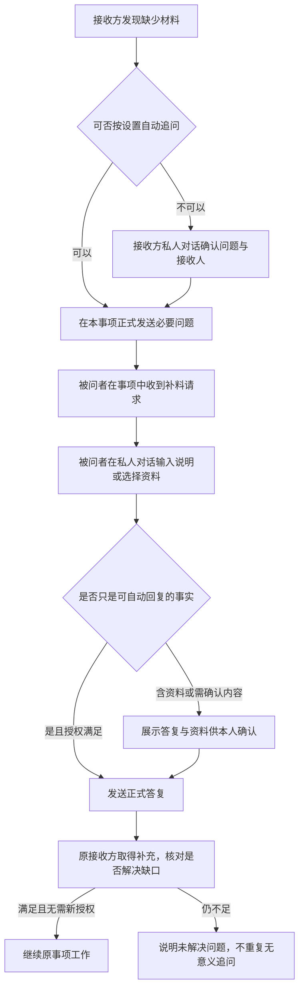

# A2A 通信与任务协作 PRD｜2026 年 10 月版

> V0.1 · 2026-09-24 · 完整产品评审稿
>
> 本文是十月 A2A 的统一阅读入口，按用户旅程、页面动线和交互结果组织。它覆盖从发起到接收、理解、执行、成果接手及结束的全流程，不约定技术实现。
>
> **已确认基线**：十月只做 A2A 通信：识别协作意图、Ask User 补齐必要信息、创建单聊/群聊、传递和查看消息及材料。自动开工、分身自主执行、自动追问、自动回复、成果生成和业务提交不在本期。后台、岗位智能体和系统智能暂不考虑。
>
> **本稿方案**：页面组织、按钮、状态及具体流程为供评审的产品方案，并非全部已获确认。标有 D01—D08 的节点尚不能最终定案，其余内容可用于开发评估和原型设计。含待定节点的完整链路须评审后再作为开发验收基线。原型现状不等于本文全部已经实现。

## 系统任务与 A2A 会话的边界

A2A 会话是独立的通信对象，不绑定 C 大脑任务。用户可以在 A2A 会话中要求分身查询某个系统任务，分身返回任务名称、负责人、状态、时间等只读事实，并标明查询时间和来源；查询结果只作为消息或上下文展示，不写入会话的关联任务字段。

A2A 不因为聊天内容自动创建任务，不因为消息内容自动认领任务，不因为会话结束自动完成任务。系统任务的修改、上传、填表和提交不在本期范围内。

## 1. 用户为什么需要它

发起人希望把一件事交代清楚，找到合适的人，拿到有依据的答复或成果；不需要反复转发散落材料、逐个询问进度。

接收人希望自己的分身知道发生了什么，读懂与本人相关的事项，能先做的工作先做；需要本人判断时，把问题和影响说清楚，成果形成后方便检查和使用。

**主旅程的交付终点**：分身提供成果及未解决事项，本人能检查、修改、下载并到原业务系统手动提交。A2A 中发送成果、结束协作，不代表 C 大脑的业务任务已经完成。

### 1.1 用语先统一

| 用语 | 本文含义 |
| --- | --- |
| 协作事项 | 一次需要传达或处理的事情，如“核对本周交付风险”；可以关联已有业务任务，也可以是普通询问 |
| A2A 会话 | 参与分身围绕一个事项形成的正式消息记录；本稿建议一事项一会话，不将与同一人的全部工作混在一个长群里 |
| 私人分身对话 | 某人在当前事项中与自己分身的交流；别人看不到原话、私人草稿和确认内容 |
| 业务任务 | C 大脑中实际存在的工作任务；不能由 A2A 聊天自动创建、改负责人或改状态 |
| 本人处理 | 包括回答问题、确认动作、检查成果；不只等于授权确认 |
| 分身成果 | 实际生成的文本、分析结论或文件；可为部分成果或草稿，不保证就是业务最终稿 |

### 1.2 版本范围

纳入本稿：自然语言发起、确定参与人、发送文字与资料、收取与理解事项；必要时查询系统任务作为参考、按配置执行/追问/回复、人工确认、成果查看与发送、协作结束、消息与事项可追溯。

不纳入：自动业务上传/填表/提交、自动变更业务任务、组织后台与岗位智能体、无人值守定时催办、长期目标盯守、组织看板、跨组织协作、无分身时自动转钉钉。普通的一次性“请帮我问进展”仍属于本稿通信场景，不等同于持续盯办。

多人协作列出完整候选旅程，但执行顺序、汇总和结束规则必须经 D06 确认，不能直接沿用旧原型的严格回合制。

## 功能总览

本章是开发入口。编号是本期功能点编号；后续章节补充交互、状态、来源和验收。本期只做 A2A 通信，不做分身自动执行。

### P01 我的助理

| 编号 | 功能点 | 用户能做什么 | 本期结果 |
| --- | --- | --- | --- |
| P01-01 | A2A 意图识别 | 描述通知、询问、任务协作或拉群需求 | 判断是否进入 A2A |
| P01-02 | 普通问题分流 | 询问知识、制度或自己的业务信息 | 走普通助理/知识库，不创建会话 |
| P01-03 | 调用 A2A 工具 | 触发创建单聊/群聊 | 生成待补信息 |
| P01-04 | Ask User 补齐信息 | 补齐创建 A2A 会话所必需的信息 | 信息完整后创建会话 |
| P01-05 | 创建单聊 | 确认单个对象和事项 | 创建单人 A2A 会话 |
| P01-06 | 创建群聊 | 确认多个成员和共同目标 | 创建多人 A2A 会话 |
| P01-07 | 创建结果反馈 | 查看创建结果 | 显示摘要和“进入 A2A 会话”链接 |
| P01-08 | 进入会话 | 点击链接 | 进入 P03 |

### P02 A2A 任务

| 编号 | 功能点 | 用户能做什么 | 本期结果 |
| --- | --- | --- | --- |
| P02-01 | 会话看板 | 查看本人参与的会话 | 按“待我处理/进行中”分组，历史通过归档入口查看 |
| P02-02 | 待我处理 | 查看需要补料或确认的会话 | 进入对应 P03 |
| P02-03 | 进行中 | 查看通信中的会话 | 显示最近记录摘要 |
| P02-04 | 已归档 | 查看已手动结束的历史会话 | 保留历史记录，不占主列表 |
| P02-05 | 会话卡 | 查看名称、类型、参与人、摘要、状态、更新时间 | 只用于进入会话，不是确认卡 |
| P02-06 | 搜索筛选 | 按名称、人员查找 | 返回匹配会话 |
| P02-07 | 提示点 | 进入待处理会话 | 完成本人的待处理动作后消除 |

### P03 A2A 会话

| 编号 | 功能点 | 用户能做什么 | 本期结果 |
| --- | --- | --- | --- |
| P03-01 | 正式协作记录 | 查看已发送消息、材料和事件 | 中间区域只读 |
| P03-02 | 会话信息 | 查看发起人、参与人、事项类型 | 顶部固定展示 |
| P03-03 | 我的分身 | 和自己的分身私聊 | 私人内容不进入正式记录 |
| P03-04 | Ask User | 补齐信息或确认通信动作 | 只在本人区域出现 |
| P03-05 | 主动补充消息 | 输入要发送的内容 | 形成通信消息 |
| P03-06 | 送达结果 | 查看已发送、已送达、失败 | 按接收人区分 |
| P03-07 | 结束会话 | 有权限用户结束会话 | 归档并保留历史 |
| P03-08 | 返回看板 | 返回 A2A 任务 | 回到 P02 |

### P03 右侧 Workspace

| 编号 | 功能点 | 用户能做什么 | 本期结果 |
| --- | --- | --- | --- |
| WS-01 | 视图切换 | 在“我的分身”和“Workspace”间切换 | 共用同一右侧区域 |
| WS-02 | 查看会话上下文 | 查看事项、成员、材料和记录 | 只展示当前会话可见内容 |
| WS-03 | 查看通信附件 | 打开会话文件 | 使用通用 Workspace |
| WS-04 | 返回我的分身 | 切回私人对话 | 状态保留 |
| WS-05 | 后续成果位置 | 预留成果查看位置 | 本期不自动生成成果 |

### 通信规则

| 编号 | 功能点 | 本期规则 |
| --- | --- | --- |
| COM-01 | 单人通信 | 两个分身围绕一个事项通信 |
| COM-02 | 多人通信 | 多个分身围绕一个事项通信，不强制严格顺序 |
| COM-03 | 信息同步 | 传递信息和材料，不默认要求回复 |
| COM-04 | 协作通信 | 明确要求回复、补料或共同讨论 |
| COM-05 | 消息去重 | 重复消息不重复创建会话 |
| COM-06 | 会话归档 | 单次事项结束后归档，历史可查询 |
| COM-07 | 普通消息分流 | 知识问答和系统通知不进入 A2A |

### 明确不做

| 编号 | 不做功能 | 处理方式 |
| --- | --- | --- |
| OUT-01 | 自动开工 | 后续版本 |
| OUT-02 | 分身自主执行 | 后续版本 |
| OUT-03 | 自动追问、自动进展回复 | 后续版本 |
| OUT-04 | 自动生成成果 | 后续版本 |
| OUT-05 | 自动上传、填表、业务提交 | 不由分身完成 |
| OUT-06 | 顶部独立行动卡 | 已删除，Ask User 只在 P03 私人区域出现 |
| OUT-07 | 常驻群和自动盯办 | 后续版本 |

### 本期开发交付链路

~~~text
P01 输入 A2A 需求
→ 模型识别 A2A
→ Ask User 补齐信息
→ 创建单聊/群聊
→ P01 显示“进入 A2A 会话”链接
→ 进入 P03
→ 查看正式记录
→ 在“我的分身”中发送和接收通信
→ 在 Workspace 查看会话材料
→ 从 P03 返回 P02
~~~

## 2. 从哪里进入，页面怎样连接

### 2.1 页面编号

**2026-10-06 交互定案：**P01 回复底部的“进入 A2A 会话”使用蓝色文字链接样式，无背景、边框、圆角及箭头；点击进入对应会话。无论来自助理链接还是看板，处于 A2A 看板或任何 A2A 会话时，侧栏“A2A 任务”保持选中。看板卡片点击直达会话，不弹摘要/确认中转窗。

A2A 会话中间只保留正式消息及真实消息附件，移除固定的“协作事项上下文与输出物”占位入口，以及“当前会话已挂起……”提示条。右侧“我的分身”保留实际 Ask User；Workspace 中查看文件时，用“我的分身”页签提示点表示有待本人处理事项，不强制切换视图。真实文件附件仍可按已有规则打开 Workspace。


| 页面 | 位置 | 用户在这里做什么 |
| --- | --- | --- |
| P01 我的助理 | 助理模式主入口 | 自然语言发起新事项；处理发起前的澄清和发送确认；进入已创建事项 |
| P02 A2A 任务 | 助理侧栏现有入口 | 查看本人参与的事项，区分需要本人处理、进行中和已结束 |
| P03 A2A 会话 | 从 P01 的“进入 A2A 会话”链接或 P02 进入 | 中间看正式协作记录，右侧与自己分身沟通、确认、补料、查看执行结果 |
| 右侧 Workspace | P03 A2A 会话右侧视图切换 | 与“我的分身”共用右侧区域；查看成果、下载、返回 A2A 会话；不新增独立 P04 页面 |
| P05 A2A 协作设置 | 后续版本 | 十月不实现自主开工、自动回复和自动成果发送配置 |



新事项在 P01 自然语言创建；模型识别为 A2A 后调用工具，必要信息通过 Ask User 补齐。本稿不新增独立 A2A 发送卡或“建群”表单。已有事项的后续消息在 P03 私人对话发起。用户在 P01 提到多个同名事项时，助理先让用户选择，不默默发到某个会话。

P02 点击卡片直接进入 P03，不显示摘要弹窗或中转确认。P01 不存在独立“结果卡”；P01 中 Ask User 完成后，模型通过工具创建事项，并在助理消息底部提供“进入 A2A 会话”链接。P03 提供“返回 A2A 任务”；返回保留看板筛选及滚动位置。通过提醒进入 P03 时，定位到当前需要处理的内容，不从长记录顶部重新找。

### 2.2 P03 页面结构

```text
助理侧栏             事项标题、参与人、返回入口
                     ┌──────────────────────┬──────────────────────┐
                     │ 正式协作记录         │ 与我的分身沟通       │
                     │ 已发出的消息         │ 收到事项后的解释     │
                     │ 已共享的材料和成果   │ 私人补充、草稿       │
                     │ 可核实的结束记录     │ 本人确认、执行结果   │
                     │ 无直接输入框         │ 私人输入框           │
                     └──────────────────────┴──────────────────────┘
```

任何人在右侧输入的原话都不会直接发给别人；分身整理后，按该动作的授权规则自动发送或请求确认。中间只展示正式发出的内容，区别显示“某人的分身”和平台事件，不伪装成人直接发言。

**与原型的差异**：十月只做通信，不实现自动开工、自动执行和成果生成。右侧 Workspace 仅保留会话相关文件/记录的查看规划。

## 3. 主用户旅程：请产品经理起草 PRD

### 3.1 场景与前提

角色：项目经理（发起人 A）、产品经理（接收人 B）及各自分身。双方具备可通信的个人分身。C 大脑中已有 PRD 编制任务和实际负责人，相关数据与材料在本人权限范围内可读取。

以下示例名称、日期与文件只用于解释；正式显示必须来自实际事项，不固定为示例。默认采用前三项自动、成果发送先确认。

### 3.2 两端完整旅程表

| 步骤 | A 在哪里做什么、看到什么 | B 在哪里做什么、看到什么 | 系统必须产生的结果与下一步 |
| --- | --- | --- | --- |
| J01 发起 | P01 输入“把 X 项目的需求材料发给产品经理，请他起草 PRD” | 尚无消息 | 识别对象、任务、材料和期望成果；有歧义进入 J02 |
| J02 澄清 | P01 看到候选任务/人员或缺少材料的问题，选择或补充 | 尚无消息 | 形成明确草稿，不提前通知 B、不生成双方正式会话 |
| J03 识别与补齐 | P01 通过 Ask User 补齐创建会话所需的信息 | 尚无消息 | 信息完整后创建单聊/群聊；本期不进入自动执行判断 |
| J04 发出与送达 | P01 显示实际发送结果和“查看协作”入口；P02 出现事项 | P02 出现本人收到的事项；按 D02 提醒 | 成功接收不等于 B 已同意、已阅读或已开始；A 可进入 P03 |
| J05 理解 | P03 中间保留已发内容，未收到 B 回复前不显示 B 私人处理细节 | P03 右侧看到“需要我做什么、已有材料、缺少什么、准备怎样做” | 只核对本人有权访问的信息；按配置与条件决定开工或请示 |
| J06 通信确认 | 不因 B 的私人确认而要求 A 代答 | B 在“我的分身”中确认接收、补充信息或回复内容 | 确认结果进入正式通信记录；不触发分身自主执行 |
| J07 补料 | 收到 B 实际发送的追问，在对应 P03 右侧提供材料，必要时确认发送 | 能做部分先做；不能完成的部分显示待补项 | 新材料进入同一事项；不可重复建一项，也不将未读材料说成已理解 |
| J08 后续执行占位 | 十月不实现成果生成 | P03 仅保留后续成果展示位置 | 不生成成果，不自动上传或提交；后续版本再定义 |
| J09 共享成果 | 共享成功后，P03 中间出现 B 的成果消息，可预览有权查看的文件 | 默认看发送确认卡，确认接收人与草稿性质后发送；或选择暂不发送 | 按成果配置执行，实际成功后才显示“已发送”；可继续修改并发送新稿 |
| J10 人工提交 | 用户要求时查询系统任务状态；不依据聊天自动改任务 | B 检查修改，去原系统手动上传、填写和提交 | 下载或打开原系统不算完成；本人说明和系统实际状态分别标注 |
| J11 结束协作 | A 认为本次要求已满足，可提出结束并确认 | B 看见协作结束记录，仍可查看历史成果 | 结束的是本次协作，不是 C 大脑任务；具体规则见 D07 |

### 3.3 两端交互时序



图中查询和协作发送只表达用户能感知的动作，不规定技术接口。B 向 A 的成果共享与 B 人工业务提交没有固定先后依赖；本稿示例按先共享再提交展开。

## 4. P01 发起：从一句话到正式发送

### 4.1 自然语言输入和澄清

用户可以描述普通通知、信息询问或工作请求，可附本人选定的资料。分身从输入和授权可读资料中整理信息，但必须让用户看到实际拟发送内容。

- 人员存在同名：候选显示姓名及实际部门/其他可识别信息，由本人选择；缺信息不编造。
- 请求只说“让产品经理做”：从实际任务确定负责人并在 Ask User 中补齐；多个候选先问。
- “写个 PPT”没有主题与用途：先问具体缺口，不直接写成完整执行请求。
- 用户要求查询系统任务且对象不唯一：先澄清查询对象；没有明确对象时不自动选择。
- 只有资料名称、无法读取：说明资料是否只是引用，不能把它显示成已附完整文件。
- 对方没有分身或没有通信资格：显示具体不可发送原因，保留草稿；不默默代发到钉钉。

澄清在对话内完成，可采用选项或文本补充；不做与用户表达无关的固定长问卷。完成澄清不代表发送授权。

### 4.2 A2A 需要澄清的信息

模型识别为 A2A 后，调用 Ask User 补齐必要信息。Ask User 的具体交互由产品通用能力负责，本文只定义业务上需要补齐的内容。

| 需要澄清的信息 | 什么时候需要 |
| --- | --- |
| 协作对象 | 用户没有明确要和谁通信，或存在同名/多个候选人时 |
| 协作方式 | 无法判断是单人通信还是多人通信时 |
| 事项内容 | 无法判断用户希望传达什么、询问什么或让对方做什么时 |
| 协作目标 | 需要对方回复或处理，但目标不明确时 |
| 必要材料 | 当前事项需要传递材料，但用户没有说明材料范围或材料缺失时 |
| 期望回复 | 用户要求对方回复，但没有说明希望回复什么内容时 |
| 群聊成员 | 用户要求多人协作，但成员不完整或存在歧义时 |
| 群聊基本规则 | 多人协作需要说明回复要求或收集方式，但用户没有说明时；未说明部分使用首期默认规则 |

Ask User 只补齐创建 A2A 会话所必需的信息。信息已经明确的内容不重复询问；不因“想得更完整”增加额外问题。

信息补齐后，创建对应 A2A 会话，并在 P01 回复中提供“进入 A2A 会话”入口。具体是单聊还是群聊、参与人和事项内容，必须与用户最终确认的信息一致。

十月不在 Ask User 中询问自动开工、自动执行、成果生成或业务提交规则，因为这些能力不在本期范围内。

### 4.3 发出后的落点

发送成功：在 P01 原位置显示“已发送给{实际接收人}”及“查看协作”。用户可继续聊其他事情，不强行跳转。点击入口进入对应 P03，P02 同时有记录。

送达尚未证实：显示“已发送，等待送达确认”；不能显示“对方已收到”。发送失败保持原草稿和原因，提供“重试发送/修改”。多人部分失败逐人展示，仅重试失败人员；本稿不固定重试次数或时间，通信服务具体承诺需另核对。

首次未有任何成功发送时不创建对方事项。已有部分发送成功则保留同一事项，后续重试补齐，不建立重复会话。

## 5. P02 找到事项：双方都知道从哪继续

### 5.1 看板方案

保留现有入口名“A2A 任务”，页面说明改为“查看协作事项、需要本人处理的内容和历史记录”。卡片管理的是协作事项，不等于 C 大脑业务任务。

建议三列：**待我处理 / 进行中 / 已结束**。将原型“待我确认”拓宽为“待我处理”，覆盖开工确认、补充信息和成果检查；将“已完成”改为“已结束”，避免混同业务完成。

| 列 | 进入依据 | 退出依据 |
| --- | --- | --- |
| 待我处理 | 当前用户存在明确未处理问题、需确认动作或成果检查事项 | 本人的待处理事项全部解决；剩余协作进入进行中，协作已结束则进入已结束 |
| 进行中 | 没有待本人的事项，但仍有发送/接收、分身处理、等待别人回复等工作 | 出现本人待处理；或满足明确结束条件 |
| 已结束 | 通知型实际完成送达，或协作型经结束流程确认 | 本稿不自动重开；新工作从历史内容发起新事项 |

分列优先级：有待本人处理先放待我处理，再判断是否已结束。已经结束后才到达的消息是否形成新的待处理请求见第 9 章，不静默重新启动工作。

### 5.2 卡片元素

| 元素 | 显示依据 | 点击/特殊规则 |
| --- | --- | --- |
| 类型 | 单人/多人 × 信息同步/需要处理 | 已确认发送内容；不由消息条数推测 |
| 标题 | 事项名称 | 点击整卡直达 P03 |
| 发起人和参与人 | 实际会话身份 | 头像来自账号，缺失用姓名首字或通用图标；不靠模型生成 |
| 我在此事项的身份 | 发起人/参与人 | 本人与实际发起人关系 |
| 摘要 | 对当前用户可见的最近有效进展或待处理原因 | 不能展示别人的私人确认或未共享成果 |
| 当前状态 | 第 10 章的协作事实 | 不把模型预计进展当实际进展 |
| 关联任务 | 实际业务任务名称，可无 | 不根据标题自动挂错任务 |
| 更新时间 | 最近正式消息或本人处理事件时间 | 单纯查看不改变排序 |
| 每列数量 | 当前筛选下的事项数 | 同一事项只计一次，不按消息条数统计 |

每列最近更新在前；支持名称/参与人搜索和“全部/我发起/我参与”筛选，组合条件同时生效。无任何事项显示“暂无协作事项，可在‘我的助理’中发起”；有条件无结果显示“没有符合条件的协作事项”。

**D02 提醒方案待确认**：建议需本人处理时点亮 A2A 入口及事项提示点；自动处理或普通新消息不逐条打扰。打开不清除待处理提示，实际处理后清除。成果到达属于本人需要检查，因此也可点亮。此方案与旧版“仅 Ask User 点红点”的口径不同，需一起更新，不混用。

## 6. P03 接收与执行：本人看到什么

### 6.1 接收方第一次进入

中间正式区显示实际收到的事项、发送者、发送时间、相关材料和业务关联。右侧分身用简短文字说明：

> “{发起人}请你处理{事项}。预期产出是{明确要求}。目前已取得{资料}，还缺{缺口}。我准备先做{可执行部分}。”

这是一种内容结构，不要求逐字套模板。没有明确产出要求时先澄清，不填“未记录”后强行开工。信息来源包括实际接收内容、本人可读 C 大脑记录和本人补充；分身的计划需与已执行结果区分。

分身只能看到文字而附件未读成功时，应当明确说“已收到附件引用，尚未取得内容”。补资料与执行状态保留在同一事项中。

### 6.2 四项配置如何落到交互

| 动作 | 配置允许自动且实际条件满足 | 配置要求本人确认/有固定边界 |
| --- | --- | --- |
| 自主开工 | 右侧说明本次实际开始的工作；不要求点按钮 | 右侧出现开工确认卡，说明范围、可做部分和缺口 |
| 补料追问 | 正式区出现实际发出的必要问题；右侧可查看本次动作 | 右侧给出问题、接收人及“确认发送/继续修改/暂不处理” |
| 进展回复 | 仅向适用对象发出已核实的进展 | 右侧给出拟回复内容，确认前不进入正式区 |
| 成果发送 | 条件全部成立时发出指定稿件，本人仍可查看 | 右侧展示文件、稿件性质及接收人，确认后发送 |

开工确认主按钮“确认开始”；次操作“调整要求”“暂不处理”。确认的是该次明确范围，不永久修改个人设置。资料补齐且目标未变时无需再次确认同一范围；任务目标或承诺变更须重新判断。

“暂不处理”不等于拒绝，事项仍待本人处理，不在正式记录发布“已拒绝”。如本人明确不承接，分身形成说明，按外发确认规则发送；发起方据此决定后续，不自动改 C 大脑负责人。

### 6.3 处理过程中

本人可继续在右侧说“先做框架”“补充这个要求”“暂停这项工作”。私人输入不自动广播。实际动作进展以发生的事实表达，如“已读取需求清单”“正在整理验收标准”；不显示无依据百分比、预计完成时间或固定成功动画。

需要补料时写清“缺什么、影响哪一部分、可以先做什么”。可继续做的部分不因另一部分待确认而全部停止。无法核实数据时说明限制，不能仅凭平台旧状态替本人编造实际进展。

本人能直接停止自己的这项分身工作，保留已完成内容；右侧提示“已停止本次处理”，可提出继续，恢复前重新核对资料、要求和授权。停止分身处理不会撤销已发消息，也不会暂停业务系统任务。其他参与人要求停止时，按其对本事项的权限及本人授权判断，不能执行无范围的“所有任务都停”。

本人新补充与正在执行目标冲突时，先保留当前成果，再解释差异并请本人选定要求，不悄悄覆盖。

### 6.4 发起人同时能看到什么

发起人只看到正式发送的回复、成果与可验证的通信状态。接收方的私人执行日志、本人设置、未共享草稿均不可见。

没有公开进展时显示“尚未收到回复”，不能推断“对方正在生成”“对方已拒绝”“本人还没批准”。十月不执行自动开工；接收方只在会话中查看、补充和发送通信内容。

## 7. 补料与回复如何来回走



任何参与人提供的新文件都要让其知道会发给谁。自动追问开关不意味着自动读取并外发被问者的私人资料。对一个问题重复“收到”不算问题已解决。

双方反复追问仍不明确时，说明当前分歧并请各自本人介入，不无限往返。是否设置固定次数或等待时限留 D08；本稿不写未经确认的分钟数。

## 8. 成果生成、发送和人工接手

### 8.1 本人成果卡

| 内容/操作 | 来源与规则 | 操作后的落点 |
| --- | --- | --- |
| 文件名、类型、大小 | 实际生成文件的内容与属性 | 不以假卡片代表生成成功 |
| “部分草稿/草稿” | 成果实际完整性和当前用途 | 缺关键输入不能标成定稿；本稿不自动评定业务验收通过 |
| 完成说明与待补项 | 实际执行和缺口 | 能区分已做与建议下一步 |
| “查看/预览” | 后续版本成果接入后适用 | 切换右侧 Workspace，关闭或切回“我的分身”后回到 A2A 会话原位置；十月不生成成果 |
| “下载” | 当前所选文件 | 下载失败保留原卡，下载不代表提交 |
| “继续修改” | 固定按钮 | 焦点回本事项私人输入框，用户说明修改要求；沿用原事项 |
| “发送给参与人” | 仅有明确共享需要及可发送对象时提供 | 按成果发送设置自动发送或先显示确认卡 |
| “查看业务任务” | 实际任务入口，有访问权限时 | 打开原系统任务；A2A 不自动填写任何内容 |

A2A 会话右侧提供“我的分身 / Workspace”两个视图。Workspace 与现有通用 Workspace 统一使用同一右侧区域；十月用于会话上下文和通信相关文件查看，不接入自动成果生成。查看文件后切回“我的分身”，私人对话状态保留。预览失败时保留可用下载入口，不能显示伪造内容。具体文件格式和大小范围待 D05，不能因原型支持四种静态预览就承诺全部生产文件。

### 8.2 修改与版本

再次生成保留前稿，最新稿标“最新生成”，旧稿标“历史稿件”；这表示生成次序，不等于业务正式版本。两份不同文件用文件名和生成时间区分，不只靠颜色。

已经发送的旧稿不被静默替换。发送新稿时说明“更新稿”，接收方能知道变化及它替代哪份内容。对旧稿的确认不能授权新稿；排队未发送的成果在发送前仍按当前有效配置与确认内容核对。

### 8.3 成果共享范围

只有本次协作明确需要的接收人，且有权查看，才可发送。群成员身份不自动证明所有人有成果访问权。自动发送只减少逐次确认，不解除权限和范围检查。

默认由本人确认发送：卡片列出接收人、说明和具体文件；“确认发送范围”“继续修改”“暂不处理”。暂不发送不删除本人草稿。发送成功才进入正式区并对实际接收人可见。

私人草稿生成即属于本人可查看成果；是否公开给参与人是另一动作。将大量成果正文粘进“进展回复”仍按成果发送处理，不能绕过配置。

### 8.4 人工提交

成果旁说明：“请检查成果，并在原业务系统手动上传、填写和提交。”不提供代提交按钮。

本人说“已经提交”时，私人记录写“你表示已提交”；如需告诉别人，按进展回复及承诺边界处理。查询取得 C 大脑实际记录后，才显示“C 大脑显示{状态}，查询于{时间}”。未接入可查询的状态就说明无法核实，不以用户点击下载或关闭窗口补状态。

## 9. 通知、多人协作和结束分支

### 9.1 纯信息同步

发起和发送确认流程相同；明确无需执行或回复时，接收方只取得信息，不自动建执行计划或要求确认开工。

全部接收人实际送达后，通知事项可归已结束，标“通知已送达”；不写“全员已读/全员同意”。部分未送达仍显示未送达人员，不能自动结束。

收到通知后自愿回复可以留在原事项记录中，不因此自动建立必须答复的协作链。若提出新的工作要求，分身提示从原背景发起新协作事项，确认后建立，保留来源关联。

### 9.2 多人协作候选旅程（D06）

建议首版采用明确分工、各自处理、发起人汇总。不是宣布取消历史回合方案，而是把选择摆到可评审的旅程上。

| 节点 | 发起方所见 | 每位参与人所见 |
| --- | --- | --- |
| 发送前 | 谁负责提供什么，汇总目标是什么 | 未发送前不可见 |
| 收到后 | 各对象是否实际送达 | 公共事项背景与明确分给自己的要求 |
| 分别处理 | 已公开回复/尚未回复，不看私人处理过程 | 各自按个人配置处理，不互相代为授权 |
| 某人待本人确认 | 其他人的独立工作继续；没有公开说明时只知道尚未回复 | 只有该人看自己的待确认内容 |
| 汇总 | 汇总已收到内容，列缺失、分歧和来源 | 能看本群有权共享的正式材料 |
| 结束 | 发起人检查汇总，确认结束或提出明确补充 | 收到正式结果与结束记录 |

在这个方案中，发起人不能把未回复当同意，不能自行改变别人的承诺。需要全员共识的事项，只收齐消息不等于共识成立。

参与人变更建议在发送前完成，发送后不直接加人查看历史。需要新增对象时发起新的关联事项，明确重新共享范围；是否支持会话内增减成员留 D06。

### 9.3 协作型如何结束（D07）

建议由发起人本人决定是否达到本次目标。在 P03 右侧说“这次可以结束”，分身展示结束摘要：本次收到什么、还缺什么、结束不改变业务任务状态。按钮“确认结束”“继续协作”。

分身可以建议结束，但不因“收齐回复”或“文件生成”直接关闭。存在未解决问题时，允许发起人选择明确结束未达成事项，必须说明未达成部分，不用“全部完成”掩盖。

如果还有别人的分身在实际处理，先明确这是提前结束请求，不假称已经停止对方全部工作。如何撤销已授权但在途的协作、参与方如何确认停止，是 D07 的开发阻断点；定案前不能实现一键强制全员停止。

结束后保留记录和成果访问，历史查阅不恢复执行。迟到回复显示为“结束后收到的回复”，本人可查看；若还要继续做，建议创建关联新事项，而非静默重开。此方案随 D07 一并评审。

## 10. 本功能的状态与可见范围

状态分为通信、本人处理、分身执行和业务任务四层；不能共用一个“完成”状态。

| 用户看到的表达 | 何时成立 | 谁能看到/消除条件 |
| --- | --- | --- |
| 已发送，等待送达确认 | 已提交发送但尚无接收证据 | 发送方；实际送达后更新 |
| 已送达 | 接收侧确已取得对应消息 | 双方；不代表附件已读懂 |
| 发送失败/部分未送达 | 具有对应失败结果 | 发送方按对象看到；重试成功更新，不重发成功对象 |
| 待我确认开工/发送 | 本人有未处理的明确动作请求 | 仅本人；确认、有效撤销或修改替代后解除 |
| 待我补充 | 当前问题需要本人提供信息 | 仅本人；补充后判断是否已解决 |
| 正在处理 | 本人分身实际开始执行 | 本人；发起方只看已正式发送的进展 |
| 等待补充材料 | 部分或全部执行缺少输入 | 本人；说明可先做部分，对外按回复规则发出 |
| 草稿已生成，待我检查 | 真实成果可用且未由本人处理 | 本人；查看不算检查通过，需明确反馈或标记已查看 |
| 已发送成果 | 具体稿件实际发送成功 | 发送方和实际接收人；不代表业务已提交 |
| 协作已结束 | 满足第 9 章相应结束条件 | 参与人；历史结果保留 |
| C 大脑显示的状态 | 真实业务记录及获取时间 | 本人有权查看；聊天不改写该状态 |

**D02 相关细化**：成果“标记已查看”只解除本人的阅读处理提示，不代表成果验收或提交；按钮建议“已查看”，不得使用“确认完成”。对外不自动发布这个私人操作。是否需要该按钮与提醒方案一起决定。

同一事项可以同时“部分工作正在处理”和“等待补料”。看板不强行丢掉其中之一：卡片摘要说明主要阻塞，P03 私人对话保留完整情况。

## 11. C 大脑对接要满足哪些用户需要

| 产品需要 | 使用节点 | 取得不了时 |
| --- | --- | --- |
| 找到实际人员及其可通信分身 | J02 发起、回复寻址 | 不能默认发给某个同名人；显示不可确定或无分身 |
| 确认已有任务、项目及负责人 | J02、J05 | 可继续普通通信，但无法以该任务归属为自动开工依据 |
| 获取任务要求、计划、状态 | J05、进展回复 | 标明未核实，不使用旧记忆冒充当前状态 |
| 读取输入材料与输出要求 | J05—J08 | 说明缺口；仅执行有充分依据的部分 |
| 理解本任务实际前后置关系 | 追问与交接对象判断 | 不只凭同名环节、标准模板关联不同项目 |
| 提供原业务任务入口 | 人工接手 | 有真实可用入口才展示跳转；无入口说明原系统中的任务名称供定位 |
| 查询人工提交后的业务状态 | J10 按需核实 | 本人说明与业务事实分开；不默认新建持续盯办 |

首个试点需要业务方提供可用的“项目—任务—负责人—输入材料—输出要求”样例及对应页面，逐项核对可读范围和更新时间。这是 D04 的业务依赖，不要求在本文写接口或数据库设计。

凭证不放进聊天或材料Ask User 补齐内容；身份权限沿用平台能力。本人确认不能使无权资料自动变成有权。

## 12. 关键异常旅程

| 触发 | 用户看到什么 | 可以做什么/后续落点 |
| --- | --- | --- |
| 对方无分身或不能接收 | P01 提示具体对象不可发送 | 修改接收人或保留草稿；不自动换其他渠道 |
| 无回复但无离线证据 | P03 显示尚未收到回复 | 本人可再次询问或决定结束；不声称对方离线/拒绝 |
| 消息重复到达 | 正式区可识别为同一事项，不重复启动 | 真正的新补充仍需处理；不能用防重复吞掉新要求 |
| 材料无权限、过期或不可读取 | 具体材料及原因、影响部分 | 请求有权方提供可共享资料；原事项继续保留 |
| C 大脑不可用 | 本次无法核实业务信息及时间 | 通信可继续；依赖核实的判断等待或明确降为草稿建议 |
| 新要求改变原目标 | 右侧说明变化和已做部分 | 本人确认新范围再继续，不用旧授权直接扩大 |
| 分身执行失败 | 实际已完成部分和失败点 | 重试当前工作、调整要求或由本人接手；不重复外发旧成果 |
| 发送成果失败 | 私人成果仍可查看，显示发送失败对象 | 重试仅发送该稿件给失败对象，不重新生成一份假装修复 |
| 私人对话中改错事项 | 发送前明确事项名与接收对象 | 用户可返回修改；不能因用户打开另一个会话自动改原确认目标 |
| 切换自动设置 | 显示保存值和后续生效说明 | 已有待确认事项不批量放行，已发送不撤回，已执行工作不追溯重做 |
| 客套回复往返 | 不生成无限“收到/谢谢” | 无实质问题则停止回应；沉默不是授权 |

## 13. 页面元素来源规则

为了让开发知道文案来自哪里，本稿按对象定义来源，而不把所有加载、关闭等通用交互再写一遍。

| 元素 | 来源类别 | 禁止混用 |
| --- | --- | --- |
| 页面、页签、按钮标题 | 本文固定文案 | 不让模型临时生成具有新权限含义的按钮 |
| 人名、部门、任务名、业务日期 | 实际身份及业务记录 | 不使用原型默认张三、李四或固定岗位补空值 |
| 消息正文 | 实际正式发送内容 | 不把私人输入自动视为已发送 |
| 分身理解、处理计划、汇总 | 基于已取得内容的生成说明 | 不把建议、预计、未核实事实写成真实状态 |
| 文件名、大小、版本与预览 | 实际成果和元信息 | 无文件时不造卡，旧稿不冒充新稿 |
| 送达、处理中、结束等状态 | 第 10 章业务事件 | 不因模型一句“我已完成”直接改业务状态 |
| 待处理提示和数量 | 本人实际未解决事项 | 不暴露别人私人确认、不按打开页面自动清空 |
| C 大脑状态 | 真实业务记录+获取时间 | 不用聊天回复、下载动作推导提交成功 |

## 14. 当前原型需要补什么

本轮仅交付文档；下面是后续原型和开发工作清单，不代表已修改。

| 编号 | 页面/环节 | 当前情况 | 本稿要求 |
| --- | --- | --- | --- |
| U01 | P01 发起 | 自然语言剧本存在 | 增加 A2A 意图识别、工具调用和 Ask User 补齐；删除独立Ask User 补齐内容，区分创建会话和送达 |
| U02 | P02 看板 | 进行中/待我确认/已完成，卡片先弹摘要 | 评审后改三列规则、直达会话及按本人待处理投影 |
| U03 | P03 接收 | 主要是固定回复和确认演示 | 增加理解摘要、材料缺口、执行计划与真实成果落点 |
| U04 | 协作设置 | 四项已保存，有静态行为预览 | 接入实际动作判断；默认规则不能只在文案里有效 |
| U05 | 补料 | 尚无完整双方流程 | 从提问到对方确认材料、同一事项续作的闭环 |
| U06 | 成果 | A2A 会话右侧新增 Workspace 视图；复用通用 Workspace，但成果文件与真实生成结果的接入规则仍需补齐 | 确定Workspace 视图、发送确认、新旧稿和手动提交提示；不新增独立成果页面 |
| U07 | 多人协作 | 旧版严格顺序与回合 | D06 选定后统一规则，不能混入各自处理方案 |
| U08 | 结束与停止 | 旧版完成选择较简化 | D07 明确谁结束、在途工作、迟到回复与业务状态独立 |
| U09 | C 大脑关联 | Mock 为主 | 按 D04 明确可取得的实际业务信息，不模拟成已接通 |
| U10 | 两端演示 | 个人分身账号切换已做，A2A 未全量隔离 | 增加明确发起/接收视角测试场景，不把个人配置切换当成真实双人协作已完成 |

## 15. 待讨论节点与开发影响

| 编号 | 问题和位置 | 本稿建议 | 状态/影响 |
| --- | --- | --- | --- |
| D01 | 首次启用个人自动策略；J05—J06 | 首次使用前清楚展示默认策略及修改入口；是否必须集中确认待定 | 阻断首次自动执行的正式放行方式 |
| D02 | 提醒、待我处理与成果已查看；P02、J04/J08 | 待处理包括确认、补料和成果检查；自动消息不逐条打扰 | 阻断提醒及看板列最终口径 |
| D03 | 新事项/必确认动作怎样授权；P01、P03 | 当前有效卡片按钮确认，不沿用跨会话“同意+编号” | 阻断正式确认交互，需与同事稿统一 |
| D04 | C 大脑实际可提供数据及本人工作范围；J02/J05 | 先选一个真实已存在任务，核对权限、负责人、材料、输出要求 | 阻断真实业务试点的完整执行；普通通信可独立评估 |
| D05 | 附件格式、数量、大小、可见范围、预览支持；P01/右侧 Workspace | 先覆盖试点真实输入与输出，尚不承诺全部格式 | 阻断文件功能的具体规格与验收 |
| D06 | 多人分别处理还是顺序回合、成员变化；第 9.2 节 | 先各自处理再汇总，不强制全部回合制 | 阻断多人执行及收口；单人旅程不依赖此选择 |
| D07 | 协作结束、在途取消、迟到回复；J11 | 发起人确认结束，保留实际未达成情况；新工作新建关联事项 | 阻断协作最终结束规则；不可伪造强制全员停止 |
| D08 | 等待多久、无效追问如何升级；第 7/12 章 | 不自动跳过或超时批准；连续无效沟通转本人 | 阻断自动超时和升级具体阈值，不能让开发随意填分钟数 |

以上待定内容只影响明确列出的节点。开发可评估完整流程、页面和业务对象，但不能把本稿的建议默认当已批准上线规则。下一轮建议先评审第 3 章两端旅程，再按实际卡点讨论 D01—D08。

## 16. 端到端验收场景

| 编号 | 从哪里开始 | 操作与期望结果 |
| --- | --- | --- |
| A01 | P01 新工作请求 | 澄清对象和任务，发送前对方无事项，确认后两端能进入同一事项 |
| A02 | P01 同名对象 | 选择前不发送，不默认给第一个匹配人 |
| A03 | P01 多人部分失败 | 成功人员不重发，只重试失败人员，仍为同一事项 |
| A04 | B 的 P03，默认配置 | 条件满足可开工；成果默认先给 B，不直接发给 A |
| A05 | B 关闭自主开工 | 可核对理解，必须本人确认才执行；自动追问不绕过开工限制 |
| A06 | 缺关键输入 | 明确缺口；可做部分先做，未得到的资料不被引用为已读 |
| A07 | A 补发资料 | 资料确认后进入原事项，B 继续原工作，不重复建任务 |
| A08 | B 生成人员可见草稿 | B 可预览和下载，A 在未共享前不能查看 |
| A09 | B 修改并发送新稿 | 旧稿与新稿可区分，旧授权不自动批准新稿 |
| A10 | 自动进展、手动成果 | 进展可按配置发出，成果正文和附件不能夹带绕过确认 |
| A11 | B 下载或打开 C 大脑 | 不自动标记业务已提交/完成 |
| A12 | B 说已提交但系统状态不同 | 区分本人说明和系统记录，显示获取时间，不自动改状态 |
| A13 | 本人停止当前处理 | 停止该事项工作并保留已有成果，不影响不相关事项 |
| A14 | 无效回复或重复投递 | 不重复开工，不无限回复客套话，真正新增内容仍会处理 |
| A15 | 一名多人参与者需确认 | 按 D06 定案验证其他人是否继续，不能同时沿用两套规则 |
| A16 | 结束及迟到回复 | 按 D07 定案验证；结束不改变 C 大脑任务状态 |
| A17 | 设置修改 | 已有待确认不自动放行，已发消息不撤回，后续动作使用有效规则 |
| A18 | 提醒定位 | 按 D02 定案，从入口进入具体待处理处；打开不等于确认或提交 |

涉及 Dxx 的场景须在定案后补最终期望并重新审阅。其他场景也必须使用实际结果验证，不能用固定 Mock 成功文本代替。

## 17. 文档关系与阅读顺序

1. **先读本文第 2—3 章**：页面在哪里、两端用户怎样走完整流程。
2. **再读第 4—9 章**：逐个交互节点检查“看到什么、做什么、结果去哪里”。
3. **最后看第 15 章**：在具体旅程基础上讨论未定边界。

[A2A 协作设置 PRD](./PRD-A2A协作设置-2026年10月版.md) 是个人规则子规范；[范围与核心流程草案](./A2A需求范围与核心流程草案-2026年10月版.md) 保留为讨论过程。本文与专项稿新增的评审建议均不覆盖用户明确决定。

旧单聊/群聊、派发催办、用户确认和通知文档仅作历史参考，不能不加区分地作为十月验收要求。验证依据见 [复盘阅读结论](./验证资料/2026-09-22-A2A复盘阅读结论.md)。同事《数字分身通用能力需求 V3.4》中的平台建设、自动化盯办与统一回合协议不自动纳入本版。

## 18. 2026 年 9 月 24 日开发讨论增量记录

本节记录《智能纪要：A to A 产品功能方案讨论 2026 年 9 月 24 日》中与十月 A2A 直接相关的结论。纪要同时包含讨论过程和候选方案；本节只记录目前可与本稿对齐的内容，存在冲突的部分列入 D09—D12，不能直接作为开发规则。

### 18.1 可纳入当前基线的结论

- A2A 与系统级任务通知分开。系统根据 C 大脑任务节点变化推送的消息属于系统消息；只有存在明确的人与人协作、任务传递、信息同步或回复意图时，才进入 A2A。
- 知识库或政策库能够直接回答的问题，不进入 A2A；没有明确协作意图的模糊查询，优先查询知识库，无法解决时再询问用户是否需要联系相关人员。
- A2A 群聊不是大范围广播通道。纯广播、超大范围触达应走系统消息；A2A 面向小范围、明确协作目标的参与人。
- 群聊和单聊首版都采用“一次事项一个会话”的方向，不做常驻周期群；会话结束后保留历史记录，主界面不继续占用展示空间。
- 助理模式作为统一入口和任务管理入口；用户从助理发起后进入对应的 A2A A2A 会话，复杂协作在A2A 会话中继续，助理主页同步状态。
- 单聊可以按“两个成员的特殊群聊”统一处理，首版不为单聊设计完全不同的业务外壳。
- A2A 任务入口位于助理模式，以看板形式查看本人参与的事项；点击待处理卡片直接进入对应A2A 会话。
- 群聊操作记录和结束后的历史需要保留，支持后续查询；归档后不出现在主列表中。
- 首版群聊采用并发回复方向，不强制按成员顺序发言；每轮等待和收集规则需要在建群时形成明确的事项上下文。

### 18.2 与当前主稿或用户已确认边界冲突的内容

| 纪要内容 | 当前处理 |
| --- | --- |
| “用户主动明确提出拉群，无需额外二次确认”与“建群需用户确认”同时出现 | 不直接定案。先走模型识别、工具调用和 Ask User 补齐流程；是否需要确认创建会话列入 D09 |
| 默认等待所有成员回复完成 | 不自动固化。与“超时未响应由群主判断”有关，具体等待条件、未回复展示和结束规则列入 D10 |
| 单聊默认 2—3 轮自动终止 | 不纳入当前主稿。自动终止会影响用户确认、补料和成果生成，列入 D11 |
| 群聊人数 20—50 人 | 作为候选产品约束记录，不作为已确认上线数值；需要结合真实试点和通知/协作分类确认 |
| 可配置定时催办/轮询规则 | 十月主范围暂不默认纳入；系统级通知和用户自行配置的自动化任务保持独立 |
| 助理仅展示状态、所有执行都在独立会话 | 方向基本一致，但“我的助理”仍承担自然语言识别 A2A、调用工具和 Ask User；不能把它做成纯只读首页 |
| “所有成员回复完成后自动汇总并推进下一轮” | 暂不作为自动规则。汇总可以是候选能力，但是否自动推进、由谁结束，列入 D06/D07 |
| 永久保留所有记录 | 仅记录为讨论方向；保留期限、删除/脱敏和历史权限尚未定义，不能在验收中承诺永久 |

### 18.3 新增待确认项

| 编号 | 问题 | 影响 |
| --- | --- | --- |
| D09 | 用户明确提出 A2A 后，工具创建单聊/群聊是否仍需要 Ask User 确认？哪些字段完整即可直接创建？ | 影响 J03、Ask User 组件和创建工具 |
| D10 | 并发群聊的收集条件是什么：所有人回复、达到截止时间、群主手动收口，还是三者组合？ | 影响群聊状态、未回复提示和汇总 |
| D11 | 单聊 2—3 轮是硬上限、建议上限还是仅防无意义循环的保护？达到上限后如何交给本人？ | 影响单聊继续、结束和异常流程 |
| D12 | 群聊人数上限是否十月固定，以及通知类大范围消息的具体系统消息入口 | 影响建群校验、空态和消息分类 |

### 18.4 对主用户旅程的补充

主旅程应改成：

```text
P01 我的助理输入自然语言
→ 模型判断是否为 A2A（否则走知识库/普通助理/系统消息）
→ 调用 A2A 工具
→ Ask User 补齐对象、目标、参与人、材料和协作规则
→ 按 D09 决定是否确认创建
→ 创建单聊或群聊
→ 进入 P03 A2A 会话
→ 分身理解、追问、执行和生成成果
→ 本人检查并手动提交业务结果
```

这条补充明确：A2A 的入口判定发生在“我的助理”，正式协作发生在独立A2A 会话；独立A2A 会话不是旧的顶部行动卡。
