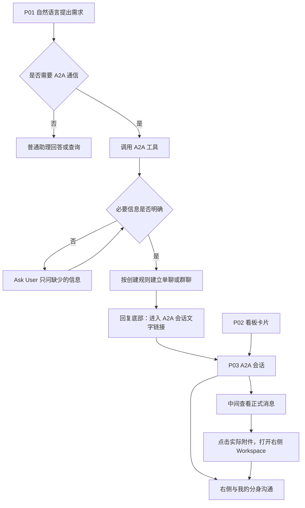

# A2A 通信与任务协作 PRD｜2026 年 10 月版

> V0.3 · 2026-10-06 · 模块化产品评审稿
>
> 本次把功能总览、功能描述和验收按同一编号对应。原先重复、冲突的执行旅程已移出当前正文。本文描述产品行为，不展开技术实现；待决策项明确标注，不能据此自行补规则。

## 1. 产品范围与阅读方式

十月聚焦 A2A 通信：识别通信需求、Ask User 补齐信息、创建单聊/群聊、交流消息与材料、查看记录和文件。A2A 会话独立存在，系统任务仅用于按需只读查询，不是创建字段、归属依据或会话绑定对象。

不包含自动开工、分身自主执行业务任务、自动生成业务成果、自动业务上传/填表/提交；后台、岗位智能体、系统智能、常驻周期群和持续盯办暂不纳入。私人协作设置的自主执行策略不进入本期主流程。分身通信回复、追问和人工确认的具体边界见 D01/D02，不能把“不自动开工”自行扩成一套未经讨论的发言协议。

**阅读对应示例：**总览中的 P01-04「Ask User 补齐信息」→正文同名 P01-04 小节→验收表 P01-04。P03 是整个 A2A 会话页面，WS 是其右侧 Workspace 子模块，COM 是跨页面通信规则；它们不是新的页面。

## 2. 功能总览

P02-06 搜索筛选、P02-07 提示点已退出本期范围；原型不新增会话搜索框、看板或导航红点。编号保留空缺，其他功能不改号。左侧现有“搜索功能”用于导航，不是会话搜索。

以下编号保持与已有总览一致。WS-05 原为“后续成果位置”，属于非本期占位，不再列为开发功能；不补占位卡、不增加空按钮。

### P01 我的助理

| 功能编号 | 功能名称及正文入口 | 用户目标 |
| --- | --- | --- |
| P01-01 | [A2A 意图识别](#p01-01) | 判断是否需要联系其他人 |
| P01-02 | [普通问题分流](#p01-02) | 继续普通问答或只读查询 |
| P01-03 | [调用 A2A 工具](#p01-03) | 进入创建会话流程 |
| P01-04 | [Ask User 补齐信息](#p01-04) | 只回答必要的澄清问题 |
| P01-05 | [创建单聊](#p01-05) | 与一个对象建立独立会话 |
| P01-06 | [创建群聊](#p01-06) | 与多个对象建立单次事项会话 |
| P01-07 | [创建结果反馈](#p01-07) | 知道会话是否创建成功 |
| P01-08 | [进入会话](#p01-08) | 从回复直接进入 P03 |

### P02 A2A 任务

| 功能编号 | 功能名称及正文入口 | 用户目标 |
| --- | --- | --- |
| P02-01 | [会话看板](#p02-01) | 查看本人参加的在办通信 |
| P02-02 | [待我处理](#p02-02) | 找到需要本人回答的会话 |
| P02-03 | [进行中](#p02-03) | 查看仍在沟通的会话 |
| P02-04 | [已归档](#p02-04) | 查阅手动归档的历史 |
| P02-05 | [会话卡](#p02-05) | 一点击进入对应会话 |

### P03 A2A 会话

| 功能编号 | 功能名称及正文入口 | 用户目标 |
| --- | --- | --- |
| P03-01 | [正式协作记录](#p03-01) | 查看已正式发送的内容 |
| P03-02 | [会话信息](#p03-02) | 识别当前在哪个会话 |
| P03-03 | [我的分身](#p03-03) | 在当前会话中私下沟通 |
| P03-04 | [Ask User](#p03-04) | 补充或决定当前通信事项 |
| P03-05 | [主动补充消息](#p03-05) | 告诉分身要传达什么 |
| P03-06 | [送达结果](#p03-06) | 知道通信是否成功 |
| P03-07 | [结束会话](#p03-07) | 明确结束本次通信 |
| P03-08 | [返回看板](#p03-08) | 回到 A2A 列表 |

### P03 右侧 Workspace

| 功能编号 | 功能名称及正文入口 | 用户目标 |
| --- | --- | --- |
| WS-01 | [视图切换](#ws-01) | 在私人对话与文件查看间切换 |
| WS-02 | [查看会话上下文](#ws-02) | 查看当前会话的通信资料 |
| WS-03 | [查看通信附件](#ws-03) | 预览和下载已共享文件 |
| WS-04 | [返回我的分身](#ws-04) | 看完文件后继续私人沟通 |

### 通信规则

| 功能编号 | 功能名称及正文入口 | 用户目标 |
| --- | --- | --- |
| COM-01 | [单人通信](#com-01) | 两位用户的分身沟通 |
| COM-02 | [多人通信](#com-02) | 多人围绕一次事项沟通 |
| COM-03 | [信息同步](#com-03) | 传递无需强制答复的信息 |
| COM-04 | [协作通信](#com-04) | 围绕明确问题交流 |
| COM-05 | [消息去重](#com-05) | 避免重复创建和重复消息 |
| COM-06 | [会话归档](#com-06) | 保持在办与历史分开 |
| COM-07 | [普通消息分流](#com-07) | 区分系统告知与人际通信 |

## 3. 页面关系与通信旅程

| 页面 | 入口 | 职责 |
| --- | --- | --- |
| P01 我的助理 | 助理默认入口 | 识别需求、Ask User 补齐、创建后提供文字链接 |
| P02 A2A 任务 | 助理侧栏 | 会话看板、待我处理分列、历史查看 |
| P03 A2A 会话 | P01 链接或 P02 卡片直达 | 中间正式记录，右侧我的分身/Workspace 切换 |

| 步骤 | 发起人 | 接收人 | 对应功能 |
| --- | --- | --- | --- |
| 表达与澄清 | 我的助理中说明与谁沟通、沟通什么，回答缺失信息 | 创建前无会话 | P01-01—P01-04 |
| 创建 | 获得结果与文字链接，点击进入 | 能从 A2A 任务找到会话 | P01-05—P01-08、P02-01 |
| 沟通 | 在正式区查看回复，在私人区说明下一条要发什么 | 在自己的私人区表达答复，按适用规则发送 | P03-01—P03-06 |
| 查资料 | 点击实际消息附件，在 Workspace 查看或下载 | 同样只访问有权看到的材料 | WS-01—WS-04 |
| 归档与恢复 | 群主在会话顶部“···”菜单归档或恢复 | 归档时主列表隐藏且只读，恢复后继续通信 | P03-07、P02-04、COM-06 |

上述旅程不包含自主起草、成果生成或业务任务完成。完成信息澄清与是否需要创建前确认是两件事，创建确认见 D01。

## 4. P01 我的助理功能描述

### P01-01 A2A 意图识别

**用户目标：**用自然语言表达沟通诉求，明确需要联系别人时进入 A2A；只是查信息时不被自动拉进会话。

**一期建议边界：要求明确的联系意图，不要求出现“A2A”术语或固定口令。** “帮我问王五”“通知李四”“拉陈工和刘工一起讨论”都可以表达联系意图。是否需要创建前再次确认属于 D01，不与意图识别混为一谈。

| 用户表达 | 产品判断 | 用户体验 |
| --- | --- | --- |
| “帮我问王五，本周供应商交付有什么风险” | 明确联系别人，对象和问题已知 | 进入 A2A 工具流程，不重复问要不要联系、联系谁、问什么 |
| “帮我问一下本周供应商交付风险” | 联系意图明确，但对象缺失 | Ask User 只问联系谁，不自行选一个人 |
| “拉陈工和刘工讨论一下评审意见” | 明确多人通信 | 复用已有成员和主题，只补真正缺少的信息 |
| “王五负责的项目现在怎么样” | 查询信息，没有明确让分身联系王五 | 走查询；不能因为出现人名就创建 A2A |
| “本周供应商交付风险找谁确认” | 可能在问负责人，也可能想联系对方 | Ask User 问“先查询信息，还是联系同事确认？” |
| “这事最好找王五聊聊” | 表达建议，是否委托分身联系不清 | 只澄清是否需要代为联系，不直接发送 |
| “先别通知李四”“帮我写一段发给李四的话” | 否定发送或只要求起草 | 不创建或发送 A2A；起草完成不算获得发送意图 |
| “客户说‘通知李四’是什么意思” | 引用/解释内容，没有对当前分身发出联系要求 | 回答问题，不根据引号里的动词触发 |
| 在澄清“联系谁”之后回答“王五” | 当前未结束的澄清上下文补充 | 接续原请求，不再要求完整复述；脱离该上下文只输入人名不触发 |

**识别与信息完整度分别判断。** 联系意图已明确但对象不明，进入补齐流程；信息齐全却没有联系意图，也不能直接联系别人。普通查询没有答案时，可以询问是否希望联系人员，不能直接转发。

**识别错误时的恢复：**用户选择“只查询”或表达“不是要联系别人”，留在普通助理，不创建会话；创建前取消则停止本次请求。用户纠正对象或目的时使用新信息，旧澄清不能继续触发创建。已经发送后不能声称通过取消就撤回。

**给研发与模型验证的要求：**不要求首期理解所有隐含意图，但明确联系表达应稳定进入 A2A，否定/引用/纯查询不应触发，模糊表达能够通过一次简短澄清让用户选方向。不能只依据“人名+确认/评审”等关键词判定。上述表格作为首批评审样例，测试时加入同义表达、多轮补充、否定和改口；记录实际判断、是否误建会话及额外追问次数。真实模型能力需要联调测得，不以 Demo 关键词匹配声称识别达标，也暂不虚设准确率承诺。

### P01-02 普通问题分流

**用户目标：**继续普通问答或只读查询。

知识、制度、自身业务信息查询由普通助理处理。查询系统任务只是取得参考信息，不生成绑定关系；若用户进一步要求联系别人，再进入 A2A。

### P01-03 调用 A2A 工具

**用户目标：**进入创建会话流程。

识别通信需求后调用 A2A 工具，将对话中已有的人员、事项和要求带入。只有信息缺失或有歧义时调用 Ask User；信息完整不重复盘问。此功能只描述调用后的产品行为，不规定接口。

### P01-04 Ask User 补齐信息

**用户目标：**只回答必要的澄清问题。

需要明确：①与谁沟通（单聊对象或群成员）；②说什么、希望获得什么回复；③必要材料（事项确实需要时）；④群聊沟通要求（用户有截止时间或收集要求时）。单聊/群聊可由明确人数判断，不再单独重复问；事项名称由已有内容归纳，不要求用户额外填写。Ask User 沿用通用工具交互：触发后在当前对话底部输入区融合展示问题面板，临时替换普通输入框，不在消息流新增可操作卡片。连续问题在同一面板内切换；完成或取消后恢复普通输入框及其未发送内容。本文只定义业务澄清内容，不重设通用控件。信息已明确不再问；群聊默认收集规则见 D02，未定案不强制追问用户代替产品决策。

### P01-05 创建单聊

**用户目标：**与一个对象建立独立会话。

通信对象和事项明确后，建立仅发起人和该对象参加的 A2A 会话。用户明确要求创建是否仍需二次确认见 D01，不预设独立发送卡。对象没有可用分身时说明无法创建并保留输入，不自动改走钉钉。

### P01-06 创建群聊

**用户目标：**与多个对象建立单次事项会话。

成员和沟通目标明确后创建群聊。采用一次事项一个会话，不建立周期常驻群，不自动关联 C 大脑任务。创建确认见 D01，人数上限见 D03，不能将“20—50人”范围直接作为一个校验值。

### P01-07 创建结果反馈

**用户目标：**知道会话是否创建成功。

创建成功后，在当前助理回复说明会话名称和参与人，底部给出“进入 A2A 会话”蓝色文字入口，无背景、边框、圆角和箭头。创建失败保留原信息并说明失败，不出现无效会话链接。结果描述可提示“可进入 A2A 会话继续沟通”。

### P01-08 进入会话

**用户目标：**从回复直接进入 P03。

点击回复底部文字入口，进入它所对应的 A2A 会话，不新建重复会话、不弹摘要窗；侧栏从“我的助理”切换为“A2A 任务”选中。

## 5. P02 A2A 任务功能描述

### P02-01 会话看板

**用户目标：**查看本人参加的在办通信。

主看板仅展示“待我处理”和“进行中”两列，顶部“已归档”入口切换到历史列表；不再有“已完成”列。同一会话按当前用户是否有未处理 Ask User/补充请求归入对应列，归档会话从所有成员主看板隐藏。

### P02-02 待我处理

**用户目标：**找到需要本人回答的会话。

当前用户存在未处理的 Ask User 或明确待本人补充的信息时进入该组。查看会话不算处理，回答或有效取消该请求后更新；没有待本人处理且未归档时回进行中。别人待确认不使本人卡片进入此组。

### P02-03 进行中

**用户目标：**查看仍在沟通的会话。

未归档且没有本人待处理事项的会话进入此组，包括等待对方答复。显示最近可见正式消息摘要；仅表示通信仍开放，不表示分身正在执行任务。

### P02-04 已归档

**用户目标：**查阅手动归档的历史。

点击看板顶部“已归档”查看历史，会话卡仍直接打开对应 A2A 会话。历史只读，可查看记录和有权访问的附件；不以一周无消息自动归档或删除。群主可在原会话恢复，无需新建关联会话。历史保留期限沿用公司要求，暂不承诺永久。

### P02-05 会话卡

**用户目标：**一点击进入对应会话。

卡片是看板中的摘要入口，不是确认卡。类型标签仅显示“单人”或“群聊”，不再组合显示单人协作、多人通知等四种类型。卡片展示会话名称、参与人姓名、最近正式摘要、当前通信状态和更新时间；参与人只显示姓名，不追加“的数字分身”。底部固定显示“发起人：{姓名}”，取实际会话发起人，不跟随轮到谁回复而变化。名称与成员来自实际会话，摘要不含他人私人内容，时间来自实际通信事件。点击整卡直达 P03，删除中转摘要弹窗。

## 6. P03 A2A 会话功能描述

### P03-01 正式协作记录

**用户目标：**查看已正式发送的内容。

中间区域按时间展示正式分身消息、发送者及实际消息附件，不提供真人直接输入框。删除固定“协作事项上下文与输出物”占位卡和“当前会话已挂起……”提示条。实际消息含文件时仍可显示具体附件入口。

### P03-02 会话信息

**用户目标：**识别当前在哪个会话。

顶部显示实际会话名称、发起人、成员及“单人/群聊”类型标签；不展示关联任务。无论从助理链接、看板或其他入口进入，侧栏 A2A 任务均保持选中；切回我的助理才改变选中项。

### P03-03 我的分身

**用户目标：**在当前会话中私下沟通。

右侧默认“我的分身”，用于本人向分身说明想法和通信要求。同一人的不同会话上下文分开；私人输入不直接成为群消息。要向群里回复时需要明确表达发送意图；是否还需确认见 D01。

### P03-04 Ask User

**用户目标：**补充或决定当前通信事项。

会话内有歧义或需要本人决定时，在右侧“我的分身”的底部输入区调用 Ask User，以同一问题面板替换该区域输入框；不把选项放在正式记录或私人消息流中。只问：要回复什么、回复给谁、材料范围等实际缺失内容。P01 创建前也可使用 Ask User，不能写成“只允许 P03”。工具交互沿用通用能力；哪些发送必须确认见 D01。

### P03-05 主动补充消息

**用户目标：**告诉分身要传达什么。

本人在右侧明确要求回复或补充某段内容，可带可共享的材料。发送前若含歧义，按 P03-04 澄清；需要确认的情况由 D01 规定。成功发送后进入中间正式记录；失败保留拟发内容。十月不因接收消息而自主执行业务任务。

### P03-06 送达结果

**用户目标：**知道通信是否成功。

区分发送中、已发送待送达确认、已送达和发送失败。多人通信按接收对象说明实际结果，部分失败不得说全员收到；重试只处理失败对象。送达不表示已读、同意或业务完成。

### P03-07 结束会话

**用户目标：**明确结束本次通信。

仅会话发起人（群主）可在 A2A 会话顶部右侧、参与人头像旁的“···”菜单操作。未归档时显示“归档会话”，已归档时显示“恢复会话”；其他成员不显示管理菜单。点击归档后所有成员主看板隐藏该会话，当前页面显示“已归档 · 只读”，输入与 Ask User 操作不可用，记录和附件保留。归档不清除尚未处理的请求，不修改 C 大脑任务。群主恢复后允许继续通信：本人有待处理请求的回“待我处理”，其他人回“进行中”，不自动提交旧确认或重新发送消息。

### P03-08 返回看板

**用户目标：**回到 A2A 列表。

会话标题左侧提供左箭头返回按钮，悬停提示“返回 A2A 任务”，不再单独显示顶部文字链接；点击回到 P02；保留原在办/归档范围和列表位置。返回不是结束或归档。

## 7. P03 右侧 Workspace功能描述

### WS-01 视图切换

**用户目标：**在私人对话与文件查看间切换。

P03 右侧顶部提供“我的分身 / Workspace”，两者共用空间，不再增加独立 P04 页面。默认我的分身；点击真实附件可切到 Workspace。切换不发送消息、不确认请求，不丢私人输入与已有标签。

### WS-02 查看会话上下文

**用户目标：**查看当前会话的通信资料。

复用现有 Workspace 展示当前会话本人可见的背景、资料和正式记录。不得带入其他会话文件，不显示关联系统任务字段；只读任务查询可作为普通消息参考。不强制在正式区放统一上下文卡。

### WS-03 查看通信附件

**用户目标：**预览和下载已共享文件。

点击正式消息内实际文件入口，在右侧通用 Workspace 打开对应文件；展示实际文件名，复用已有预览、标签和下载交互。同一文件重复打开复用标签。无访问权限说明不可读；预览不支持但可下载时提供下载。格式、大小及权限范围见 D05。

### WS-04 返回我的分身

**用户目标：**看完文件后继续私人沟通。

切回我的分身后恢复同一会话的私人消息、输入和阅读位置；保留 Workspace 已打开标签，便于再次查看。待处理提示仍按真实请求存在。

## 8. 通信规则功能描述

### COM-01 单人通信

**用户目标：**两位用户的分身沟通。

单聊作为两个成员的会话，发起人为群主；沿用正式记录、私人对话和 Workspace 规则，不因只有两人采用另一套页面。是否采用轮次限制见 D04。

### COM-02 多人通信

**用户目标：**多人围绕一次事项沟通。

首期方向为并发回复，不强制按名单发言。具体收集截止、未回复处理、汇总及下一轮推进见 D02，不能沿用旧版强制顺序或自动跳过。群聊最大人数见 D03。

### COM-03 信息同步

**用户目标：**传递无需强制答复的信息。

用户希望告知信息时，不默认要求收悉或逐人回复。明确的人际信息同步可走 A2A；纯系统广播和大范围通知走系统消息。通知送达不自动归档；归档规则统一见 COM-06。

### COM-04 协作通信

**用户目标：**围绕明确问题交流。

用户希望获得答复、补充资料或讨论时，在同一会话中保留上下文。回复、再次追问和资料发送范围按 D01/D02 定案；通信完成度不依赖业务任务状态，不自动开展业务执行。

### COM-05 消息去重

**用户目标：**避免重复创建和重复消息。

同一创建请求或同一消息重试不重复建会话、重复展示正式消息；新内容即使文字相似也不能随意吞掉。礼貌确认不触发无限相互回应，轮次保护见 D04。

### COM-06 会话归档

**用户目标：**保持在办与历史分开。

会话归档和恢复由发起人/群主手动操作，入口与权限见 P03-07；双方列表按同一归档事实更新。归档前已接受的消息保留；归档后提交的新发送应失败并提示“会话已归档，请群主恢复后再发送”，不能自动恢复或伪报成功。只有群主恢复后才继续通信；归档不是业务完成，模型不能根据内容、回复收齐或等待时长自动归档。

### COM-07 普通消息分流

**用户目标：**区分系统告知与人际通信。

系统因业务节点变化产生的通知不自动创建 A2A；查询政策或系统任务先走相应只读能力。有明确联系人员需求时才进入 P01-01。

## 9. 数据与状态口径

- 人员、会话名称、参与人来自实际会话；正式消息来自实际发送内容；文件名与大小来自实际附件。没有数据时不填演示事实。
- 私人对话仅本人可见，不将未发送的输入或 Ask User 原文自动公开给参与人。
- 已发送不等于已送达，已送达不等于已读或同意。只有实际事件才能更新状态。
- “待我处理”来自本人尚未处理的请求；“进行中”仅表示通信未归档；“已归档”来自明确归档操作，不由模型判断业务完成。
- 系统任务查询结果可以作为消息参考，标明来源和获取时间；不增加会话关联任务、任务认领、自动完成等功能。
- 加载、保存失败、通用错误样式等沿用公司产品规范，不在本文重复设计。

## 10. 待决策及受影响功能

| 编号 | 需要确定的规则 | 影响功能 |
| --- | --- | --- |
| D01 | 用户明确要求创建后是否需二次确认；会话中哪些发言、追问、资料发送可直接进行，哪些须 Ask User | P01-05、P01-06、P03-03—P03-05、COM-04 |
| D02 | 多人回复收集条件、截止时间缺省规则、是否自动汇总及下一轮如何推进 | P01-04、COM-02、COM-04 |
| D03 | 群聊精确人数上限；哪些大范围信息转系统通道 | P01-06、COM-02、COM-03 |
| D04 | 单聊/群聊的无意义循环保护；轮次上限及达到上限后的处理 | COM-01、COM-02、COM-05 |
| D05 | 通信附件的支持格式、大小、数量及访问范围 | WS-03、P03-05 |
| D06（已定案） | 两列主看板；顶部已归档入口；仅群主在会话“···”归档/恢复；归档只读，恢复按本人待处理状态分列。历史保存按公司要求另行落地，不影响此交互定案 | P02-01、P02-04、P03-07、COM-06 |

已确认的简化交互（文字链接、侧栏高亮、卡片直达、删除中间占位卡和挂起条）不因上述问题悬而不定。待定部分只能作为评审输入，定案后须同步更新对应功能和验收。

## 11. 功能验收对照

每一行对应总览和正文中的同一功能。涉及 D01—D06 的执行细则需确认后补最终验收，不让开发自行猜测。

| 功能编号 | 功能名称 | 验收结果 |
| --- | --- | --- |
| P01-01 | A2A 意图识别 | 明确的联系请求进入创建流程，普通提问不误建群。 |
| P01-02 | 普通问题分流 | 查询一个系统任务不会创建 A2A 会话或关联任务字段。 |
| P01-03 | 调用 A2A 工具 | 已提供的信息保留，缺失信息进入 P01-04。 |
| P01-04 | Ask User 补齐信息 | 只追问缺失的业务信息；不询问系统任务关联和自动开工。 |
| P01-05 | 创建单聊 | 成功后双方可进入同一会话；失败不显示创建成功。 |
| P01-06 | 创建群聊 | 实际成员与已明确对象一致，失败不会创建重复群。 |
| P01-07 | 创建结果反馈 | 仅成功创建或定位到已有会话时提供对应链接。 |
| P01-08 | 进入会话 | 打开正确会话，左侧 A2A 任务保持高亮。 |
| P02-01 | 会话看板 | 同一会话在主看板只出现一次，归档历史不混进在办列表。 |
| P02-02 | 待我处理 | 打开会话不自动清除真实待处理状态。 |
| P02-03 | 进行中 | 等待对方回复不会显示为待本人确认或业务已完成。 |
| P02-04 | 已归档 | 归档历史可找到；未归档的较早会话不因日期被丢弃。 |
| P02-05 | 会话卡 | 点击卡片一次即进入会话，侧栏 A2A 任务仍选中。 |
| P03-01 | 正式协作记录 | 无附件会话不出现通用输出物卡；私人草稿不进入正式记录。 |
| P03-02 | 会话信息 | 不同入口进入相同会话，标题、成员和导航状态一致。 |
| P03-03 | 我的分身 | 私人询问和未发送草稿仅本人可见，不自动广播。 |
| P03-04 | Ask User | 问题出现在正确用户、正确会话的底部输入区；完成或取消恢复输入框，补齐信息不代表自动开工。 |
| P03-05 | 主动补充消息 | 发送到当前明确的目标会话，失败不声称已发送。 |
| P03-06 | 送达结果 | 正式状态与实际通信结果一致，重试不重复发送给成功对象。 |
| P03-07 | 结束会话 | 模型总结、无回复或超过一周均不自动结束会话。 |
| P03-08 | 返回看板 | 返回后仍选中 A2A 任务，会话状态不因离开改变。 |
| WS-01 | 视图切换 | 两个视图互斥展示，切换不丢输入和文件选择。 |
| WS-02 | 查看会话上下文 | 当前会话无资料时显示空态，不出现不可点击的假文件。 |
| WS-03 | 查看通信附件 | 点击具体附件打开具体内容，而非占位目录或虚构成果。 |
| WS-04 | 返回我的分身 | 往返切换后可接着写原输入，不重置会话。 |
| COM-01 | 单人通信 | 单聊具备与群聊一致的基本通信入口。 |
| COM-02 | 多人通信 | 成员可分别回复，不把模型生成的汇总视为全员一致意见。 |
| COM-03 | 信息同步 | 通知不会生成虚假的全员同意或自动业务任务。 |
| COM-04 | 协作通信 | 补充进入原会话，不因一次追问另建群或自动开工。 |
| COM-05 | 消息去重 | 重试不制造重复群或重复正式消息。 |
| COM-06 | 会话归档 | 各成员看到同一归档事实，不各自猜测任务是否完成。 |
| COM-07 | 普通消息分流 | 普通系统通知和知识查询不挤入 A2A 看板。 |

## 12. 原型现状与关联文档

本稿为产品要求，不把已实现与待实现混在同一结论中：文字链接样式、两种入口的侧栏高亮、看板直达、删除中间占位卡和挂起条已完成；Workspace 当前仍存在占位实现，WS-02/WS-03 所要求的真实文件查看需要后续完善。看板归档、Ask User 创建流程、多人通信细则不能因文档中已有描述就视为实现完成。

- [A2A 协作设置预研稿](./PRD-A2A协作设置-2026年10月版.md)：后续执行策略，不是十月通信开发范围。
- [验证阅读结论](./验证资料/2026-09-22-A2A复盘阅读结论.md)：实测依据与验证缺口。
- [本次重排前主稿](./历史版本/A2A主稿-20261006重排前.md)：仅供追溯，不作为当前开发基线。

本版直接更新原主文档地址。总览、功能正文、验收使用同一套编号；今后新增或调整功能时三处同步更新。

## 13. P01-01 / P01-04 演示剧本：先澄清意图，再补齐对象

**目的：**展示 Ask User 在沟通信息不明确时如何补齐，不是新的发送表单。仅为前端固定剧本，真实模型与 Ask User 工具调用仍需正式接入；本演示使用输入区融合问题面板，复用统一容器；消息流仅保留说明及回答记录。

### 剧本 A：用户没有明确委托联系

| 步骤 | 用户/分身表现 | 系统行为与验收 |
| --- | --- | --- |
| 1 | 用户在我的助理输入“本周供应商交付风险找谁确认” | 尚未创建会话、没有向任何人发消息 |
| 2 | 分身通过 Ask User 问“你希望先查信息，还是联系同事确认？” | 展示“先查询信息，不联系别人 / 联系同事的分身确认”两个方向 |
| 3A | 用户选择先查询 | 退出 A2A 创建流程；Demo 说明未接业务查询，不编造查询结论 |
| 3B | 用户选择联系同事 | 联系意图已明确，继续补对象 |
| 4 | Ask User 问“你想向哪位同事确认本周供应商交付风险？”；用户点击王五选项 | 只补对象，不重复问主题、目标、期限或系统任务 |
| 5 | 选择对象完成回答 | Demo 创建与王五的单聊，并传递已明确的问题；这不是对生产 D01 二次确认规则的定案 |
| 6 | 助理回复“已创建与王五的单聊……”并提供蓝色“进入 A2A 会话”文字 | 点击直达该会话；左侧 A2A 任务高亮 |

### 剧本 B：联系意图已经明确

输入“帮我问一下供应商本周交付风险”。直接走上表第 4 步，只补联系对象。不能再次问“你想查询还是联系别人”。

### 取消与补充说明

- 两个 Ask User 步骤均可取消；取消后不创建会话、不发消息。
- Demo 完成回答后原问题不再可重复提交，避免重复创建。
- 单聊模拟通信沿用现有 A2A 演示；本次不新增自主任务执行。
- 固定剧本当前覆盖以上两种输入，不能据此声称前文所有识别样例均已实现。真实模型按 P01-01 的产品边界验收。

### 2026-10-07 原型同步

已实现两列主看板、已归档入口、群主顶部菜单、归档只读和恢复分列。归档字段与旧消息/业务完成状态独立；待确认请求归档期间暂停展示，恢复后继续处理。本原型以当前演示视角的发起人/参与人判断菜单权限，不表示已完成真实身份认证和多用户服务端接入。当前演示会话仍为内存数据，刷新恢复种子数据；正式产品需保存归档事实与历史记录。

### 2026-10-07 显示精简

返回入口改左箭头按钮；会话卡底部固定“发起人：姓名”；参与人仅显示姓名；卡片与会话页的类型标签统一为“单人/群聊”。这次调整展示层，不擅自取消信息同步与协作通信的行为区分。

### 2026-10-07 P02 提醒方式定案

看板以“待我处理”分列及数量表示需要本人处理的会话，不单独开发 P02 提示点，也不新增侧栏 A2A 任务汇总红点。P03“我的分身”页签现有的待回答提示保留，用于 Workspace 与私人对话之间的定位。
