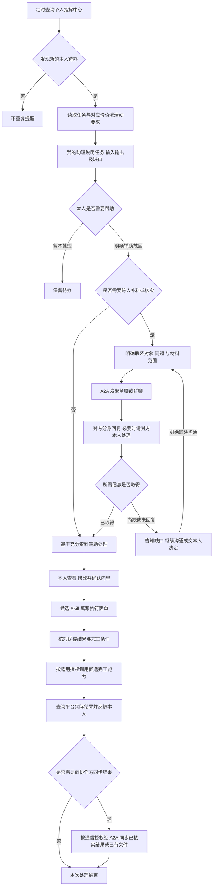
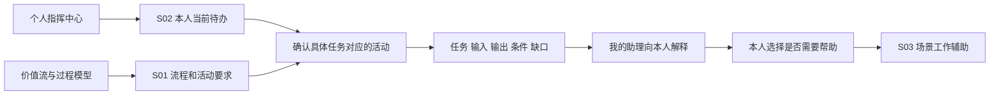
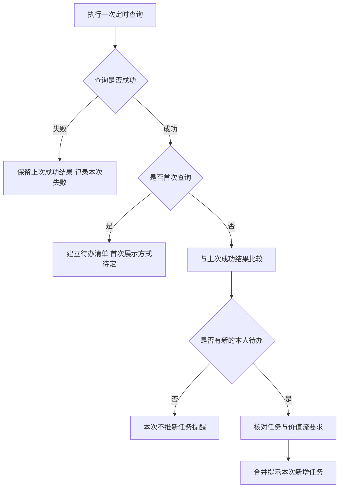
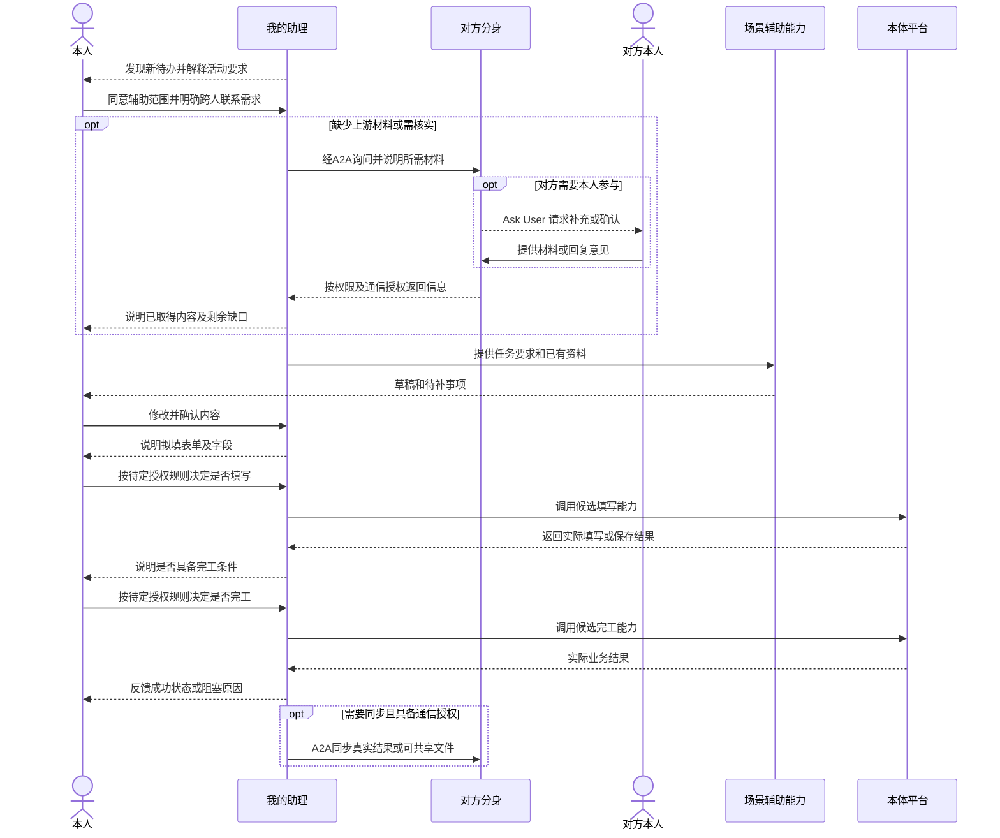

# 个人待办感知与价值流辅助办理场景说明

> V0.3 · 2026-10-09 · 场景讨论稿
>
> 面向产品、开发和验证团队：说明数字分身如何发现员工新任务，结合价值流理解工作要求，向本人提供辅助，并通过候选 Skill 完成后续表单和完工操作。
>
> **场景目标：让员工少找任务、少查流程、少重复整理材料，知道眼下该做什么，并获得具体帮助。** 填表、完工属于本场景新增的业务操作方向，是否纳入本次迭代、哪些步骤需要本人确认，尚未定案；现有 A2A 通信 PRD 的只读业务边界不因此自动改变。

## 1. 用一个工作故事说明

以“产品经理收到一项 PRD 编制任务”为例。任务名称、流程名称、输入输出要求均应来自实际平台记录，下面是待选真实样例的业务故事。

### 1.1 早上发现新任务

到达设定的查询时间，分身查询个人指挥中心，发现本人新增了一项待办理任务。分身读取这项任务的要求，再查价值流，找到它所处的流程、阶段和活动节点，以及节点需要的输入材料和输出内容。

助理向本人提醒：

> 你新增了一项「PRD 编制」任务。我查到它对应「某价值流」的「某阶段／PRD 编制节点」，需要根据需求明细整理 PRD，并填写相关说明。目前已取得需求背景，详细需求清单还需要补充。需要我先帮你整理一版框架吗？

这段提醒需要让用户看懂四件事：**来了什么任务、为什么与我有关、这一步要求做什么、分身现在能帮到什么程度。** 没查到节点要求或输入材料时，明确说明缺失，不能补造完整流程。

### 1.2 本人选择需要的帮助

本人可以让分身开始辅助，也可以先补充材料或暂不处理。建议将辅助执行范围说清楚，例如“先整理框架，需求明细到齐后再补正文”，不要将一次同意解释成授权全部后续业务操作。

本例中，需求明细尚在上游人员手里。本人说：“帮我向需求负责人确认最新的需求清单，同时先整理已有资料。”分身核对实际联系人；对象不明确时通过 Ask User 补齐，再发起 A2A 沟通。

对方分身收到询问后，按对方的权限和个人通信设置回复；需要对方本人提供材料或决定时，在对方的私人对话中请求处理。自己允许辅助执行，不等于替对方授权。

材料经 A2A 返回后，本人分身核对来源、版本和完整性，将有权使用的内容带回原任务处理上下文。在已明确允许的范围内继续辅助，提供草稿供本人查看、修改。回复未解决缺口时继续说明缺什么；超时未回复时告知本人，不假设对方已经同意。资料足够时可以直接辅助，不必为了走流程强制建群。

### 1.3 内容确认后落到业务表单

本人认可内容后，分身可以提出：“这份内容可以填写到该任务的执行表单，是否帮你填入？”

本场景希望进一步具备：读取该任务实际执行表单，整理字段与待填内容，通过填写能力落入表单。**填写草稿、保存、提交分别具有什么效果，需要核对本体平台的实际操作。** 目前不能把“填入成功”写成“流程已提交”。

### 1.4 确认满足要求后办理完工

表单、材料和业务前提满足后，分身提示本人是否执行“完工”。本人确认机制尚待讨论；本稿建议在操作前明确说明对象、当前条件和预计影响。

操作后应查询平台实际结果：可能是任务完成，也可能进入审批或下一环节，应按真实结果反馈。未明确成功时不连续重复点击完工。

## 2. 完整场景流程

A2A 在主流程中承担两处连接：办理前补料/核实，办理后按需同步结果。若缺少资料但有可独立处理的部分，可以在本人许可范围内先做，不必等待全部回复；未经明确许可不能自动开始辅助。

图中后半段是目标场景，不代表目前产品已经具备业务写入能力。表单填写、保存、提交、完工的人工确认点，统一见第 7 章。

## 3. 各模块负责什么

| 模块 | 职责 | 不应混同的内容 |
| --- | --- | --- |
| 定时调度 | 在设定时间触发一次待办查询 | 调度不等于查询 Skill；也不代表自动派发任务 |
| 个人指挥中心查询 | 告诉分身“我现在具体有哪些待办” | 不能把查询失败当作本人没有任务 |
| 价值流读取 | 告诉分身“这类任务位于哪一步，工作要求是什么” | 流程规范不等于本次任务已经具备全部输入 |
| 任务与活动对应 | 把具体待办与正确的流程、节点对应起来 | 不能仅凭同名任务猜节点或跨项目串联 |
| 我的助理 | 提醒新任务、解释要求、提出辅助建议和处理入口 | 不要求在主助理长对话里完成全部工作 |
| 任务处理会话与 Workspace | 围绕这一具体工作查看资料、处理内容、检查草稿 | 私人工作草稿不自动发给其他人 |
| A2A | 在确有跨人沟通需求时询问、补料或同步信息 | 不负责执行表单和办理完工 |
| 表单与完工能力 | 对指定业务对象执行明确操作，并核对结果 | A2A 会话完成、草稿完成和业务完工是不同结果 |

## 4. 可能涉及的 Skill

先按业务能力拆分，便于讨论输入输出；不提前规定必须开发成五个独立程序。A2A 复用已有通信能力，作为横跨这些 Skill 的支撑单独列出，不重复定义为业务办理 Skill。

| 能力编号 | 候选 Skill | 输入 | 应返回或完成的结果 | 当前定位 |
| --- | --- | --- | --- | --- |
| S01 | 价值流与活动读取 | 本人身份、指定流程或当前任务的活动线索 | 本人涉及的流程、阶段、活动；当前节点的输入、输出、办理要求及相关环节；信息来源 | 用户明确提出的读取能力 |
| S02 | 个人指挥中心待办查询 | 本人身份、查询范围 | 本人可见待办、实际状态、派工信息、时间要求和任务详情入口；本次查询结果与时间 | 用户明确提出的查询能力 |
| S03 | 场景工作辅助 | 当前任务、已核实的节点要求、可用资料、本人指定的辅助范围 | 如 PRD 框架、待填内容或检查清单；同时说明缺失依据与未完成部分 | 根据首个试点选择，不先建设万能执行 Skill |
| S04 | 执行表单填写 | 指定任务及实际表单、经确认的待填内容 | 字段内容填入及实际保存结果；不能填的字段与原因 | 新增业务操作候选能力 |
| S05 | 任务完工办理 | 指定任务、完工要求、必要材料、适用的本人授权 | 执行完工动作，查询并反馈真实结果或阻塞原因 | 新增业务操作候选能力 |
| A2A 支撑 | 跨人询问与材料传递 | 明确的参与人、问题、可共享材料及适用授权 | 收到的回复/文件及来源、未解决问题；内容经核对后用于原工作上下文 | 复用现有通信功能，不替代 S04/S05 |

### S01 价值流与活动读取

需要同时支持两个问题：

- **个人范围查询**：“我参与了哪些流程、哪些阶段、哪些活动节点？”
- **具体任务解释**：“我现在这项待办对应哪个活动，要求输入什么、输出什么？”

提醒新任务时优先返回本项相关信息，不把本人所有流程一次性堆进提醒。本人对应多个岗位或多个流程时，需能明确本项任务实际适用的节点。找不到唯一对应关系时，先说明无法确定，不据此生成表单或执行操作。

验证资料显示，部分任务卡可提供实例、工作项和项目组等下钻线索，并据此查询前后置及负责人；但不是所有任务类型都有这些线索。首个样例需用同一条真实待办核对“任务实例 → 当前活动 → 适用价值流及版本 → 输入输出要求”，不能将查到相邻任务或同名节点视为已经完成匹配。前后置关系用于说明材料缺口和可能的协作对象，不自动授权联系或催办。

### S02 个人指挥中心待办查询

首次查询先取得本人当前清单。后续查询与上次成功结果比较，识别新任务和相关变化；每个任务应有稳定的业务识别依据，不能只按标题去重。

重复查到同一条未变化任务不再次发送“你有新任务”。是否对临期、逾期或重要变更另行提醒，是可单独扩展的规则，不默认加入首次新任务提醒。

验证期查询路径提供了任务标识、本人归属、状态、时间和任务卡标记等线索。产品核对时需确认：查询结果是否完整翻页、任务是否确属本人、平台状态与标记是否一致；无计划时间或占位日期不能直接判为临期、逾期。网络或鉴权失败应保留上次成功清单并标注数据时间，不应当作“当前没有待办”。

### S03 场景工作辅助

以首个场景实际需要为准。PRD 编制可以是整理需求背景、生成章节框架、列出待补问题；不应在缺少需求明细时声称已完成最终 PRD。

工作辅助可以复用已有能力，是否需要新增专项 Skill 要核对现有能力。不能仅因为读取到价值流，就假设分身具备所有节点的执行能力。

### S04 执行表单填写

先读取当前实际表单及字段要求，区分可自动填入、有依据但需本人确认、尚缺信息的字段。草稿可以成为填写依据，但不直接等同于正式表单已经保存。

需确认表单是否支持仅保存草稿；若填写与提交不可分离，应在产品上按一次业务提交讨论授权，不能按低影响的“填一下”处理。是否还需独立上传附件能力，由真实表单要求决定，不在本稿默认增加。

### S05 任务完工办理

必须确认“完工”按钮的实际语义：是当前人办理结束、提交审批，还是整项任务最终完成。只有取得实际业务结果后，才可反馈对应状态。

若提示资料缺失、必填项未完成或前置环节未满足，应指出阻塞；不自行绕过条件，也不重复提交同一完工动作。

## 5. 数据来源怎样汇合

对应关系应优先来自平台已有的任务与流程信息。需要核实平台能否提供：任务所属流程、当前活动、具体实例、适用版本以及输入输出资料。无法对应时仍可提醒“收到新任务”，但应说明价值流要求尚未匹配，不能编造节点。

这套关系用于任务辅助场景，不改变“A2A 会话不绑定系统任务”的通信产品规则。

## 6. 定时发现与提醒

“早中晚固定查询”是当前讨论方向，具体时间由后续评审确定，不暂定成已经批准的日程。

建议先支持新增派工提醒，不将所有未完工任务在每次查询时都当作新增。首次已有大量待办时，建议一次概览而不是逐条推送，避免第一天出现通知堆积。

本人选择“暂不处理”不会删除原任务；下次查询是否再提醒，需要区别“新任务提醒”和“本人设置的再次提醒”。查询读取的状态应标明时间，实时待办和分析库快照不混用为同一时刻的事实。

提醒内容建议包括：任务名称、时间要求（若有）、对应活动及关键要求、已有资料与缺口、分身可提供的具体帮助。多个新任务可合并提示，但每项应能进入自己的处理上下文。

## 7. 人工参与与业务操作边界

下面是本稿用于讨论的授权分段，尚未全部确认。

| 阶段 | 建议的本人参与 | 需要明确的边界 |
| --- | --- | --- |
| 定时查询 | 本人允许后按设定时间查询，不每次重复询问 | 谁配置、能否暂停、查询范围 |
| 新任务提醒 | 本人了解任务，选择现在处理、补充或暂不处理 | 提醒不代表自动开工 |
| 内容辅助 | 本人明确允许分身先做哪部分 | 生成框架不代表授权业务写入 |
| 表单填写 | 本人核对填哪张表和主要内容，再执行适用操作 | 保存草稿与提交是否分离 |
| 完工 | 建议单独确认具体对象及影响 | 本人能否长期授权、什么情况下必须逐次确认仍待讨论 |

## 8. A2A 在什么地方参与

| 参与点 | 用户动作与通信内容 | 通信结果如何回到场景 |
| --- | --- | --- |
| 辅助前补料 | 本人要求向明确对象询问缺失材料；不清楚找谁时先澄清 | 对方按权限返回材料，核对后供原任务辅助使用 |
| 办理中核实 | 对输入要求、版本或口径存在分歧时，在原协作会话继续询问 | 保留已核实事实与未解决问题，不用模糊回复替代办理条件 |
| 办理后同步 | 有实际同步需要时，向明确参与人发送已核实结果或可共享文件 | 对方收到的是通信信息，不等于其任务已自动开工或完成 |

A2A 通信与业务办理分别使用对应的授权规则。本人同意辅助，不代表已经允许共享所有私人资料；也不能替其他参与人确认。具体等待时长、超时和迟到回复处理沿用 A2A 主 PRD 的已定规则及待定项，本场景不另造默认值。

通信中需要传达任务名称、要求或材料时，可以作为消息上下文；这不增加 A2A 会话与系统任务的绑定字段。收到材料后如何交回原任务处理会话，需要保留明确的来源和对应工作请求，不能将其他会话的材料混入。

A2A 会话完成、本人成果确认、表单保存和业务完工分别成立。系统待办提醒、表单保存、完工操作都不通过 A2A 自动代办。

## 9. 与此前验证材料的衔接

| 既有验证线索 | 本场景可参考什么 | 仍需核对什么 |
| --- | --- | --- |
| 个人指挥中心任务查询（能力包 `cbrain-personal-tasks`、`personal-task-progress-query`） | 任务卡字段、本人归属、状态与时间的查询线索，可用于设计 S02 的输入、结果和异常判据 | 目标账号与任务类型的实际覆盖范围；本次新派工能否稳定识别；字段是否在现用平台仍有效 |
| 风险扫描与变化识别（`personal-task-risk-reminder`） | 区分首次清单、新任务、完成候选和临期风险；对无时间、占位日期、查询失败分别处理 | 这些附加提醒是否需要、频率与授权如何设计；不能把验证期催办规则直接加入本场景 |
| 本体定位与实时前后置（`cbrain-query-base`、`cbrain-platform-order-routing`） | 从具体任务下钻活动、前置材料与下游负责人，区分实时业务结果和分析快照 | 首个样例的任务与价值流节点、版本、输入输出能否稳定对应；审批等无下钻参数的任务需另行验证 |
| 分身协作协议（`twin-collab-protocol`） | 平台负责业务任务流转，分身传递背景、缺口和核实结果；回执不能代替业务结果 | 补料对象、可共享范围、迟到或缺失回复如何回到原任务；以本产品 A2A PRD 的授权和会话规则为准 |
| 审核流回显与同意（`audit-flow-display`、`audit-flow-approve`） | 提醒核对真实表单、按钮、必填项及操作后的平台状态 | 审核同意不等于任意任务的表单填写或完工；S04/S05 仍需独立验证与产品决策 |

以上为 2026-10-09 收到的本地《A2A数字分身协作能力包》中的文档和脚本线索，包内“实测”属于验证方记录，尚不是本产品的联调或验收结论。只吸收业务场景、数据来源和失败判据；WuKongIM 收发脚本、Hermes 配置、cron 原始提示词、内网地址及固定时间均属于验证环境实现，不是本产品的选型或需求。验证组出现过的 Skill 名称也不是最终交付清单，先用真实样例确认能力，再决定复用、补齐或新建。

## 10. 下一步需要讲清楚的内容

1. **选择首个真实场景**：哪个员工、哪一类任务、哪条价值流；建议只选一个能完整演示的样例。
2. **确认任务与节点对应关系**：个人指挥中心能提供什么，价值流能返回什么，无法匹配时如何处理。
   以同一条真实任务核对稳定标识、当前活动、适用版本、前后置及输入输出；记录哪些任务类型缺下钻线索。
3. **确定定时查询规则**：早中晚的具体时间、首次已有待办怎样提示、失败提醒和重复提醒怎么处理。
4. **确认帮助到哪一步**：先生成框架、完整文档还是待填字段，是否已有 Skill 可用。
5. **核对实际表单和完工操作**：表单字段、附件要求、保存/提交区别、完工前提与后续影响。
6. **明确 A2A 接力场景**：首个样例需联系谁、缺哪份材料、对方如何回复、材料怎样回到原任务处理会话，办理后是否需要同步。
7. **决定人工确认点和迭代范围**：内容辅助、表单填写、提交和完工各自是否纳入，不能一次批准默认覆盖全部步骤。

## 11. 场景验证应看到的结果

- 同一任务连续查到，不重复冒充新派工提醒。
- 新任务能解释到实际适用的活动节点；匹配失败时明确说明。
- 提醒让本人知道需要做什么、分身能先帮助什么、还缺什么。
- 未经适用授权，不开始后续辅助或业务写操作。
- 草稿、表单填入、表单保存、业务提交和任务完工分别反馈，不混成一个“已完成”。
- A2A 补料请求能送到正确对象；对方需要本人确认时不替其作答；收到材料后能回到原任务辅助流程，缺料或超时不伪装为已解决。
- 办理后 A2A 同步引用平台实际结果，消息发送不代替任务完工。
- 表单或完工失败时可追溯具体对象与原因，不重复操作，不伪报成功。

## 12. 相关资料

- [A2A 通信与任务协作 PRD](./PRD-A2A通信与任务协作-2026年10月版.md)：跨人通信及授权规则。
- [Hermes 验证阅读结论](./验证资料/2026-09-22-A2A复盘阅读结论.md)：已有验证证据与边界。
- [群聊验证完整复盘](./验证资料/群聊验证复盘_完整包_20260922/数字分身群聊验证-全流程技术复盘-研究版.md)：任务上下文、核实进展和协作过程。
